# Keyflow · Piano Performance & Concert VFX Studio

> **English version: [README.en.md](README.en.md)** · Bản dưới đây là bản gốc tiếng Việt. Hai tệp là
> cùng một tài liệu, cùng ảnh (do CI render) và cùng bảng tham số dòng lệnh; `tools/check_sources.py`
> kiểm cả hai nên không bản nào lệch khỏi bản kia.
>
> **Nhật ký thay đổi: [CHANGELOG.md](CHANGELOG.md)** (bản tiếng Anh: [CHANGELOG.en.md](CHANGELOG.en.md))
> — mọi thay đổi người dùng nhìn thấy, ghi theo từng phiên bản phát hành.
>
> **Tải bản dựng: [kho phát hành công khai](https://github.com/lxmtuu/KeyFlow/releases)** — ZIP portable và bộ cài `.exe`.
> Kho bạn đang đọc là **kho mã nguồn**; gói phát hành và trang sản phẩm nằm ở kho kia
> (xem [`docs/PRIVATE-SOURCE-PUBLIC-RELEASES.md`](docs/PRIVATE-SOURCE-PUBLIC-RELEASES.md)).

Keyflow là ứng dụng desktop Windows (C# · WPF · .NET 10) để **chơi đàn, luyện tập và làm video piano theo MIDI** với chất lượng trình diễn hoà nhạc. Giao diện có **hai ngôn ngữ — English và Tiếng Việt** — đổi ngay trong ứng dụng, không cần khởi động lại (xem [Đa ngôn ngữ](#đa-ngôn-ngữ)). Sân khấu mặc định là một hội trường tối: nốt rơi theo thời gian, bàn phím 88 phím đổ bóng bằng shader mô phỏng mô hình Unreal (GGX + softbox + ACES), tia lửa nóng sáng nguội dần theo bức xạ nhiệt, sóng cộng hưởng âm học, lửa tại điểm phím gõ và các lớp không khí (bụi acoustic, cánh hoa, đèn sân khấu) có thể bật riêng. Sân khấu ấy do một **engine GPU Direct3D 11** vẽ trên luồng riêng — HDR 16-bit, bloom nhiều tầng, tới 240 FPS và không bao giờ làm chậm đầu vào MIDI; bộ dựng hình WPF chỉ còn là đường dự phòng khi Direct3D không khởi động được (xem [Sân khấu & hiệu ứng hình ảnh](#sân-khấu--hiệu-ứng-hình-ảnh)).

**Hiệu ứng đã duyệt (mã nguồn hiện tại):** vào Tổng quan → **Hiệu ứng hạt nâng cấp**, hoặc chọn preset **Prism Flow - Wisps / Prism Flow - Flames** để dùng vật liệu held/release chung cho GPU Live Stage và AR cùng cách chia cap AR 192. Preset cũ không tự đổi; renderer phần mềm giữ classic.

Ảnh dưới đây do **chính ứng dụng render** trong CI (`--snapshot`) với `--lang=vi`, nằm trong `docs/previews/vi/` và được cập nhật tự động — không phải ảnh dàn dựng (bản tiếng Anh có bộ ảnh riêng ở `docs/previews/en/`):

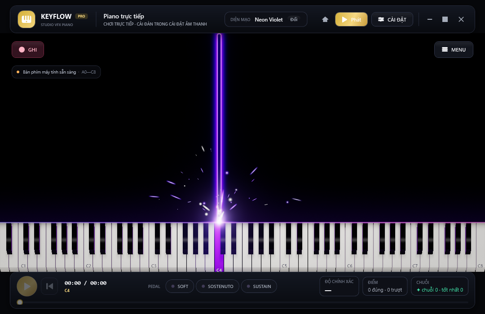

*Sân khấu live do engine GPU Direct3D 11 vẽ (ảnh CI dựng bằng WARP, bộ dựng hình phần mềm của Windows): nốt rơi, đường chạm phát sáng, tia lửa, bàn phím 3D có ánh sáng và transport dưới cùng.*

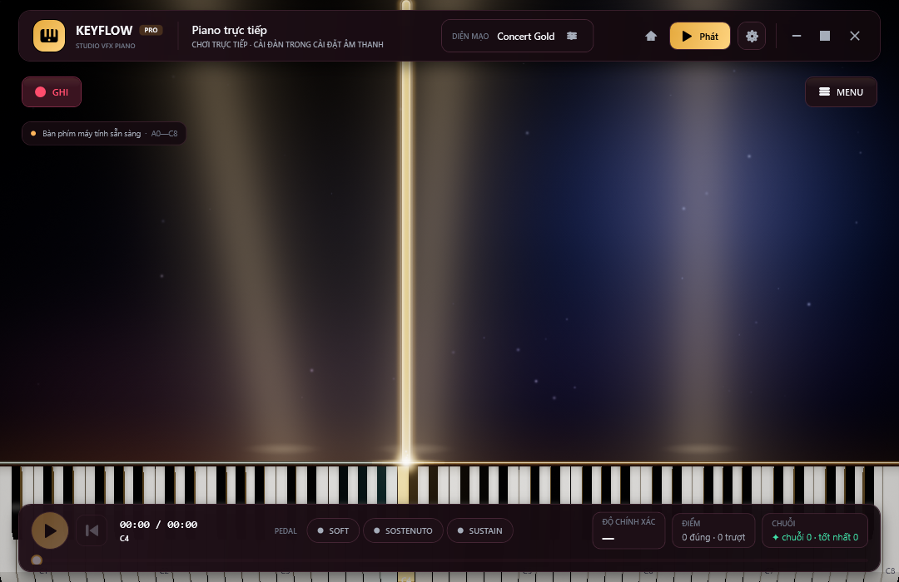

*Cùng sân khấu với một ảnh nền do người dùng chọn: ảnh phủ kín khung (crop giữa, không méo tỉ lệ) và bị*
*làm tối ở mức mặc định 30/100 nên nốt vẫn đọc được. Ảnh nền ở đây là `docs/samples/stage-backdrop.png` — repo tự sinh bằng*
*`tools/make_stage_background.py` để ảnh minh hoạ vừa tất định vừa không dính bản quyền của người khác.*

| Bàn phím & phím tắt | Hộp thoại Play |
| --- | --- |
| 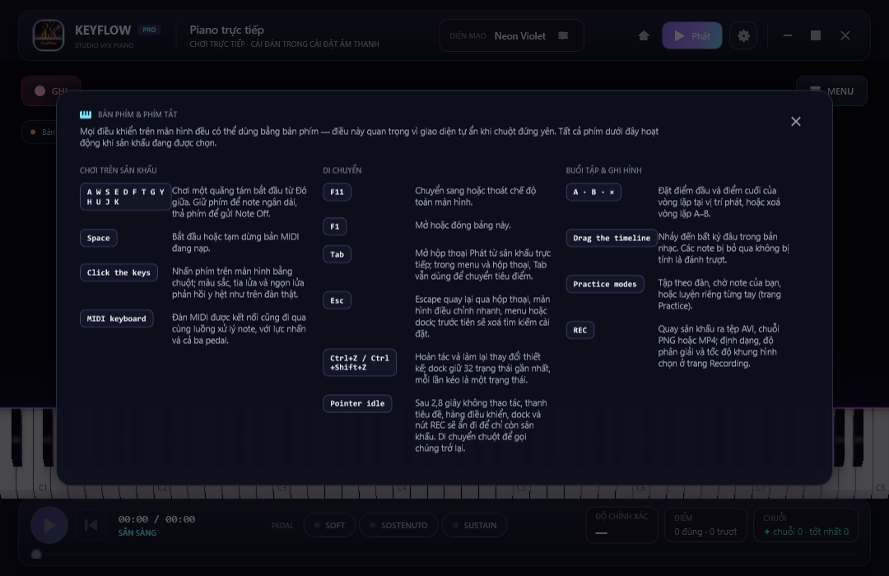 | 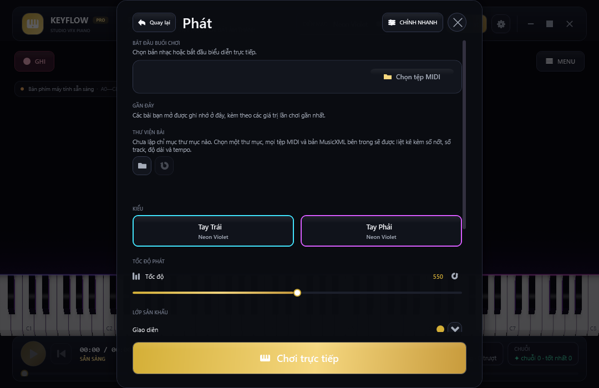 |

| Menu khởi động (thẻ giao diện có cả chọn ngôn ngữ) | Dock thiết kế (Style) | Dock thiết kế (Theme) |
| --- | --- | --- |
| 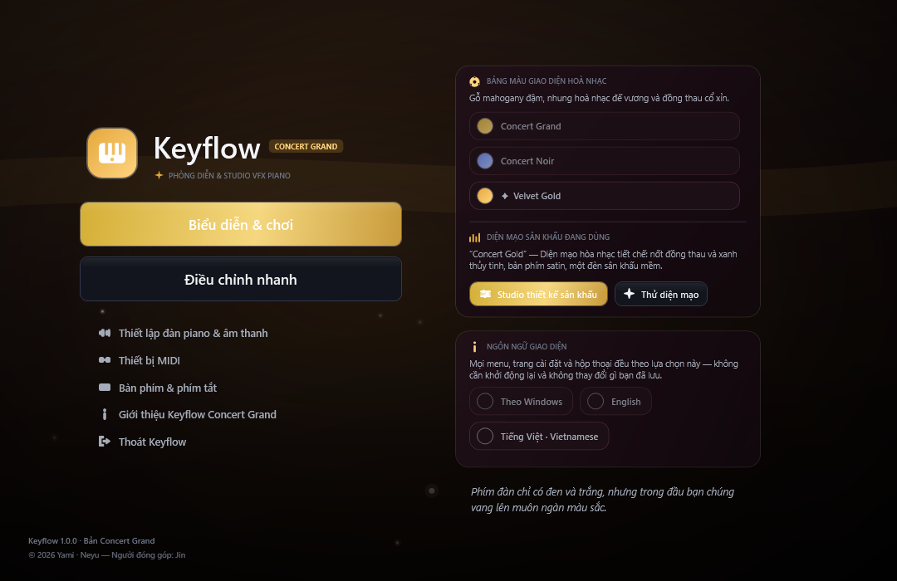 | 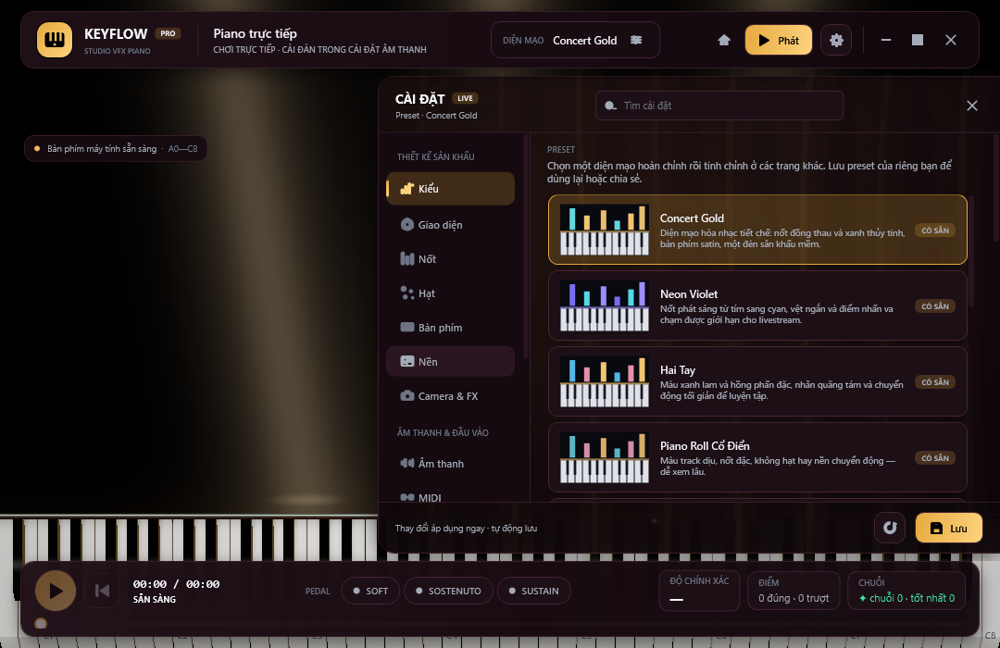 | 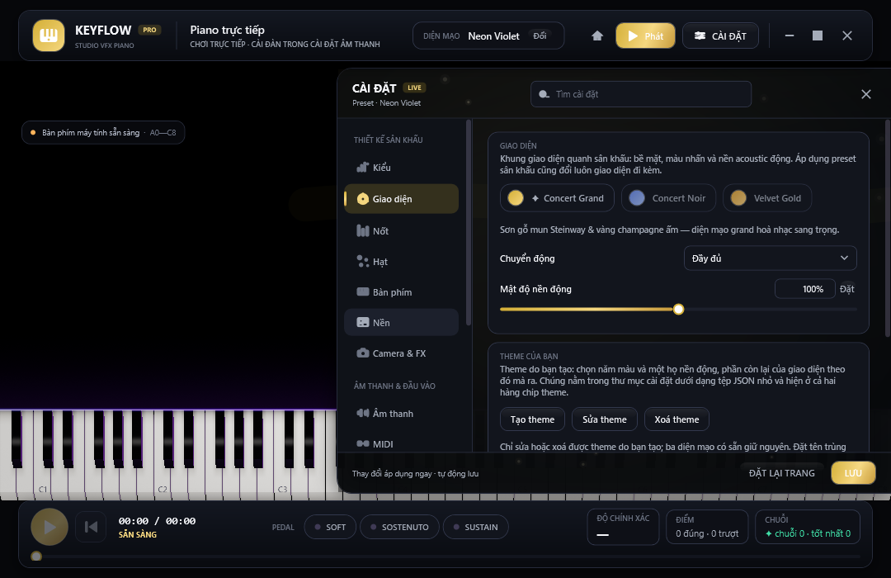 |

> **Ảnh trong README do chính ứng dụng render** trong CI (`--snapshot`). Muốn làm mới sau khi sửa
> giao diện: xem [Tạo lại ảnh giao diện](#tạo-lại-ảnh-giao-diện).

## Mục lục

- [Bắt đầu nhanh](#bắt-đầu-nhanh) · [Yêu cầu hệ thống](#yêu-cầu-hệ-thống)
- [Cài đặt công cụ](#cài-đặt-công-cụ) · [Tải mã nguồn](#tải-mã-nguồn) · [Biên dịch và chạy](#biên-dịch-và-chạy)
- [Thiết lập lần đầu](#thiết-lập-lần-đầu) · [Bắt đầu sử dụng](#bắt-đầu-sử-dụng)
- [Bàn phím & thao tác nhanh](#bàn-phím--thao-tác-nhanh)
- [Chức năng](#chức-năng) · [Đa ngôn ngữ](#đa-ngôn-ngữ) · [Bản đồ giao diện](#bản-đồ-giao-diện) · [Giới hạn hiện tại](#giới-hạn-hiện-tại)
- [Tạo lại ảnh giao diện](#tạo-lại-ảnh-giao-diện) · [Đóng gói và xuất file .exe](#đóng-gói-và-xuất-file-exe)
- [Kiểm thử](#kiểm-thử) · [Tài liệu kỹ thuật](#tài-liệu-kỹ-thuật) · [Cấu trúc chính](#cấu-trúc-chính) · [Giấy phép](#giấy-phép)

## Bắt đầu nhanh

Đã quen với .NET? Toàn bộ quy trình gói gọn trong vài lệnh PowerShell (chi tiết từng bước ở các mục bên dưới):

```powershell
winget install --id Git.Git -e; winget install --id Microsoft.DotNet.SDK.10 -e
git clone https://github.com/lxmtuu/PianoPath.git; cd PianoPath
dotnet run --project .\PianoPath.csproj -c Release    # biên dịch rồi mở ứng dụng
.\publish.ps1 -Zip                                    # đóng gói publish\win-x64\PianoPath.exe + file ZIP để gửi đi
```

Nếu máy chặn script PowerShell, chạy `Set-ExecutionPolicy -Scope Process Bypass` trước `.\publish.ps1`.

## Yêu cầu hệ thống

| Thành phần | Yêu cầu | Ghi chú |
| --- | --- | --- |
| Hệ điều hành | Windows 10 (khuyến nghị 22H2) hoặc Windows 11, 64-bit | Ứng dụng dùng WPF và WinMM nên chỉ chạy trên Windows. |
| Để **chạy bản đã đóng gói** | Không cần cài gì thêm với bản self-contained; bản framework-dependent cần **.NET 10 Desktop Runtime (x64)** | Xem [Đóng gói và xuất file .exe](#đóng-gói-và-xuất-file-exe). |
| Để **biên dịch từ mã nguồn** | **.NET 10 SDK** (10.0.100 trở lên) và **Git** | Chỉ cần .NET SDK và Git; ứng dụng tải mẫu Salamander khi người dùng yêu cầu âm thanh. |
| IDE (tuỳ chọn) | Visual Studio 2026 với workload **.NET desktop development**, hoặc VS Code + extension **C# Dev Kit** | .NET 10 cần Visual Studio 2026 (18.0) trở lên; VS 2022 chỉ mở được dự án khi đã cài .NET 10 SDK và không hỗ trợ đầy đủ. |
| Ổ đĩa | ~1,5 GB cho SDK + ~500 MB cho mã nguồn và bản build | Cần thêm khoảng 748 MB để cài Salamander Grand nếu muốn dùng tiếng piano. |
| Âm thanh | Card âm thanh bất kỳ được Windows nhận (WASAPI; tuỳ chọn ASIO cho sound card thu âm, `waveOut` làm đường dự phòng) | |
| Đồ hoạ | GPU hỗ trợ **Direct3D 11** (feature level 11_0 trở lên, shader model 5.0) | Sân khấu mặc định là engine GPU: Keyflow thử card đồ hoạ trước rồi mới tới **WARP** (bộ dựng hình phần mềm của Windows — cùng shader, chỉ chậm hơn card thật); shader HLSL được biên dịch lúc khởi động bằng `d3dcompiler_47.dll` có sẵn trong Windows. Direct3D không khởi động được thì dùng bộ dựng hình WPF và nói lý do ở **Ứng dụng → GRAPHICS ENGINE**. |
| MIDI (tuỳ chọn) | Đàn/thiết bị MIDI USB được Windows nhận diện | Không có đàn vẫn chơi được bằng bàn phím máy tính hoặc piano ảo. |
| Python (tuỳ chọn) | Python 3.9+ | Chỉ dùng cho `tools/check_sources.py` (kiểm tra tĩnh, không cần .NET SDK). |

## Cài đặt công cụ

Mở **PowerShell** (không cần quyền admin) và cài lần lượt. Nếu đã có sẵn công cụ nào thì bỏ qua bước đó.

1. **Git**

   ```powershell
   winget install --id Git.Git -e
   ```

   Không dùng winget thì tải Git tại <https://git-scm.com/download/win>.

2. **.NET 10 SDK** (đã bao gồm runtime để chạy ứng dụng)

   ```powershell
   winget install --id Microsoft.DotNet.SDK.10 -e
   ```

   Hoặc tải bộ cài "SDK 10.0.x – Windows x64 Installer" tại <https://dotnet.microsoft.com/download/dotnet/10.0>. Mở lại PowerShell rồi kiểm tra:

   ```powershell
   dotnet --list-sdks      # phải có một dòng 10.0.xxx
   ```

3. **IDE (tuỳ chọn)**
   - **Visual Studio 2026**: tải Community (miễn phí) tại <https://visualstudio.microsoft.com/>, trong Visual Studio Installer tích workload **.NET desktop development**. Workload này đã kèm .NET 10 SDK.
   - **Visual Studio Code**: cài extension **C# Dev Kit** (Microsoft); extension tự dùng SDK đã cài ở bước 2.

## Tải mã nguồn

Kho này là **kho mã nguồn** của mô hình hai kho; visibility của nó (public hay private) là thiết lập của chủ
repo và đã đổi qua lại trong ngày 2026‑10‑16 — ở trạng thái nào thì người dùng cuối cũng không cần mã nguồn:
tải gói ở [kho phát hành công khai](https://github.com/lxmtuu/KeyFlow/releases). Phần dưới dành cho người đóng góp.

```powershell
cd $HOME\source            # hoặc thư mục bất kỳ; tránh đường dẫn có ký tự đặc biệt
git clone https://github.com/lxmtuu/PianoPath.git
cd PianoPath
```

Không cần tải thư viện âm thanh để biên dịch. Khi muốn phát tiếng đàn, mở **SETTINGS → Audio** và bấm **DOWNLOAD PIANO · 748 MB**; quá trình tải chỉ bắt đầu sau khi xác nhận bằng thao tác này, có thể huỷ và tiếp tục sau.

Tải ZIP từ GitHub ("Code → Download ZIP") cũng đủ để biên dịch mã nguồn; kho mã nguồn không chứa mẫu piano.

## Biên dịch và chạy

### Dòng lệnh (khuyến nghị)

```powershell
dotnet restore .\PianoPath.csproj                        # tải gói (lần đầu)
dotnet build   .\PianoPath.csproj -c Release             # biên dịch → bin\Release\net10.0-windows\PianoPath.exe
dotnet run --project .\PianoPath.csproj -c Release       # biên dịch (nếu cần) và chạy
```

- `dotnet run` không có `-c Release` sẽ dùng cấu hình Debug (`bin\Debug\net10.0-windows\PianoPath.exe`), chậm hơn khi vẽ nhiều hạt.
- Có thể chạy trực tiếp file `.exe` trong thư mục `bin\...`. Mẫu piano không nằm trong thư mục build; tải Salamander từ trang Audio khi muốn bật tiếng.
- Lần chạy đầu Windows có thể hỏi quyền tường lửa (câu hỏi bình thường với ứng dụng MIDI/mạng nội bộ). Các gói tải về từ GitHub Release **chưa được ký mã số**, nên Windows SmartScreen có thể hiện bảng "Windows protected your PC" khi cài đặt hoặc chạy lần đầu: bấm **More info → Run anyway** để tiếp tục. Kiểm tệp tải về bằng `SHA256SUMS.txt`.

### Tham số dòng lệnh

| Tham số | Tác dụng |
| --- | --- |
| `--verify [--verify-log=<file>] [--verify-review-out=<dir>]` | Chạy bộ kiểm chứng hồi quy rồi thoát (mã thoát `0` = đạt). Cờ tùy chọn `--verify-review-out` render đủ **48 ảnh review Phase 1** (Concert Gold, Neon Violet, Two Hands × bốn mốc × WPF/GPU‑WARP × 100%/50%), kèm `manifest.json` và `index.html`; ảnh 50% là trung bình 2×2 từ cùng ảnh 1920×1080, không render lại scene nhỏ. Xem [Kiểm thử](#kiểm-thử). |
| `--verify-prism-only` | Dùng cùng `--verify --verify-review-out=<dir>` để kiểm input/look và capture riêng Prism Flow: 78 ảnh baseline P0 + 30 ảnh palette/satin thử nghiệm, D3D/WARP Stage–AR với camera synthetic, không chạy/chứng nhận toàn suite, live MIDI hoặc hiệu năng phần cứng. Xem [báo cáo P0](docs/PRISM-FLOW-P0-AUDIT.md) và [bản thử P1/P2](docs/PRISM-FLOW-P1-PREVIEW.md). |
| `--verify-key-light-only` | Dùng cùng `--verify --verify-review-out=<dir>` để render đối chứng riêng Key light qua GPU/WARP và software, gồm phím nghỉ/nhấn, mức 0–200%, đèn tắt độc lập và kiểm AR không đổi. Không chạy/chứng nhận toàn bộ suite hay hiệu năng phần cứng. |
| `--verify-key-ensemble-only` | Dùng cùng `--verify --verify-review-out=<dir>` để chạy cảnh hạt phối hợp Live Stage/AR reference: nốt đơn, hợp âm, giữ/thả/pedal, hai palette và Key light 0/100. Chỉ diagnostic native theo checkpoint; không đổi mặc định hoặc chứng nhận toàn bộ suite/hiệu năng. |
| `--verify-ar-budget-only` | Cùng `--verify --verify-review-out=<dir>`: trial AR cap 192, so chọn hạt cũ/fair, bốn views, raw/eligible/payload/non-particle guards và slice f29–44. Mặc định tắt; không chứng nhận hardware/FPS hoặc đổi artwork. |
| `--verify-option-matrix-only` | Cùng `--verify --verify-review-out=<dir>`: ma trận option N12(b) — 11 nhóm setting (chất liệu nốt, trail, wave, burst, morph, flash, release, bốn lớp ambient) × mọi giá trị chúng nhận, mỗi nhóm có ảnh baseline lúc tắt, chạy trên **WPF và D3D/WARP** ở cùng cảnh, cùng seed và cùng thời điểm (128 ảnh 960×540). Lượt chạy đỏ nếu một giá trị không vẽ gì hoặc hai giá trị cho ra cùng một khung hình, và mọi baseline của một cảnh phải giống nhau từng bit. Đây là bằng chứng renderer rẽ nhánh, không phải duyệt mỹ thuật, AR hay hiệu năng. |
| `--verify-option-pose-only` | Cùng `--verify --verify-review-out=<dir>`: lát AR/pose N12(d) — mỗi trục được chụp **tắt và bật** ở cùng pose, qua **ba pose AR đã hiệu chỉnh** (reference, oblique, near-overhead) trên D3D/WARP ở 1280×720, cùng seed và cùng input (**63 captures**): phần 1 là năm trục hiệu ứng vẽ vào ảnh camera (wave, burst, hai kênh morph, vòng release — 27 ảnh), phần 2 là chất liệu nốt và trail dựng thành mảng chiếu cùng bốn lớp ambient vẽ screen-space (36 ảnh). Lượt chạy đỏ nếu một giá trị không đổi đủ 12 px so với ảnh tắt cùng pose. Bằng chứng option đi qua đường chiếu AR, không phải duyệt mỹ thuật, camera thật hay che tay. |
| `--verify-refraction-only` | Cùng `--verify --verify-review-out=<dir>`: N8 — **sáu chất liệu nốt** (Solid, Neon, Glass, Fire, Gem, Crystal Outline) × ba mức `NoteRefraction` 0/50/100 × **WPF và D3D/WARP** ở 960×540, cùng cảnh nốt rơi, cùng seed và cùng mốc (**36 ảnh**). Mỗi hàng chỉ đổi slider, nên khác biệt giữa hai ảnh trong hàng là slider và không gì khác. Lượt chạy đỏ nếu WPF không đổi ảnh ở bất kỳ chất liệu nào (viền khúc xạ, hoặc sheen khi bật satin), hoặc nếu shader GPU đổi ảnh ở Neon/Fire/Crystal Outline — ba nhánh đó không đọc `NoteB.w` nên chúng phải giống hệt từng byte. Bằng chứng nhánh renderer cho khác biệt **có chủ ý** ở §3.6 `docs/NOTE-EFFECTS-ACTION-PLAN.md`, không phải duyệt mỹ thuật, parity WPF↔GPU hay khung hình phần cứng. |
| `--verify-ar-material-only` | Cùng `--verify --verify-review-out=<dir>`: N16 — **sáu thiết lập chất liệu nốt** (`NoteTint`, `NoteGlow`, `NoteEdge`, `NoteEdgeWidth`, `NoteRefraction`, `Notes3D`) × **ba chất liệu** mà contract typed đang pilot (Solid, Gem, Crystal Outline) trên **lớp phủ AR** ở pose `ar-reference`, cùng camera, cùng cảnh nốt rơi, cùng seed (**18 khung so sánh**, mỗi khung chỉ đổi một thiết lập so với khung "default" của chính chất liệu đó). Cùng hai thiết lập đó cũng được vẽ trên WPF và D3D/WARP để đặt cạnh nhau. Lượt chạy đỏ nếu một thiết lập mà hàm vật liệu đọc **bên trong thân nốt** lại không đổi ảnh AR, hoặc nếu `NoteRefraction`/`Notes3D` của Crystal Outline — nhánh không đọc chúng — vượt ngưỡng 12 px. `NoteGlow` được đo nhưng **không** tuyên bố, vì quầng sáng nằm ngoài hình chữ nhật của nốt. Không phải duyệt mỹ thuật, không phủ mọi giá trị, không phải camera thật hay khung hình phần cứng. |
| `--verify-ar-effect-only` | Cùng `--verify --verify-review-out=<dir>`: N17 — **mười bảy family hiệu ứng** mà contract typed còn để `Unverified` trên lớp phủ AR, mỗi family chụp trong **đúng cảnh mà vòng đời của nó cần** và mỗi cột chỉ bật **một** family (**51 khung**, ba hàng: giá trị của sản phẩm, family bị tắt, thiết lập thứ hai ở đầu xa của khoảng contract khai báo). Bốn cảnh: **Held** (hai phím cách nhau hai quãng tám đang giữ — năm family hold, `particles.wisps`, `particles.flames` và `atmosphere.beams`), **Approach** (`falling.trail`, `falling.shimmer` và `falling.pulse` trên một nốt đang bay, chưa vang), **Impact** (`impact.burst`, `particles.sparks`, `impact.wave`, `impact.flash`, `impact.morph` sau đúng một cú đánh) và **Release** (một phím nhấc lên sau 0,2 s — `release.fx`). Family không có công tắc boolean thì công tắc là **choice mà chính renderer coi là tắt** (`FallingTrail` None, `ImpactMorph` None, `ReleaseEffect` Fade); boolean khác chỉ được ghim **bật** khi family không vẽ được nếu thiếu nó, còn lại ghim **tắt**. Hàng đầu xa được chọn theo giá trị: ứng viên nào có đầu xa **bằng đúng** khung tham chiếu thì bị bỏ qua (`falling.trail` vì thế đo `FallingTrailLength` 100 thay vì `FallingTrailIntensity` — vốn đã ở 100 trong look xuất phát), và nếu không còn ứng viên nào thì family bị từ chối. **Năm cổng**: khung gốc đè ≥ 500 px lên hình camera; layer phát quad riêng của family; tắt family đổi ≥ 12 px; **đầu xa khác khung tắt ≥ 12 px**; **đầu xa khác khung gốc ≥ 12 px** — tức ba khung phải là ba bức ảnh. Boom/percentages không chụp được ghi vào `unshot`, và `pinned` ghi mọi thiết lập bị ghim. Mỗi khung còn ghi **số hạt còn sống cạnh số hạt layer thực vẽ** (`demand`/`quads`), nên một cột bị chặn trần của lớp AR tự nói nó bị chặn thay vì để người đọc suy ra từ hằng số. Đây là **trang ảnh + manifest**, không phải tuyên bố mới: bốn family hold đã được `VerifyArNoteProjection` đo bằng assertion từ trước, còn **arc, pulse, trail, shimmer và tám family của đợt 3–4 thì chưa từng được đo riêng**. Không đổi binding, không phải duyệt mỹ thuật hay khung hình phần cứng. |
| `--verify-stage-effect-only` | Cùng `--verify --verify-review-out=<dir>`: N17S — **ba family hạt** mà trang AR báo `capped` (hoặc láng giềng gần nhất của chúng) được chụp lại trên **renderer Live Stage**, cùng cảnh/cùng timing/cùng seed và cùng cách tách một-family-một-cột với trang AR, nhưng **không có trần 192-quad**: mỗi family lại có ba hàng (giá trị của sản phẩm, family bị tắt, đầu xa của khoảng contract). Câu hỏi của trang AR là "kéo `WispAmount`/`ParticleAmount` có đổi hình không?" bị trần trả lời thay; cột stage trả lời nó bằng pixel — cùng thiết lập, không có trần, `demand == quads` nên con số là của thiết lập chứ không phải của trần. Không đề xuất nâng trần AR; trần stage 24 000, trần AR 192, đây là **bằng chứng nhánh renderer**, không phải tuyên bố mới, không đổi binding hay mặc định. |
| `--verify-ar-value-pilot-only` | Cùng `--verify --verify-review-out=<dir>`: pilot ma trận giá trị N17V — **17 family** (`particles.wisps`/`particles.flames`/`atmosphere.beams`/`hold.bar`/`hold.breath`/`hold.vibration`/`hold.color-cycle`/`hold.arc`/`falling.pulse`/`falling.shimmer`/`particles.sparks`/`impact.flash`/`falling.trail`/`impact.burst`/`impact.wave`/`impact.morph`/`release.fx`) ở **3 điểm / setting** (thấp/giữa/cao: `WispAmount` 15/75/150, `FlameIntensity` 20/60/100, `BeamIntensity` 30/65/100, bốn `Hold*` intensity 25/60/100, `HoldBreathRate` 25/75/100, `FallingPulseRate` 25/75/100, `NoteShimmerAmount` 50/70/100 ở Approach 0,5 s, `ParticleAmount` 20/70/120, `ImpactFlashIntensity` 25/60/100 ở Impact 0,2 s, `FallingTrail` Glow + `FallingTrailLength` 25/60/100, `ImpactBurst` Embers/Fireworks/Dust, `ImpactWave` Ring/Shockwave/Ripple, `ImpactMorph` Shatter/Melt/Bounce, `ReleaseEffect` Float Up/Dissolve/Smoke ở cảnh Release nhả phím 0,2 s; `falling.trail` thêm cột `FallingTrail` Glow/Blur/Ribbon, `impact.flash` thêm cột `ImpactFlashStyle` Flash/Lightning/Plasma; đợt D thêm mỗi percentage còn lại một cột: `WispSpeed` 100/300/600, `WispTurbulence` 25/60/100, `WispGlow` 50/125/200, `FlameHeight` 25/60/100, `ParticleSpeed` 75/175/300, `ParticleSize` 2/8/16, `ParticleGlow` 50/125/200, `ParticleLife` 0,5/1,5/3, `FallingTrailIntensity` 0/50/100, `ImpactWaveIntensity` 0/75/150, `ImpactMorphIntensity` 25/60/100, `ReleaseIntensity` 25/60/100). Công tắc dạng `Choice` dùng đúng giá trị "tắt" của renderer (`None`/`Fade`); `ShowImpactRings` được ghim bật cho `impact.wave`. Trên AR `ar-oblique`, mỗi bước so với `off` và với bước kế phải ≥12 px (kể cả `off↔mid`), cùng pose/cảnh/seed/timing như N17; quad chứng minh đọc từ bảng witness chung của N17 nên family không phải hạt không bị đo nhầm bằng bộ đếm hạt. **31 cột / 17 family / 124 khung**; mỗi cột ghi rõ setting nào được lái, setting nào `pinned` (giữ giá trị trung tính) và setting nào `unshot` — đọc từ `EffectContractCatalog` nên không cột nào bị gọi là cả family. Pilot cho §11.3.1, không đổi binding. |
| `--verify-ar-lifecycle-pilot-only` | Cùng `--verify --verify-review-out=<dir>`: pilot vòng đời N17L — **một family impact** (`impact.flash` Plasma) ở **3 mốc thời gian** T0 0,05 s (3 khung), T1 0,20 s (12 khung), T2 0,35 s (21 khung) trên AR `ar-oblique` (WARP). Mỗi mốc so `off↔on`; T0/T1 ≥12 px, T2 đã hết hạn (<12 px, flash 0,26 s). 6 khung, pilot cho §11.3.2, không đổi binding. |
| `--verify-ar-lifecycle-only` | Cùng `--verify --verify-review-out=<dir>`: **ma trận vòng đời N17L (đầy đủ)** — **17 family** × **2–3 mốc** trên AR `ar-oblique` (WARP), mỗi mốc `off↔on` cùng pose/camera/seed: Held 8 family ×2 (0,40 s/1,00 s), Approach 3×2 (0,25 s/0,50 s), Impact 5×3 (0,05 s/0,20 s/0,35 s), Release 1×2 (0,40 s/0,60 s). 78 khung, mỗi tờ một mốc (9 tờ); T0/T1 ≥12 px, T2 impact.flash hết hạn, các family khác phải còn vẽ (quads>0, ≥500 px). Bằng chứng vòng đời, không đổi binding. |
| `--verify-option-numeric-only` | Cùng `--verify --verify-review-out=<dir>`: N12(e) — **chín trục số** (`Note width` trên nốt rơi **và** trên thanh giữ phím, tốc độ rơi, độ sáng trail/wave/flash/release, bán kính sóng, số hạt mỗi cú chạm) × ba giá trị mỗi trục × **WPF và D3D/WARP** ở 960×540, cùng cảnh/cùng seed (54 ảnh). Mỗi cặp giá trị trong một trục phải đổi ≥12 px trên **cả hai** renderer — nên một ngưỡng/kẹp ẩn làm hai mức slider ra cùng một khung hình sẽ đỏ ngay; mỗi ảnh còn đọc lại giá trị sau `Clamp()` để chắc nó được ghi dưới đúng mức đã vẽ. Bằng chứng renderer đọc đúng giá trị, không phải duyệt mỹ thuật hay tính tuyến tính của phản ứng. |
| `--verify-preset-roundtrip-only` | Cùng `--verify --verify-review-out=<dir>`: N12(f) — **mọi preset đang ship** (14 built-in + 6 tệp shelf) được áp đúng đường của dock, ghi ra tệp preset bằng `WritePresetFile`, đọc lại bằng `ReadPresetFile` rồi áp lần nữa. Cả **20 preset** phải giữ **mọi thuộc tính ghi được** của `PianoVisualSettings` (so bằng reflection, lỗi nêu đúng tên thuộc tính) và khung hình 90 frame phải **trùng từng byte** trên **cả WPF và D3D/WARP** (40 ảnh lưu, 80 frame so sánh). Một thuộc tính bị tệp preset hoặc migration làm rơi sẽ đỏ ngay — đó là look đổi hình sau khi mở lại. Không phải duyệt mỹ thuật. |
| `--encode-probe=<file.avi>` | Ghi **ba khung** vào một tệp AVI không nén rồi thoát (mã thoát `0` = đã ghi xong, `2` = máy này không ghi được). Đây là **phép thử đường ống mẫu**: AVI không cần bộ mã hoá nào, nên `--verify` chỉ gọi nó khi lượt chạy **không ra được tệp MP4 nào** — và luôn gọi *sau* lượt ghi, không bao giờ trước, để một phép thử có thể treo không chặn mất chính thứ nó định giải thích. |
| `--encode-take=<file.mp4>` | Ghi **một** bản MP4 ngắn 64×48 rồi thoát, in ra từng bước đã làm (mã thoát `0` = đã ghi xong, `2` = máy này không ghi được MP4). Đây là tiến trình con mà `--verify` tự gọi để thử bộ mã hoá: bộ mã hoá là mã gốc, lỗi trong đó có thể làm sập cả tiến trình, nên nếu chạy trong chính lượt kiểm chứng thì sẽ mất luôn kết luận — chạy riêng thì chỉ tốn một dòng SKIP. |
| `--bench[=<khung>] [--bench-out=<tệp.json>] [--bench-baseline=<tệp.json>] [--bench-adapter=<tên>]` | Chạy **cổng hiệu năng** rồi thoát: dựng sân khấu GPU bằng chính vòng dựng hình của app ở **1920×1080**, đo **thời gian của từng khung** cho hai cảnh (*look mặc định* và *look nặng nhất có sẵn*) rồi ghi báo cáo JSON — mean/median/p95/p99/max kèm thời gian từng khung. Mã thoát `0` = đạt, `2` = không đo được khung nào (máy không có thiết bị Direct3D, hoặc vòng dựng hình dừng giữa chừng), `3` = **vượt ngân sách** trên máy có card đồ hoạ thật (p95 < 8 ms cảnh mặc định, < 16 ms cảnh nặng). Máy chỉ có bộ dựng hình phần mềm (WARP — mọi runner CI) **không bị xử theo ngưỡng tuyệt đối**: báo cáo vẫn ghi đủ số, và CI so **tương đối** với lần đo trước trên cùng loại máy (`--bench-baseline` là báo cáo của lần đó). `--bench-adapter` dành cho máy nhiều GPU (laptop iGPU + card rời): ghim lượt đo vào adapter có tên chứa chuỗi đã cho (ví dụ `--bench-adapter="RTX 4050"`, không phân biệt hoa thường); chuỗi phải khớp **đúng một** adapter — không khớp hoặc khớp nhiều hơn thì lượt đo báo lỗi kèm danh sách adapter của máy thay vì âm thầm đo GPU khác. Mặc định đo 120 khung và ghi ra `%TEMP%\keyflow-bench.json`. Xem [Cổng hiệu năng](#cổng-hiệu-năng---bench). |
| `--bench-note-materials=<mẫu> [--bench-out=<tệp.json>]` | Probe **GPU-only** riêng: một nốt MIDI 60 tĩnh ở **1920×1080**, 2D; Solid làm control so với Gem và Crystal Outline. Tắt layer không liên quan; chia mẫu thành **3 vòng cân bằng thứ tự** (Solid→Gem→Crystal Outline, Gem→Crystal Outline→Solid, Crystal Outline→Solid→Gem). Mỗi block warm-up ít nhất 24 khung và 1,5 giây cho vật liệu đó, rồi đo bằng D3D11 timestamp/disjoint queries **chỉ quanh lệnh `DrawInstanced` của nốt** — không dùng p95 toàn khung. Mặc định 120 mẫu/vật liệu được chia 40 mẫu mỗi vòng (yêu cầu giới hạn 20–5000); vì warm-up lặp lại, tối thiểu khoảng 13,5 giây tổng. JSON ghi adapter/backend, cỡ, phạm vi, thứ tự vòng, từng batch và offset tới mẫu GPU thô; `%TEMP%\\keyflow-note-materials.json`. WARP chỉ xác nhận đường query/schema, **không phải bằng chứng hiệu năng card thật**; phép thử không sửa cài đặt/preset và không cập nhật `EffectCostAssessment` (vẫn `Unmeasured`). Mã thoát `0` = mọi batch hoàn tất và mỗi vật liệu có ít nhất một mẫu hợp lệ (không đồng nghĩa đạt ngân sách), `2` = không khởi động được Direct3D, `4` = query hoặc batch không đủ mẫu. |
| `--bench-detail [--bench=<khung>] [--bench-out=<tệp.json>]` | Đo **ma trận mật độ nốt** (N9) rồi thoát: **18 ô** = 3 cỡ (1280×720, 1920×1080, 2560×1440) × 1/20/60 nốt đồng thời × (không hiệu ứng / có **trail Glow + echo ghost + landing glow**). Mỗi ô tắt ambient, impact, hạt và không bấm phím, nên hiệu số giữa hai ô cùng số nốt là chi phí của đúng lớp nốt. Playhead mở ở một cửa sổ nhìn để khung đầu tiên đã đủ N thanh. Các ô **không có ngưỡng**: không bao giờ làm đỏ CI (`0`), và chỉ chạy khi được gọi — `--bench` của CI không đụng tới. Đi kèm `--bench` thì chạy sau các cảnh có ngân sách. Số đo trên WARP chỉ so được tương đối; bảng p95 cần máy có card đồ hoạ thật. |
| `--bench-ar` | Thêm **cảnh AR** vào cổng hiệu năng (hoặc chạy riêng cảnh đó nếu không có `--bench`): look mặc định ở **1920×1080** phủ lên một camera tổng hợp **1280×720, 60 fps** đi qua lớp camera, cùng nốt rơi và phím sáng trên bàn phím đã đánh dấu. Báo cáo JSON có thêm mục `camera` (số hình đã vẽ, thời gian app giữ mỗi hình trước khi vẽ — trung bình và tệ nhất). Cùng mã thoát và cùng luật máy-nào-bị-xử như `--bench` (p95 < 16 ms trên máy có card thật). |
| `--soak-record=avi\|mp4 [--soak-seconds=<n>] [--soak-out=<tệp.txt>] [--soak-file=<tệp>] [--soak-resolution=Window\|720p\|1080p] [--soak-window=<rộng>x<cao>]` | Mở cửa sổ thật với sân khấu GPU, bấm REC ở **1080p/60 fps**, "đánh" các hợp âm liên tục `--soak-seconds` giây (mặc định 20) rồi dừng và ghi báo cáo: khoảng dừng UI lớn nhất, memory đầu/đỉnh/cuối, thời gian đóng tệp và dung lượng tệp. Dùng để đo một bản ghi dưới tải mà không cần ngồi bấm tay; không hỏi hộp thoại lưu. Một AVI không codec MJPEG sẽ tự chuyển sang MP4 như khi bấm REC. Đặt cỡ cửa sổ bằng `--soak-window` để thử chế độ "theo cửa sổ" trên hình dạng lạ. Báo cáo còn đối chiếu **kích thước khung mà tệp MP4 tự khai** với kích thước đã yêu cầu. Mã thoát `0` = chạy xong, `1` = lỗi hoặc kích thước lệch. |
| `--show-settings [--settings-tab=style\|theme\|notes\|particles\|keyboard\|background\|camera\|audio\|midi\|practice\|history\|recording\|general]` | Mở sẵn dock cài đặt ở đúng trang — 12 nhóm mới; mọi tên trang cũ vẫn có alias. Dùng thêm `overview`, `press`, `hold`, `release`, `lighting`; `history`/`practice` cùng mở Luyện tập & lịch sử, `general`/`theme` cùng mở Ứng dụng. |
| `--snapshot <file.png> [--compact] [--play-preview] [--menu]` | Chụp màn hình rồi thoát (`--compact` = 1080×700, `--play-preview` = nhấn sẵn một nốt, `--menu` = mở menu khởi động). |
| `--gpu` | Giữ lại cho các script cũ: **sân khấu GPU Direct3D 11 đã là sân khấu mặc định** của mọi lần chạy, nên cờ này không đổi gì. Máy không có card đồ hoạ dùng WARP, bộ dựng hình phần mềm của Windows. CI dùng nó để chụp `stage-gpu.png`. |
| `--software` | Vẽ **một lần chạy** bằng bộ dựng hình WPF thay vì engine GPU (không đụng vào cài đặt đã lưu): dùng cho ảnh tất định và cột "WPF/software" của gallery preset và note-material trong CI. |
| `--play-dialog` / `--shortcuts` | Mở sẵn hộp thoại Play / thẻ phím tắt để chụp ảnh (dùng cùng `--snapshot`). |
| `--lang=<en\|vi>` | Chạy một lần bằng ngôn ngữ chỉ định, **ghi đè** cài đặt đã lưu — dùng để chụp ảnh giao diện tiếng Việt hoặc kiểm bản dịch mà không đụng vào `%LOCALAPPDATA%\Keyflow`. |
| `--preset=<tên>` / `--play-chord` | Áp một preset có sẵn chỉ trong lần chạy này (không cần dấu cách: `--preset=GalaxyVoyage`), và giữ thêm một hợp âm rải khi chụp để hiện các hiệu ứng giữ phím nối các phím (tia điện). CI dùng chúng để chụp `stage-gpu-galaxy.png` và `stage-gpu-storm.png`. |
| `--note-style=<Solid\|Neon\|Glass\|Fire\|Gem\|CrystalOutline>` / `--note-depth=<2d\|3d>` | Ghi đè vật liệu và chiều sâu nốt **chỉ trong lần chạy preview** (có thể dùng `Crystal Outline` hoặc `CrystalOutline`); không sửa file cài đặt/preset. `Gem` và `Crystal Outline` áp dụng trên stage WPF/GPU; AR camera-facing quads cũng route style IDs qua shared `ShadeNoteMaterial`. Regression WARP mới sample đủ sáu style branches và Gem/Crystal trên flat AR path, đang chờ CI; full setting/value parity, webcam và hardware còn Unverified. |
| `--background-image=<file.png>` | Vẽ một ảnh cụ thể phía sau bàn phím **chỉ trong lần chạy này**: không bật cờ "đã sửa", không tự lưu, nên `visual-settings.json` giữ nguyên. CI dùng nó để render ảnh minh hoạ tính năng ảnh nền từ ảnh mẫu `docs/samples/stage-backdrop.png` (sinh bởi `tools/make_stage_background.py`) thay vì ảnh chụp của người nào đó. |
| `--settings-dir=<thư mục>` | Đọc/ghi cài đặt và preset người dùng ở thư mục khác (mặc định `%LOCALAPPDATA%\Keyflow`) — hữu ích cho bản portable hoặc khi muốn chụp ảnh từ trạng thái mặc định. Chạy `--verify` luôn tự dùng thư mục tạm nên **không bao giờ ghi đè cài đặt/preset thật của bạn**. |

Ví dụ tạo lại đúng ảnh của README (hai mươi tám ảnh — mỗi ngôn ngữ một bộ: bản này đọc `docs/previews/vi`, còn
`README.en.md` đọc `docs/previews/en`, `--lang` ghim đúng ngôn ngữ của bộ ảnh):

```powershell
$exe = ".\bin\Release\net10.0-windows\PianoPath.exe"
foreach ($lang in @('en', 'vi')) {
  $set = "docs\previews\$lang"        # mỗi bản README chỉ đọc bộ ảnh của đúng ngôn ngữ đó
  $dir = "$env:TEMP\keyflow-preview-$lang"   # thư mục cài đặt tạm: ảnh chụp luôn là trạng thái chạy lần đầu
  Remove-Item -Recurse -Force $dir -ErrorAction SilentlyContinue   # CI dùng một thư mục tạm riêng cho từng ảnh
  & $exe --snapshot $set\stage-live.png       --compact --play-preview  --lang=$lang --settings-dir="$dir"
  & $exe --snapshot $set\stage-gpu.png        --compact --play-preview  --lang=$lang --settings-dir="$dir" --gpu --play-chord
  & $exe --snapshot $set\stage-gpu-galaxy.png --compact --play-preview  --lang=$lang --settings-dir="$dir" --gpu --play-chord --preset=GalaxyVoyage
  & $exe --snapshot $set\stage-gpu-storm.png  --compact --play-preview  --lang=$lang --settings-dir="$dir" --gpu --play-chord --preset=ElectricStorm
  & $exe --snapshot $set\background-image.png --compact --play-preview  --lang=$lang --settings-dir="$dir" --background-image=docs\samples\stage-backdrop.png
  & $exe --snapshot $set\main-menu.png         --compact --menu          --lang=$lang --settings-dir="$dir"
  & $exe --snapshot $set\design-dock.png       --compact --show-settings --lang=$lang --settings-dir="$dir" --settings-tab=style
  & $exe --snapshot $set\theme-dock.png        --compact --show-settings --lang=$lang --settings-dir="$dir" --settings-tab=theme
  & $exe --snapshot $set\practice-dock.png     --compact --show-settings --lang=$lang --settings-dir="$dir" --settings-tab=practice
  & $exe --snapshot $set\history-dock.png      --compact --show-settings --lang=$lang --settings-dir="$dir" --settings-tab=history
  & $exe --snapshot $set\recording-dock.png    --compact --show-settings --lang=$lang --settings-dir="$dir" --settings-tab=recording
  & $exe --snapshot $set\play-dialog.png       --compact --play-dialog   --lang=$lang --settings-dir="$dir"
  & $exe --snapshot $set\shortcuts.png         --compact --shortcuts     --lang=$lang --settings-dir="$dir"
  & $exe --snapshot $set\language-dock.png     --compact --show-settings --lang=$lang --settings-dir="$dir" --settings-tab=general
}
```

### Visual Studio 2026

1. **File → Open → Project/Solution**, chọn `PianoPath.csproj` (không có file `.sln`, Visual Studio tự tạo solution tạm).
2. Chọn cấu hình **Release** hoặc **Debug** trên thanh công cụ, nhấn **F5** (chạy kèm debugger) hoặc **Ctrl+F5**.
3. Muốn chạy với tham số (ví dụ `--verify`): **Project → PianoPath Properties → Debug → Open debug launch profiles UI → Command line arguments**.

### Visual Studio Code

1. **File → Open Folder** chọn thư mục `PianoPath`; C# Dev Kit tự nhận `PianoPath.csproj`.
2. Nhấn **F5** → chọn **C#** → **PianoPath**; hoặc dùng terminal tích hợp với các lệnh `dotnet` ở trên.

### Cập nhật phiên bản mới

```powershell
git pull
dotnet build .\PianoPath.csproj -c Release
```

## Thiết lập lần đầu

1. **Âm thanh**: Keyflow phát qua thiết bị đầu ra mặc định của Windows bằng **WASAPI** (tự lùi về `waveOut` khi cần); mục **OUTPUT & LATENCY** của trang Audio chọn WASAPI shared/exclusive, một driver **ASIO** hoặc `waveOut`, kèm độ trễ mong muốn. Đổi loa/tai nghe trong *Settings → System → Sound* của Windows trước khi mở ứng dụng.
2. **Piano**: Salamander Grand Piano V3 là cây đàn duy nhất. Bản cài không tải mẫu ngầm; trong **SETTINGS → Audio**, bấm nút **Tải đàn piano · 748 MB** để tải một lần. Từng tệp FLAC được xác minh, tiến độ có thể huỷ/tiếp tục và đàn tự nạp sau khi hoàn tất. Dùng **HALL REVERB** để bật/tắt tiếng vang, chọn phòng (hall, concert hall, soundboard hoặc impulse response WAV/FLAC) và bật/tắt string resonance.
3. **Đàn MIDI**: cắm đàn trước khi mở ứng dụng thì Keyflow tự kết nối ngõ vào đầu tiên. Cắm sau thì mở **SETTINGS → MIDI** rồi bấm nút icon làm mới thiết bị. Nhãn thiết bị phía trên bàn phím chuyển sang `MIDI IN · C4` khi nhận Note On. Cùng trang có ngõ ra MIDI (nếu muốn phát qua synth ngoài), metronome và danh sách track.
4. **Đồ hoạ**: sân khấu chạy bằng GPU ngay từ lần mở đầu, không phải bật gì. Muốn đổi tốc độ khung hình (60 / 120 / 144 / 240 FPS hoặc không giới hạn), tắt VSync của cửa sổ sân khấu GPU, mở cửa sổ đó cho màn hình thứ hai hoặc xem engine nào đang vẽ thì vào **SETTINGS → General → GRAPHICS ENGINE**. Đây là thiết lập của máy: áp preset không đổi chúng.
5. **Giao diện**: chọn preset ở **SETTINGS → Style** (mặc định *Concert Gold*), chọn giao diện hoà nhạc ở **SETTINGS → Theme** (Concert Grand / Concert Noir / Velvet Gold; Concert Grand là mặc định riêng của bộ chọn theme, còn preset Concert Gold ghép với Velvet Gold), rồi tinh chỉnh ở các trang Notes / Particles / Keyboard / Background / Camera & FX. Mọi thay đổi áp dụng ngay và tự lưu.
6. **Vị trí lưu cấu hình**: `%LOCALAPPDATA%\Keyflow\visual-settings.json` (cài đặt hiện tại), `%LOCALAPPDATA%\Keyflow\library.json` (danh sách bài mở gần đây kèm giá trị đã dùng cho từng bài), `%LOCALAPPDATA%\Keyflow\history\practice.jsonl` (lịch sử luyện tập) và `%LOCALAPPDATA%\Keyflow\presets\*.json` (preset người dùng) và `%LOCALAPPDATA%\Keyflow\themes\*.json` (theme tự tạo, xem mục Theme tự tạo bên dưới); đổi chỗ bằng `--settings-dir=<thư mục>`. Xoá file `visual-settings.json` hoặc bấm **RESET TO DEFAULT** trong dock để về mặc định; sao chép thư mục `presets` để mang preset sang máy khác (hoặc dùng IMPORT/EXPORT). Id giao diện cũ (`sakura`, `noir`, `velvet`) được tự động chuyển sang id mới khi nạp file cũ.
7. **Ghi hình**: trang **Recording** chọn **Format** — *AVI video*, *PNG sequence (32-bit alpha)* (chuỗi khung PNG có kênh trong suốt để ghép vào Premiere/Resolve/OBS) hoặc *MP4 (H.264 + AAC)* (một tệp đã có luôn tiếng, không phải ghép gì thêm), **Resolution** và **Frame rate**; bấm **REC** ở góc sân khấu, chọn nơi lưu rồi bấm lại để dừng. Với AVI, cài một codec MJPEG (ví dụ gói K-Lite) nếu muốn tệp nhỏ hơn, không bắt buộc.

## Bắt đầu sử dụng

1. Ứng dụng khởi động ở **menu hoà nhạc** (Perform & Play / Quick Adjustments / Piano & Audio Setup / MIDI Devices / Keyboard & Shortcuts / About / Exit). Các lối tắt **Piano & Audio Setup** và **MIDI Devices** mở đúng trang cài đặt; **Quick Adjustments** mở điều khiển sân khấu thường dùng, còn **Stage Design Studio** mở dock đầy đủ. Nút **HOME** trên header quay lại menu bất cứ lúc nào.
2. **Live Play**: nhấn một phím trên piano, bàn phím máy tính hoặc đàn MIDI để chỉ hiện nốt vừa chơi. Khi chưa cài Salamander, phần hình và MIDI vẫn hoạt động nhưng chưa có tiếng; mở **Piano & Audio Setup** để tải đàn. Sau khi cài, các phím máy tính, phím ảo và MIDI cùng phát qua Salamander. Nút **HALL** bật/tắt tiếng vang.
3. Bấm **Play** trên header (hoặc **Perform & Play** ở menu chính) để mở hộp thoại phiên. Chọn **MIDI File** để mở bài `.mid`/`.midi` hoặc bản nhạc **MusicXML** (`.musicxml`, `.xml`, `.mxl` — tệp nén đọc qua `META-INF/container.xml`), hoặc chọn **Live Play** để biểu diễn ngay. Với MusicXML, **điểm chia tay đọc từ khuông nhạc** (khuông 1 = tay phải, khuông 2 = tay trái, hoặc mỗi tay một `part`) nên không phải đoán, và giá trị đó được nhớ cho bài đó trong `library.json`. Khi chưa có bài, nút phiên cỡ nhỏ ghi **Choose a MIDI file**; khi đã nạp bài, nút ghi **Start playback** (nút MIDI bên cạnh dùng để thay bài); khi bài đang phát, nút ghi **Return to playback**. Nút vàng lớn **Live Play** vẫn bắt đầu chơi trực tiếp như trước. Thẻ Left Hand và Right Hand mở bộ chọn preset riêng cho từng tay, kèm lựa chọn màu tuỳ chỉnh. **QUICK ADJUST** mở nhanh kiểu nốt, chế độ màu, tốc độ, độ sáng, màu từng tay và các lớp sân khấu; các thay đổi đồng bộ với dock Design. **Advanced settings…** mở dock đầy đủ. Danh sách **RECENT** giữ các bài đã mở cùng số nốt, số track, tempo và preset lần trước; bấm một dòng để mở lại đúng thiết lập đã lưu, dấu **×** để quên. Phần **LIBRARY** có thể lập chỉ mục một thư mục, tìm theo tên/nhãn và mở bài ngay trong hộp thoại.
4. Khi bài chạy, nốt đi xuống và chạm đường sáng ngay trên phím đàn. Nhấn phím đàn để chơi cùng và nhận phản hồi đúng/sai.
5. Nếu đã cắm đàn MIDI khi mở ứng dụng, Keyflow tự kết nối ngõ vào đầu tiên tìm thấy. Khi cắm sau, mở **SETTINGS → MIDI** rồi bấm nút icon làm mới thiết bị; ứng dụng tự chọn và kết nối đàn mới. Nhãn xanh phía trên bàn phím đổi thành `MIDI IN · C4` khi nhận Note On. Trong dock cài đặt (nút bánh răng trên header hoặc phím `Esc`) chọn thiết bị vào/ra khác, chế độ tập, tempo, track, metronome và điểm đầu/cuối vòng lặp. `Esc` quay lại theo đúng thứ tự bề mặt đang mở (Quick Adjust, Play, cài đặt, menu); từ sân khấu nó mở dock.

Keyflow dùng **duy nhất Salamander Grand Piano V3**: grand Yamaha C5 thu ở 48 kHz/24-bit bởi Alexander Holm, giấy phép CC BY 3.0. 641 tệp FLAC (tổng 748 397 030 byte, xấp xỉ 748 MB) được tải theo yêu cầu vào `%LocalAppData%\Keyflow\Instruments\SalamanderGrandPiano`; tải ghim vào một commit, xác minh Git blob SHA-1 từng tệp, bỏ qua tệp hợp lệ đã có và tiếp tục an toàn sau khi huỷ. Mapping SFZ được tạo riêng cho bộ mẫu này; không có nhập SF2 hoặc chọn nhạc cụ khác. Engine phát stereo 44.1 kHz, hỗ trợ Note On/Off, ba pedal MIDI, reverb và cộng hưởng dây. MIDI output là đường âm thanh bổ sung nếu chọn thiết bị MIDI ngoài.

## Bàn phím & thao tác nhanh

Thẻ **F1** trong ứng dụng liệt kê đúng bảng này (ảnh ở đầu README), không cần mở tài liệu:

| Nhóm | Phím / thao tác | Tác dụng |
| --- | --- | --- |
| Chơi nhạc | `A W S E D F T G Y H U J K` | Một quãng tám từ nốt giữa (C4); nhấn giữ để duy trì nốt, thả ra để gửi Note Off. |
| Chơi nhạc | `Space` | Phát/tạm dừng bài MIDI đang mở. |
| Chơi nhạc | Click chuột lên phím đàn | Chơi phím ảo với đầy đủ phản hồi màu, tia lửa, lửa. |
| Chơi nhạc | Đàn MIDI | Velocity, Note On/Off và ba pedal (`CC 64/66/67`) đi vào cùng luồng phản hồi. |
| Điều hướng | `F11` | Bật/tắt toàn màn hình. |
| Điều hướng | `F1` | Mở/đóng thẻ phím tắt. |
| Điều hướng | `Tab` | Mở hộp thoại Play từ sân khấu; trong menu và hộp thoại, Tab vẫn chuyển tiêu điểm như bình thường. |
| Điều hướng | `Esc` | Quay lại theo thứ tự giao diện đang mở (Quick Adjust → Play → cài đặt → menu → sân khấu); ở màn hình sân khấu mở dock, ô tìm kiếm được xoá trước và thẻ F1 đóng trước. |
| Điều hướng | `Ctrl+Z` / `Ctrl+Shift+Z` | Hoàn tác / làm lại thay đổi trong bàn thiết kế. Dock giữ **32 trạng thái** gần nhất; một lần kéo slider (hoặc một đợt chỉnh liên tục) tính là **một** bước, và `Ctrl+Z` không giành quyền hoàn tác của ô đang gõ. |
| Điều hướng | Để chuột yên ~2,8 giây | Toàn bộ giao diện (thanh trên/dưới, Menu, REC và cả dock nếu đang mở) tự ẩn, chỉ còn đàn, nền và nốt đang chạy. Di chuyển chuột để hiện lại đúng những gì vừa ẩn. Giao diện không tự ẩn khi đang kéo slider, mở danh sách chọn, mở bảng chọn màu, đang mở thẻ phím tắt, hoặc khi gõ phím trong bảng cài đặt. |
| Phiên làm việc | **A**, **B**, **×** (thanh thời gian) | Đặt/xoá vòng lặp A–B tại playhead. |
| Phiên làm việc | Kéo thanh thời gian | Tua bài; nốt bị bỏ qua không tính là miss. |
| Phiên làm việc | Trang Practice | Follow along, Wait for my note, Right hand only, Left hand only; tempo 50–150%. |
| Phiên làm việc | **REC** | Ghi sân khấu ra AVI, ra thư mục khung PNG 32-bit (có alpha), hoặc ra **MP4 có luôn âm thanh trong tệp**, theo định dạng/độ phân giải/fps đã chọn ở trang Recording. |

## Chức năng

### Sân khấu & hiệu ứng hình ảnh

| Nhóm | Chi tiết |
| --- | --- |
| Nốt | 6 vật liệu (Solid / Neon outline / Glass / Fire có vân cháy animation / Gem mặt cắt / Crystal Outline trong mờ góc cạnh), 5 chế độ màu (gradient theo cao độ với 6 palette hoặc màu đầu–cuối tuỳ chỉnh, theo tay với điểm chia đổi được, theo track MIDI với bảng 8 màu, cầu vồng theo cao độ, cầu vồng theo thời gian), độ rộng, bo góc, độ dài tối thiểu, khe hở, đổ bóng 3D, tên nốt in trên thanh, tint, bloom, độ sáng/dày viền, glow cạnh trước, khúc xạ, shimmer (dải bóng chạy dọc nốt), landing glow (quầng sáng đón nốt — sân khấu GPU), tốc độ rơi và **hướng di chuyển** (Down: rơi xuống chạm phím rồi chìm dưới đường chạm; Up: sinh ra tại phím theo tiếng nốt và bốc lên khỏi đỉnh sân khấu — tia lửa, lửa, vòng sóng vẫn bung tại phím), falling FX (7 kiểu vệt + pulse + ghost), hold FX (bar/breath/rung/arc điện), release FX (6 kiểu) và smart modulators (velocity/octave/zone/pedal/tempo/audio). |
| Hạt & lửa | Tia lửa incandescent có physics đầy đủ (gravity, drag, vector field…), wisps plasma bốc lên từ phím đang giữ (mật độ, tốc độ, chiều cao, độ rộng, nhiễu loạn, glow), lửa theo nốt (cường độ, chiều cao, màu ấm hoặc theo nốt, cháy tiếp khi giữ phím rồi tắt dần), vòng sóng va chạm, sóng impact (Ring/Shockwave/Ripple + chớp Flash/Lightning/Plasma theo lực nhấn), 5 kiểu nổ hạt, 5 kiểu morph (xem `docs/EFFECTS-REDESIGN.md`); riêng GPU, luồng hạt khi giữ phím dùng cùng họ với burst đã chọn (than hồng, nước bắn, pháo hoa, confetti hoặc bụi), còn tốc độ vật lý của hạt tách khỏi đồng hồ nhạc. |
| Bàn phím | 88 phím vẽ bằng **shader ray-trace**: BRDF GGX/Smith/Schlick, softbox có penumbra thật, contact occlusion trong khe phím, IBL môi trường, đèn màu hắt từ phím đang kêu, tonemap ACES filmic (Off/Fast/Balanced/Cinematic + key light, bóng, occlusion, gloss, rim, emission, exposure, tilt camera). Kiểu Classic / Studio 3D / Glass, chiều cao, độ dài phím đen, nhãn phím, bóng nắp đàn, dải nỉ đỏ, độ lún khi nhấn. Phím của nốt MIDI đang phát cũng sáng, không chỉ phím người chơi nhấn. Trên sân khấu GPU các thanh trượt đổ bóng ở trên đi thẳng vào shader HLSL và được áp lại **ở mỗi khung hình**; bộ chọn chất lượng Off/Fast/Balanced/Cinematic chỉ định hình bộ dựng hình phần mềm (đường dự phòng và bản ghi PNG trong suốt), nơi bàn phím bake một lần rồi cache, mỗi phím kêu chỉ vẽ lại một tile nhỏ nên giữ được 60 fps. |
| Nền | Màu đặc / ảnh (PNG, JPEG, BMP, GIF, TIFF + làm tối 0–100) / Green screen — thử ngay với ảnh mẫu `docs/samples/stage-backdrop.png` hoặc chạy `--background-image=<file.png>`; aura gradient, sao + sao băng, guide lanes, vignette, horizon glow, light beam; màu và đường halo; riêng GPU có 6 nền shader (Aurora / Nebula / Prism / Ember Haze / Ocean Flow / Retro Grid) có thể chỉnh cường độ/tốc độ/màu nền; 6 kiểu chuyển động hit-line (Pulse / Sweep / Twin Comets / Spectrum / Electric Arc / Ripple) có thanh chỉnh cường độ/tốc độ bên cạnh màu halo; cùng 4 lớp ambient độc lập (Energy/Nature/Light/Cosmic — lớp Light có thêm Spotlights). |
| Sân khấu GPU (mặc định) | Sân khấu chính được vẽ bởi một engine Direct3D 11 viết bằng [Vortice.Windows](https://github.com/amerkoleci/Vortice.Windows) — không còn lựa chọn "Renderer": engine phần mềm WPF chỉ còn là fallback tự động khi Direct3D không khởi động được và đường vẽ cho bản ghi PNG trong suốt (chạy một lần bằng `--software`): một **vòng lặp game riêng** trên luồng của nó (60 / 120 / 144 / 240 FPS hoặc không giới hạn) sở hữu `ID3D11Device` + `ID3D11DeviceContext`, nên một khung hình nặng chỉ làm giảm FPS chứ không bao giờ làm chậm MIDI. Nốt MIDI vào được gửi tới cả bộ tổng hợp âm thanh lẫn engine GPU **ngay trên luồng callback MIDI** (nốt và pedal giữ đúng thứ tự đến), nên cả tiếng lẫn hiệu ứng đều không phải chờ dispatcher của WPF. Shader HLSL (`Gpu/StageShaders.hlsl`): phím 3D có ánh sáng GGX, bóng đổ, AO, đèn màu hắt từ phím đang kêu; vật liệu nốt Solid/Neon/Glass/Fire/Gem/Crystal Outline (Gem có mặt cắt, Crystal Outline có viền góc cạnh trong mờ); tới 24 000 hạt (tia lửa, wisp, lửa, vòng sóng, chớp) mô phỏng trên CPU và vẽ bằng instancing; tất cả dựng ở **HDR 16-bit** rồi bloom nhiều tầng + tonemap ACES. Nút **OPEN GPU STAGE WINDOW** mở một cửa sổ swap chain `IDXGISwapChain` (flip model, VSync tuỳ chọn, F11 toàn màn hình) cho màn hình thứ hai / máy chiếu / OBS. Không khởi động được Direct3D thì app giữ engine phần mềm và nói lý do. **Mọi họ hiệu ứng của engine phần mềm đều chạy trên GPU**: vệt rơi (Glow, Sparkles, Speed lines, Blur, Ribbon, Rainbow, Stream), bóng ma, thanh giữ / thở / rung / tia điện nối phím đang giữ, sóng va chạm phẳng (Ring, Shockwave, Ripple), chớp Flash / Lightning / Plasma, biến hình nốt (Shatter, Melt, Absorb, Bounce, Star morph), hiệu ứng nhả phím, guide lanes, hạt acoustic, bốn lớp ambient, Pedal Glow và tên nốt trên phím (atlas chữ dựng một lần bằng WPF). **Riêng sân khấu GPU có thêm**: **Note shimmer** (dải bóng trôi dọc thân nốt, mang màu nốt), **Landing glow** (quầng sáng tụ lại trên phím mà nốt sắp chạm — vừa đẹp vừa là trợ thủ luyện tập), **Halo light pulses** (ở kiểu Pulse, ba đầu sáng màu halo chạy dọc đường chạm; Tempo sync/Pedal Glow/Audio reactive có thể làm chúng mạnh hơn), **Shooting stars** (sao băng lướt qua nền sao) và lớp ánh sáng **Spotlights** (ba luồng đèn mềm lảo đảo theo nhạc, được hỗ trợ cả ở WPF fallback và GPU); nền shader (**Aurora, Nebula, Prism, Ember Haze, Ocean Flow, Retro Grid**) cùng 6 kiểu hit-line (**Pulse, Sweep, Twin Comets, Spectrum, Electric Arc, Ripple**) với thanh chỉnh cường độ/tốc độ riêng, bên cạnh màu halo. Luồng hạt GPU khi giữ phím dùng chung họ hiệu ứng với burst (**Embers, Water Splash, Fireworks, Confetti, Dust**), còn tốc độ vật lý hạt độc lập với đồng hồ nhạc. Neon Violet, Galaxy Voyage, Electric Storm, Concert Gold, Moonlight Sonata, Ice Crystal, Sakura Nocturne, Aurora Rainbow và Sunset Drive chọn chuyển động hợp chủ đề; Classic Roll / Lo-Fi / Green Screen giữ sân khấu yên hoặc gọn khi phù hợp. **Ghi hình từ GPU**: khi sân khấu GPU đang hiện, REC để luồng dựng hình vẽ thêm một khung off-screen **đúng kích thước và FPS của bản ghi** (không phải bản phóng to của khung xem trước), các lớp WPF (khuông nhạc, camera, bộ đếm) được trộn lên trên; PNG trong suốt vẫn dùng engine phần mềm. **Cài đặt** nằm ở **Ứng dụng → GRAPHICS ENGINE**: GPU frame rate (60 / 120 / 144 / 240 FPS / Unlimited, mặc định 144), VSync in the GPU stage window (mặc định bật), nút mở cửa sổ và dòng trạng thái ghi adapter đang dùng cùng thời gian biên dịch shader; đó là thiết lập của máy nên áp preset giữ nguyên chúng, và tệp cũ ghi engine `Software` được chuyển sang GPU khi nạp. **Lớp phủ WPF**: khuông nhạc, điểm đánh dấu bàn tay, hình camera, watermark và bộ đếm phím/FPS vẫn là lớp vector vẽ phủ lên khung GPU. Ảnh: `docs/previews/vi/stage-gpu.png`. |
| Camera & FX | Parallax, zoom, khung hình, saturation, contrast, bloom. |
| Lớp phủ camera & theo dõi bàn tay | Trang **Camera & FX** có thẻ **WEBCAM OVERLAY**: công tắc **Camera overlay** vẽ một camera trực tiếp hoặc một tệp video (chạy lặp) lên sân khấu như một cửa sổ nhỏ — chọn camera trong danh sách máy đang có (**REFRESH CAMERAS** đọc lại), **USE CAMERA** / **CHOOSE VIDEO…** để đổi nguồn, cùng **Corner** (bốn góc), **Size** (15–60% chiều rộng sân khấu), **Opacity**, **Mirror** và **Key tolerance** (0 = tắt key, 100 = rộng nhất) để key màu xanh lá thuần — đúng màu của preset **Green Screen** — nên phông xanh biến mất còn người chơi ở lại. Dòng trạng thái dưới các hàng nói rõ đang mở camera nào, đang chạy tệp nào, hay vì sao không chạy được (máy không có camera, máy không có Media Foundation). Khung hình đọc bằng Media Foundation (`Camera/`) trên luồng riêng và lên sân khấu tối đa 60 lần mỗi giây nên không chặn vẽ. Với camera trực tiếp, app chọn chế độ gần 720p nhất ở tốc độ cao nhất camera có (tối đa 60 fps; ưu tiên MJPG), đọc theo đúng nhịp camera và hiện chế độ thật trong dòng trạng thái, ví dụ `720p · 60 fps · MJPG`. Thẻ **HAND TRACKING** ngay bên dưới có công tắc **Hand tracking** và slider **Skin sensitivity**: ứng dụng đọc bàn tay từ chính khung camera — không mô hình, không tải thêm gì; pixel nào là da thì theo màu (YCbCr), nhóm ô da liền kề lớn nhất là bàn tay — rồi đếm số ngón đang giơ và **đánh dấu phím mà bàn tay đang ở trên** bằng một dải sáng trên phím, một chấm vị trí và một chấm cho mỗi ngón. Camera vẫn được mở cho lớp này khi ảnh camera đang ẩn, và dòng trạng thái báo số ngón, phím và phần trăm khung hình bàn tay chiếm. Đây là thị giác cổ điển nên cần nền đơn giản và đủ sáng; hai bàn tay cùng lúc thì chỉ bàn tay lớn nhất được theo. |
| AR overlay | Thẻ **AR OVERLAY** trong Camera & FX: camera làm nền toàn màn hình, 4 góc calibration, FOV và pose bàn phím pitch/yaw/roll tự do được lưu. Calibrate có gizmo kiểu Unity **Move / Rotate / Scale** cùng thanh trượt số cho tịnh tiến và scale đồng đều; calibration v5 lưu đầy đủ transform, còn v1–v4 nạp translation 0/scale 1. **Notes in perspective** tạo note 3D camera-facing với cùng đường chiếu đã hiệu chỉnh ở Lite/Standard/Ultra; Quality chỉ đổi ánh sáng/hiệu ứng. Mũi tên vàng là hướng Learn chạy về phím; Perform MIDI đi lên theo hướng ngược lại. Calibrate có căn hướng Perform lên màn hình hoặc căn theo chiều sâu phím, cộng tilt/azimuth độc lập với transform. Các núm hướng nằm sau toggle và trước MinLength. **Live press bars** riêng mặc định tắt (key tint độc lập); khi có pose 3D, chúng dùng cùng đường chiếu ở mọi bậc Quality; mặc định giữ phím không tự làm thanh mờ, còn pha nhả vẫn giảm sáng. Có **độ mờ vệt nhấn theo vòng đời** tuỳ chọn (hai thanh trượt, mặc định tắt) để vệt đổi độ đậm theo quãng đã vươn, và thanh trượt **Độ phủ** (giấu sau chevron) cho đầu vệt chạy vào thân phím — tới mức phủ toàn bộ ở 200 % — cả flat lẫn 3D. Mọi vệt nhấn còn được tô theo tint `VelocityColor` của look theo strength thật của cú phím. Ánh sáng bấm phím theo tay đúng **một lần cho một cú bấm** — ngón tay là nguồn duy nhất, không còn cú sáng lặp khi đầu vệt live rơi chạm phím (ở cả hai hướng nốt); flash impact nở vào mượt ~55 ms và tắt dần êm, độ sáng/kích thước đi theo velocity rõ rệt hơn (dải nhạc động rộng gấp ~3 lần), và phím giữ lâu "thở" nhẹ — tất cả ăn đồng thờ cho Live Stage lẫn lớp phủ AR vì chung một pipeline sáng. Từ bậc AR Standard, một **vạch damper** phát sáng ôm mép sau phím — vươn lên và sáng dậy theo pedal sustain (mức 0..1), màu halo của look; khung nhìn `90° overhead` có calibration riêng và được CI chiếu lại trên WARP. Toggle **Alignment check** (thẻ KEYBOARD ALIGNMENT) vẽ lại khung phím đã lưu kèm vạch quãng tám lên ảnh camera đang chạy — thuộc máy, mọi bậc chất lượng, chỉ khi đã calibrated — để thấy ngay camera có bị xê, và khung chọn được 5 màu tương phản; bảng độ cao catalogue đã khóa (impact nổi 0,2 cm, pulse ≥ 0,3 cm, `ArElementHeights`). Vạch damper cũng có toggle bật/tắt riêng và màu *Theo look (halo)/Tự chọn* ở thẻ AR PLAYBACK. **Đo trôi tự động** (toggle trong thẻ KEYBOARD ALIGNMENT, mặc định bật, thuộc máy) cứ vài giây so vùng phím trên ảnh với calibration; phím trôi quá ngưỡng trong vài lần đo liền thì dòng trạng thái AR nhắc đánh dấu lại — không bao giờ tự chỉnh calibration. Hai nút ngay trong thẻ, **EXPORT CALIBRATION** / **IMPORT CALIBRATION**, ghi mọi calibration của camera đang dùng ra một tệp JSON `keyflow-ar-calibration` (kèm ảnh PNG chụp frame camera cạnh tệp để người dùng dễ nhận ra) và khôi phục khi cần — mỗi hàng khôi phục qua đúng kiểm tra của một lần calibrate mới, hàng hỏng bị bỏ qua, và không đụng tới setting nào nên preset/mã chia sẻ không bao giờ mang calibration. Trong cửa sổ Calibrate, một dòng **mẹo đặt camera** (treo qua vai, tránh ống quá rộng, tay ngoài khung) khép lại các lỗi quen thuộc của lần đầu, và trạm canh màu da sống bên trong vùng phím đã đánh dấu khẽ cảnh báo khi có tay trong khung hình lúc đang đánh dấu., và lớp AR tự tinh chỉnh theo khung nhìn (`ArViewPresets`): view nghiêng giữ lift catalogue kèm beam/arc đứng dựng, view 90° trực đỉnh thu về dưới pixel và giấu quad đứng. Một **ngân sách hiệu năng** (`ArQualityBudget`) cắt các họ hiệu ứng theo thứ tự roadmap — hạt, pulse, note light, light bars, style nốt, impact glow — khi GPU quá ngân sách và trả lại nguyên vẹn; phím/note/keypress không bao giờ bị cắt. Không vẽ flat stage trails trên camera; ambient cánh hoa/sao băng vẫn phẳng. Đường render có regression WARP; build/xUnit/WARP chưa chạy ở sandbox này, webcam thật vẫn **Unverified** (xem `docs/AR-OVERLAY-ROADMAP.md`). |
| Lớp không khí (tuỳ chọn) | Hạt acoustic lơ lửng trong không gian hoà nhạc (số lượng, màu), bật ở **Background → ATMOSPHERE → Acoustic motes**; 4 lớp ambient độc lập (Energy/Nature/Light/Cosmic) ở trang **Background** — sét, mưa, thiên hà, matrix... Mặc định **tắt** để sân khấu sạch. |
| Hiệu năng | Mọi animation (nốt rơi, cánh hoa, backdrop, chuyển panel) chạy trên **cùng một đồng hồ vsync** (`FrameClock`) nên không rung, không vẽ thừa khung hình; đồng hồ tự nhả khi sân khấu đứng yên. Mức chuyển động Off/Calm/Full, tôn trọng thiết lập giảm animation của Windows. |
| Chất lượng tự động (GPU) | Chỉ áp dụng trên GPU phần cứng. Nếu p95 timestamp D3D11 của pass scene+bloom+composite vượt 90% ngân sách liên tiếp 3 cửa sổ × 60 mẫu, hệ thống giảm theo thứ tự bloom 6→4→2 tầng, rồi mật độ ambience 100→60→30%; hồi phục từng bước sau 8 cửa sổ p95 dưới 75%. Bộ điều khiển chỉ đổi bloom/ambient, không đổi hình học nốt/phím, pitch/timing, preset hay JSON đã lưu; tier chỉ áp cho sân khấu đang hiển thị, bản ghi luôn Full và các khung chỉ phục vụ ghi hình không được lấy mẫu, kèm trạng thái lý do. Query `DONOTFLUSH` không chặn luồng dựng hình; WARP/phần mềm bị bỏ qua, còn `--bench`, probe vật liệu nốt và ảnh tất định luôn Full. Logic đã có test chuyển tier; lợi ích hiệu năng trên iGPU thật vẫn **Unmeasured** cho tới khi đo lại bằng phần cứng. |

Sân khấu chính chính là engine GPU Direct3D 11 (mặc định từ bản này; ảnh CI dựng bằng WARP):

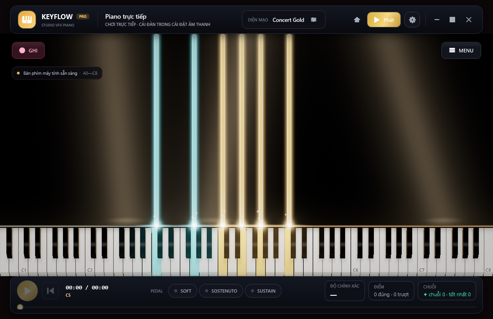

*Cũng sân khấu ấy với một hợp âm đang giữ (`--play-chord`): thanh giữ và các hiệu ứng giữ phím nối những*
*phím đang nhấn trên diện mạo mặc định Concert Gold — cùng engine nhưng khác bức hero phía trên, nên hai ảnh không còn là một.*

Cùng engine với hai preset dùng các họ hiệu ứng: **Galaxy Voyage** (vệt cầu vồng, lớp Cosmic thiên hà) và **Electric Storm** (vệt speed lines, tia điện nối các phím đang giữ, lớp Energy bão sét):

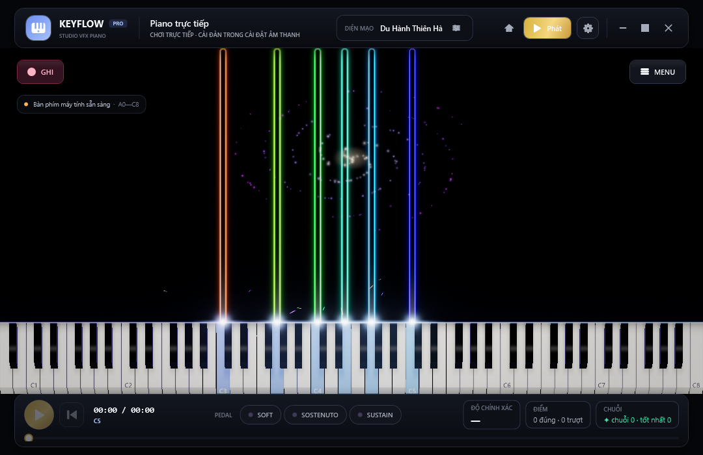
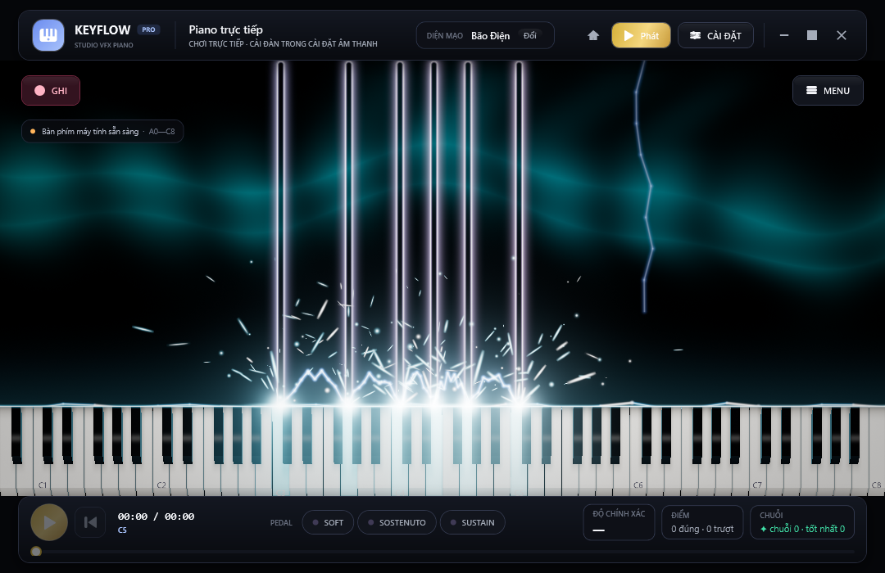

Mọi preset có sẵn, mỗi preset vẽ bằng cả hai engine cạnh nhau (phần mềm | GPU), nằm trong gallery CI [`docs/previews/presets.jpg`](docs/previews/presets.jpg). Gallery vật liệu nốt so sánh Solid/Neon/Glass/Fire/Gem/Crystal Outline trên WPF và GPU; các ô được thu còn **50%** để soi độ rõ của mặt cắt Gem và viền pha lê:

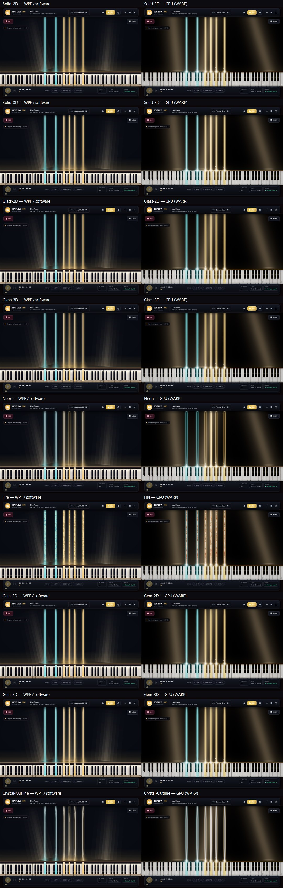

`Gem` và `Crystal Outline` là material của sân khấu WPF/GPU; AR camera-facing quads dùng chung shader material nhưng không dùng mesh stage. `Notes3D` là trục depth độc lập; `Streak` vẫn để giai đoạn trail sau. WARP style samples cho AR đang chờ CI; full parameter/value parity, webcam và hardware vẫn Unverified. Workflow dựng lại hai gallery; `tools/check_sources.py` kiểm tra preset gallery, ma trận note-material 9×2, artifact và drift gate.

### Âm thanh, MIDI & luyện tập

| Nhóm | Chi tiết |
| --- | --- |
| Piano | Chỉ dùng Salamander Grand Piano V3 (Yamaha C5): tải một lần khoảng 748 MB từ **SETTINGS → Audio**; tiến độ hiển thị ngay trên trang, từng tệp được xác minh, có thể huỷ/tiếp tục, và sau cài sẽ tự nạp lúc mở app. Không đóng gói mẫu, không nhập SF2 hoặc nhạc cụ SFZ khác. Phát stereo 44.1 kHz qua WASAPI shared/exclusive, ASIO hoặc `waveOut`; trang Audio cũng có gain, reverb, cộng hưởng dây và trạng thái đường ra/buffer thật. |
| Reverb | Hall reverb stereo chạy thời gian thực, bật mặc định, có nút bypass độc lập; reverb vẫn vang sau khi nhả phím. Ngoài hall cổ điển còn có **convolution reverb** (FFT phân vùng, overlap‑save): phòng hòa nhạc ~2,8 s và bảng cộng hưởng gần máy sinh sẵn trong app, hoặc impulse response `.wav`/`.flac` do người dùng nạp. |
| Pedal | Ba pedal MIDI tiêu chuẩn: una corda/soft (CC 67, giảm gain và làm dịu âm), sostenuto (CC 66, giữ những nốt đang nhấn khi pedal xuống), sustain/damper (CC 64, giữ tiếng sau khi nhả phím). Pedal sustain là **damper liên tục**: pedal nửa chừng (half‑pedal) kéo dài đuôi tiếng thay vì giữ hẳn, và đạp lại kịp lúc (repedal) bắt được dây còn đang kêu — giá trị CC 64 thô từ pedal liên tục đi thẳng vào synthesizer. Khi pedal xuống, dàn **cộng hưởng dây** (64 waveguide, một dây một phím) cùng ngân vang như trên đàn grand thật và tắt ngay khi nhả pedal; nút STRING RESONANCE trong Settings → Audio bật/tắt. Nút trên màn hình, pedal MIDI vào Salamander và MIDI output đều được kết nối; độ dài thanh nốt live chỉ tăng trong lúc phím được giữ, còn pedal chỉ tác động lên tiếng đàn. |
| MIDI vào | Phím máy tính, click/giữ phím ảo và WinMM MIDI input; tự mở MIDI input đầu tiên, giữ lựa chọn sau khi làm mới danh sách, hiển thị tín hiệu/nốt nhận được. |
| MIDI ra | WinMM MIDI output để gửi Note On/Off tới synthesizer hoặc thiết bị MIDI đã chọn. |
| Bài MIDI | Đọc **định dạng 0/1/2** (format 2 là các chuỗi độc lập nên được chạy lần lượt, hết chuỗi này tới chuỗi kia), **độ chia PPQ hoặc SMPTE** (SMPTE là thời gian tuyệt đối: tempo chỉ đổi nhịp của metronome chứ không đổi vị trí nốt), tempo map, nhịp, tên track, thời lượng/velocity nốt (bỏ qua kênh trống 10), solo/mute và đổi màu từng track, tua, tempo, loop A–B, metronome theo tempo map (nhấn mạnh phách đầu ô nhịp). |
| Luyện tập | Follow along, Wait for my note, Right hand only, Left hand only; chờ nốt đúng mới đi tiếp. Tua, đổi chế độ/track hoặc lặp A–B không tính các nốt đã bỏ qua là miss; mỗi vòng lặp A–B được chấm lại từ đầu. |
| Điểm số | Thống kê hit/miss, accuracy, streak và phản hồi đúng thời điểm trên footer. |

### Giao diện, preset & ghi hình

| Nhóm | Chi tiết |
| --- | --- |
| Ba giao diện hoà nhạc | **Concert Grand** (Steinway ebony & vàng champagne — theme mặc định nếu chưa có preset chọn giao diện), **Concert Noir** (obsidian & platinum), **Velvet Gold** (nhung đỏ mahogany & đồng thau; được preset Concert Gold ghép sẵn). Đổi theme là đổi toàn bộ surface/accent qua `DynamicResource` trong một khung hình, không cần mở lại app; backdrop động (sóng cộng hưởng, quầng cực quang, nhung) đi kèm từng theme. |
| Theme tự tạo | Trang Theme → **USER THEMES**: **CREATE / EDIT / DELETE** mở xưởng theme — đặt tên, chọn họ nền động (Acoustic/Obsidian/Imperial) và **năm màu** (màu nhấn, màu nhấn phụ, phát sáng, bề mặt, hạt sáng); hai mươi token còn lại của giao diện được **suy ra** từ năm màu đó nên không thể tạo ra bảng màu chữ không đọc được. Xưởng có dải xem trước cập nhật ngay khi gõ. Theme lưu thành tệp JSON nhỏ trong `%LOCALAPPDATA%\Keyflow\themes\*.json` (sửa tay được) và hiện cạnh ba theme có sẵn ở cả hai hàng chip. |
| Preset sân khấu | 14 look built-in: Concert Gold (mặc định), Neon Violet, Two Hands, Classic Roll, Green Screen, Inferno, Ice Crystal, Sakura Nocturne, Moonlight Sonata, Aurora Rainbow, Ocean Depths, Galaxy Voyage, Electric Storm, Retro Arcade; kèm 3 preset community Ember Rain, Lo-Fi Study, Sunset Drive. Các look theo vai trò Concert / Neon / Learning với lớp FX tiết chế. Preset người dùng lưu trong `%LOCALAPPDATA%\Keyflow\presets\*.json` với SAVE AS / DELETE / IMPORT / EXPORT; header hiển thị tên preset và dấu `*` khi đã chỉnh sửa. |
| Thư viện theo thư mục | Hộp thoại Play có mục **LIBRARY**: nút icon thư mục để lập chỉ mục một thư mục (mỗi tệp MIDI/MusicXML được đọc bằng chính reader của app để lấy số nốt, số track, độ dài, tempo), nút icon làm mới đọc lại (chỉ đọc lại tệp đã thay đổi), ô tìm kiếm lọc theo tiêu đề/tên tệp/thẻ, mỗi dòng có nút mở bài, thông tin bài và các **thẻ** (thêm bằng `+ TAG…`, bỏ bằng cách bấm thẻ). Thư mục được **theo dõi** nên thêm/xoá/đổi tệp là danh sách tự cập nhật; chỉ mục và thẻ nằm trong `library-index.json`, tệp hỏng đọc thành thư viện rỗng thay vì lỗi. |
| Bóng luyện tập & biểu đồ | Trang History có **PRACTICE CHART** (mỗi ngày một cột trong 14 ngày gần nhất, cột cao theo độ chính xác của ngày đó, ngày không luyện vẫn nằm trên trục, dòng dưới in số lượt và trung bình của cả cửa sổ) và **GHOST OF THIS SONG** (mỗi chấm là một nốt đã chấm điểm của lượt chơi: ngang theo vị trí trong bài, dọc theo cao độ, xanh = trúng, đỏ = trượt; lượt tốt nhất và lượt mới nhất dùng chung trục nên so được với nhau; bài chưa chơi lần nào thì in lý do thay vì khung rỗng). |
| Preset thumbnail | Mỗi preset trong danh sách Style có thumbnail mini render thật (nền tối, phím trắng/đen, vạch nốt theo palette). |
| Lớp khuông nhạc | **Sheet music** (thẻ LAYERS, mặc định tắt) vẽ khuông đôi phía trên piano roll và chạy theo playhead: mỗi nốt nằm trên khuông mà **điểm chia tay** xếp cho nó, khoá nhạc 𝄞/𝄢 (khi font có glyph, không thì chữ G/F), **hoá biểu suy ra từ chính bài** (tương quan Krumhansl–Kessler trên thời lượng vang của từng cao độ; bài không khớp tông nào thì viết theo C major) nên ký hiệu viết đúng tông đó — F major viết B♭ trên dòng B chứ không phải A♯ trên dòng A — và dấu hoá chỉ hiện khi ô nhịp thật sự cần: nốt đã có trong hoá biểu thì trơn, dấu thăng/giáng giữ đến hết ô nhịp của chính khuông đó, nốt tự nhiên lấy lại bằng dấu hoàn ♮, dòng kẻ phụ khi nốt ra ngoài khuông, vạch nhịp theo lưới phách của chính bài (ô nhịp đậm hơn), vòng sáng quanh nốt đang vang và nốt đã đánh/đánh trượt đổi màu. Nốt ngắn còn được **nối đuôi theo phách** (beaming) như bản khắc nhạc: độ dài một phách lấy từ chính lưới phách của bài, nốt đủ ngắn thì mọc **cờ** (móc đơn/đôi/ba), hai nốt cạnh nhau trong cùng một phách và cùng một tay thì **chung một đuôi nối**, nốt nằm giữa hai nốt đó làm đứt đuôi, và nốt rỗng (nốt trắng trở lên) không bao giờ vào đuôi nối dù nhịp có nhanh. Mỗi tay là một bè, nên **chỗ tay kia im lặng được viết bằng dấu nghỉ** trên khuông của chính tay đó, với hình dấu nghỉ đúng độ dài khoảng lặng (tính theo phách của bài: nốt móc đơn/đôi, nốt đen, nốt trắng, nốt tròn), và khoảng lặng liền mạch chỉ viết **một** dấu nghỉ chứ không phải một dấu cho mỗi nốt tay kia đánh, còn khoảng lặng dài được viết **theo từng ô nhịp**: tay im suốt bốn ô thì ra bốn dấu nghỉ, ô nào im từ đầu tới cuối ô đó là **dấu nghỉ tròn** (đúng cách bản khắc viết một ô nhịp im lặng, bất kể nhịp gì), và phần lẻ ở hai đầu — chỗ tay bắt đầu hoặc thôi đánh giữa ô — giữ hình theo độ dài của chính nó. Toàn bộ phần tính trước của khuông (dấu hoá, đuôi nối, dấu nghỉ — `SheetLayer.Plan`) được **giữ lại giữa các khung hình** và chỉ tính lại khi đổi bài, đổi lưới phách, đổi điểm chia tay hay đổi tông, nên vẽ 60 khung/giây không phải tính lại từ đầu. Nốt bị **vắt qua vạch nhịp** (cùng cao độ, nốt sau bắt đầu đúng chỗ nốt trước dứt) được nối bằng **dấu luyến**: một đường cong nối hai đầu nốt, vẽ **về phía đuôi quay đi** (đuôi lên thì cong xuống dưới), và nốt được luyến **không ghi lại dấu hoá** — dấu hoá đi theo dấu luyến qua cả vạch nhịp, nên nốt sau nó trong ô nhịp mới vẫn được ghi đúng. **Hợp âm được ghép thành một cột nốt**: các nốt cùng lúc trong cùng một tay là **một sự kiện** — một đầu nốt cho mỗi cao độ nhưng **chung một đuôi** (đuôi dài từ đầu nốt xa nhất qua giữa cột, cờ theo nốt ngắn nhất), và đuôi nối đi qua hợp âm như đi qua một nốt. `SheetLayer.Chords`/`Streams` cũng gom bài thành **hai dòng đọc** (mỗi tay một dòng, mỗi sự kiện một nhóm nốt xếp theo cao độ) và đưa vào phần tính trước `Plan` — nền cho cách vẽ đánh dấu theo ngón tay. **Chỗ dòng nhạc đổi tay** cũng được viết ra: nốt của tay này dứt đúng chỗ nốt tay kia bắt đầu (trong cùng khoảng chờ mà dấu luyến cho phép) là **một câu nhạc đổi tay**, nên hai đầu nốt được nối bằng **một đường cong vắt qua khoảng giữa hai khuông** (`SheetLayer.Slurs`/`Slur`) — cong theo hướng dòng nhạc đi để ôm lấy khoảng giữa hai khuông chứ không cắt qua khuông nào. Hai nốt cách nhau **một quãng tám trở lên** là hai bè (bè trầm và giai điệu) chứ không phải đổi tay, và **hợp âm không đổi tay**: một khối nốt là hợp âm mới chứ không phải dòng nhạc đi tiếp. Đây vẫn là lớp đọc nốt chứ chưa phải bản khắc nhạc đầy đủ: mỗi khuông mới có một bè, chưa vẽ nhiều bè trên cùng một khuông hay dấu luyến/articulation đọc từ chính bản nhạc. |
| Nhập bài | **MIDI** (`.mid`, `.midi`) và **MusicXML** (`.musicxml`, `.xml`, `.mxl` — tệp nén đọc qua container): nhạc cụ, số phách trong ô nhịp, tempo map, nhịp đổi giữa bài, hợp âm (`<chord/>`), `backup`/`forward`, tên bè; điểm chia tay của bản nhạc đọc thẳng từ `<staff>` (khuông 2 = tay trái) nên không phải suy luận, và được ghi nhớ theo tệp. |
| Menu & hộp thoại | Menu hoà nhạc và hộp thoại **Play** được mở từ menu chính hoặc nút Play trên header; có Back theo đúng bề mặt gọi, nút bánh răng/chevron mở dock rồi quay lại Play, nhóm chọn bài / RECENT / LIBRARY, hai thẻ tay thao tác được bằng bàn phím, tốc độ phát, lớp sân khấu và CTA tự đổi giữa chọn MIDI, bắt đầu phát và quay lại phần đang phát mà không khởi động lại bài. Thư viện không để ô tìm kiếm rỗng khi chưa lập chỉ mục. |
| Thẻ F1 | Bảng phím tắt trong ứng dụng, chia ba nhóm (Play the stage / Move around / Session & capture). |
| Hoàn tác / làm lại | Mọi thay đổi trong dock đi vào lịch sử 32 bước: `Ctrl+Z` lùi, `Ctrl+Shift+Z` (hoặc `Ctrl+Y`) tiến. Ảnh chụp là JSON của `PianoVisualSettings` nên đi qua đúng `CopyFrom`/`Clamp` như khi bạn tự đặt lại giá trị; đổi preset cũng là một mốc; còn **nhập hồ sơ** thì mở một lịch sử mới — trạng thái vừa nhập là mốc đầu tiên nên `Ctrl+Z` không lùi được qua nó. |
| Hồ sơ cài đặt | **IMPORT/EXPORT PROFILE…** ở trang General gói cả ba thứ vào một tệp `Keyflow.profile.json`: cài đặt sân khấu, ngôn ngữ và giao diện. Kéo‑thả tệp hồ sơ vào cửa sổ là áp dụng; thả tệp `.mid`/`.midi` để mở bài, thả ảnh để đặt nền. Ngôn ngữ không có trong bản build sẽ rơi về tiếng Anh chứ không để giao diện nửa dịch. |
| Trợ năng | Mọi nút chỉ có glyph (loop **A**/**B**/**×**, ↺, các nút cửa sổ, chevron của hộp thoại Play) đều có **tên cho trình đọc màn hình**, lấy từ chính tooltip đã dịch nên đổi ngôn ngữ là đổi theo; các hàng sinh tự động của dock (slider, ô số, combo, swatch màu) cũng được đặt tên theo nhãn của hàng. **Tab** giữ tiêu điểm trong dock (`KeyboardNavigation.TabNavigation="Cycle"`) và đi qua từng trang theo đúng thứ tự các hàng được in; ở cửa sổ nhỏ (1080×700) mọi hàng vẫn nằm trong cột cuộn và mọi điều khiển vẫn nằm trong thẻ của hàng (`VerifyDockAccessibility`), và khi Windows bật **high contrast** thì khung giao diện vẽ bằng chính màu hệ thống (`SystemColors`) còn theme đã chọn vẫn được giữ nguyên trong file cài đặt — Windows báo đổi lúc nào là cửa sổ vẽ lại ngay lúc đó (`SystemParameters.StaticPropertyChanged`). |
| Đa ngôn ngữ | Hai ngôn ngữ đóng gói: **English** và **Tiếng Việt**, chọn ở trang General hoặc bằng chip ngay trên menu khởi động; đổi là toàn bộ nhãn, hộp thoại, thông báo lỗi và menu ngữ cảnh vẽ lại trong khung hình hiện tại. Không có nhãn tiếng Anh lọt sang tiếng Việt: `tools/check_sources.py` chứng minh hai bảng cùng tập khoá và `--verify` đổi ngôn ngữ thật trên cửa sổ đang mở. |
| Ghi âm thanh | Trang Recording có công tắc **Record audio**: bản AVI/chuỗi PNG kèm tệp WAV stereo 16-bit ngay cạnh video (`take.wav` / `audio.wav` trong thư mục khung) để ghép sau, còn bản **MP4 nhận đúng những mẫu đó vào thẳng trong tệp dưới dạng AAC** nên không còn gì phải ghép. Âm thanh lấy từ chính các khối mà engine render (tap này chỉ được gắn trong lúc ghi nên lúc diễn bình thường không tốn gì); dòng thông tin đổi theo thực tế từng máy (**Salamander đã nạp** → ghi rõ đường tiếng đi đâu, **chưa nạp** → nói rõ bản ghi sẽ không có tiếng). Với AVI, nút REC vẫn in ra dòng `ffmpeg -i video.avi -i take.wav -c:v copy -c:a aac take.mp4` để ghép hai tệp. |
| Ghi hình | REC ghi khung hình sân khấu theo độ phân giải (cửa sổ/720p/1080p) và 15–60 fps, canh theo đồng hồ thật: **AVI** một tệp, hoặc **chuỗi PNG 32-bit** vào một thư mục (mỗi khung một tệp `frame-000001.png`, kèm `sequence.json` ghi kích thước/khung hình mỗi giây/số khung và dòng lệnh ffmpeg để dựng lại thành video alpha). Bật **Transparent background** cho chuỗi PNG để sân khấu bỏ các lớp tô đục — nền chụp trong suốt, cây đàn và hiệu ứng vẫn còn (tắt lớp Background nếu chỉ muốn mỗi cây đàn). **Đường tiếng**: bật **Record audio** (mặc định bật, trang Recording) thì REC ghi thêm một tệp **WAV stereo 16-bit 44,1 kHz** cạnh video (trong thư mục khung nếu ghi chuỗi PNG) — đúng những khối PCM mà engine phát ra (hoặc tự render khi máy không có thiết bị ra âm thanh, nên vẫn ghi được đủ độ dài), và hộp thoại sau khi dừng ghi in độ dài cùng **dòng lệnh ffmpeg** ghép thành MP4. **MP4 (H.264 + AAC)** ghi bằng **Media Foundation sink writer** đã có sẵn trong Windows — không thêm thư viện, không cần ffmpeg: khung hình của sân khấu được chuyển sang **NV12** (BT.601) rồi mã hoá H.264 với bitrate tính theo kích thước × fps (sàn 2 Mbps, trần 24 Mbps), còn PCM của engine được mã hoá AAC ngay trong cùng tệp, mỗi mẫu mang đúng mốc thời gian của nó (`Mp4Recorder.FrameTime`/`AudioTime`). Máy không có bộ mã hoá H.264 thì báo rõ bằng câu có mã lỗi thay vì ghi ra tệp hỏng; máy có H.264 nhưng thiếu bộ mã hoá AAC vẫn ghi được **phần hình** và hộp thoại nói rõ vì sao thiếu tiếng. Máy chưa nạp Salamander thì chỉ ghi hình và dòng thông tin nói rõ. Preset **Green Screen** tô nền xanh lá thuần để key trong OBS. Máy không có codec MJPEG thì ghi RGB không nén và tự dừng khi chạm giới hạn 2 GB của AVI. |

## Đa ngôn ngữ

Giao diện có hai ngôn ngữ đóng gói — **English** và **Tiếng Việt** — và đổi **ngay trong ứng dụng**, không khởi động lại: mọi nhãn, tooltip, hộp thoại, danh sách combo, thẻ phím tắt F1, menu khởi động và cả thông báo lỗi đều vẽ lại trong khung hình hiện tại.

| Ở đâu | Làm gì |
| --- | --- |
| Trang **General** (dock → nhóm APP) | Chọn **English**, **Tiếng Việt** hoặc **Theo Windows**. Ô mô tả bên dưới ghi rõ ngôn ngữ nào đang chạy và nó được chọn từ đâu. |
| **Menu khởi động** | Thẻ *INTERFACE LANGUAGE* với chip chọn nhanh — mở app lần đầu là đổi được ngay, không phải đi tìm trang cài đặt. |
| Dòng lệnh | `--lang=vi` (hoặc `en`) chạy một lần bằng ngôn ngữ chỉ định, **không** ghi vào `visual-settings.json`. CI dùng cờ này để render ảnh tiếng Việt. |
| Tìm kiếm trong dock | Một hàng khớp cả từ tiếng Anh lẫn từ đã dịch: gõ `speed` hoặc `tốc độ` đều ra cùng slider *Fall speed*. Ngoài nhãn, mỗi hàng còn trả lời **từ đồng nghĩa** (`tempo` → *Fall speed*, `fps` → *Frame rate*, `brighter` → các slider độ sáng) và **tên setting** (`NoteFallSpeed` → `fall`+`speed`), nên không phải nhớ đúng chữ trên nhãn. Nhiều từ khoá là phép **giao**: `speed fall` thu hẹp đúng hàng đó. Phần khớp được **tô màu accent** ngay trong nhãn, và ô tìm kiếm tự nhảy sang trang đầu tiên có kết quả. |

Ảnh chụp trang General khi app chạy tiếng Việt — bộ ảnh tiếng Việt của CI, render với `--lang=vi`:

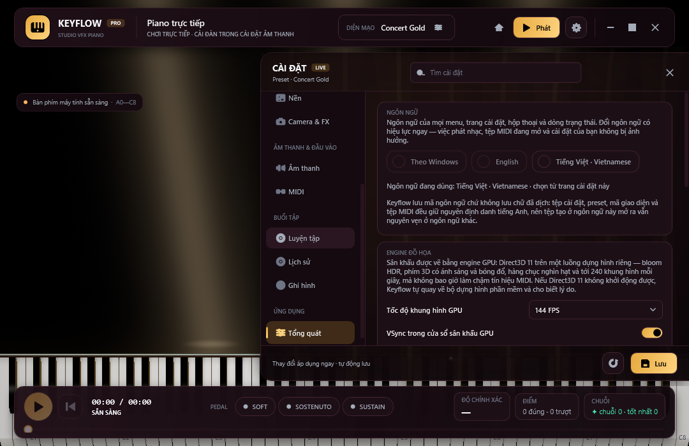

*Toàn bộ điều hướng, nhãn, chú thích và nút bấm đều là tiếng Việt; tên preset `Concert Gold` vẫn giữ nguyên vì đó là id ổn định. Ảnh dừng ở thẻ **ENGINE ĐỒ HỌA** (`GRAPHICS ENGINE`: tốc độ khung hình GPU, VSync, nút mở cửa sổ sân khấu GPU); phía dưới còn thẻ **HỒ SƠ CÀI ĐẶT** (`SETTINGS PROFILE`: nhập/xuất hồ sơ).*

Ba điều nguyên tắc:

- **Id không đổi, chỉ caption đổi.** Giá trị trong `visual-settings.json`, tên preset, id theme, tên thiết bị Windows và tên tệp luôn là tiếng Anh — bật tiếng Việt không làm hỏng preset hay file đã lưu, và một preset đem sang máy tiếng Anh vẫn đọc được.
- **Thiếu bản dịch thì in tiếng Anh**, không in ô trống. Khoá lạ không có trong inventory (tên thiết bị, tên tệp người dùng đặt) đi thẳng tới màn hình nguyên văn.
- **Thêm ngôn ngữ = thêm một tệp bảng.** Sao chép `Localization/Strings.English.cs`, dịch phần giá trị, thêm một dòng vào `Languages.All`; renderer, XAML và `visual-settings.json` không phải sửa gì. `tools/check_sources.py` và `--verify` sẽ chứng minh bảng mới dịch đủ mọi khoá của inventory.

Chi tiết kiến trúc, quy ước dịch và checklist thêm ngôn ngữ: [`docs/LOCALIZATION.md`](docs/LOCALIZATION.md).

## Bản đồ giao diện

Dock cài đặt có **12 trang trong ba nhóm**, dùng chung một bộ giá trị cho Live Stage/AR. Chọn Stage/AR trên header chỉ nhấn mạnh ngữ cảnh, không bật output hay đổi camera.

| Nhóm | Trang | Nội dung |
| --- | --- | --- |
| **THIẾT KẾ HIỆU ỨNG** | Tổng quan | Preset built-in/community/người dùng, import/export/share code, công tắc hạt nâng cấp và lối tắt. |
| | Nốt & màu | Màu theo pitch/tay/track, vật liệu, hình dáng, chuyển động và falling FX. |
| | Nhấn phím | Impact/rings/flash, spark emitter và physics dùng chung nhấn/giữ. |
| | Giữ phím | Wisps, Flames và Hold FX. |
| | Thả phím | Kiểu nhả và cường độ. |
| | Ánh sáng | Key lighting, AR key tint, light beams, halo, shading, post-FX và modulators. |
| **KHÔNG GIAN** | Sân khấu & nền | Cỡ/kiểu bàn phím, ảnh/màu nền, atmosphere và ambient. |
| | Camera & AR | Nguồn camera/video, căn chỉnh và backup, đường đi 3D, live bars, delay/quality, output và hand tracking. |
| **PHIÊN & ỨNG DỤNG** | Ghi hình | AVI/PNG/MP4, độ phân giải/FPS/audio, ghi và xuất AR offline. |
| | Âm thanh & MIDI | Salamander, reverb/IR, output/ASIO/latency/gain, MIDI in/out, track mute/color. |
| | Luyện tập & lịch sử | Practice mode/tempo/auto-tempo/loop, chart/ghost, lịch sử và xuất/xóa báo cáo. |
| | Ứng dụng | Theme, ngôn ngữ, FPS/VSync, trợ năng, cập nhật và profile import/export. |

Điều khiển phổ biến đặt trước; chi tiết nằm trong **Nâng cao**. Tìm kiếm mở phần có kết quả, xóa query trả lại trạng thái mở trước đó. Tên trang CLI cũ vẫn được chuyển đến nhóm mới; preview Practice và History trước đây nay cùng một trang Luyện tập & lịch sử.

Phần còn lại của giao diện:

| Khu vực | Nội dung |
| --- | --- |
| Header | Logo + brand, bài đang mở, chip **LOOK** (preset hiện tại + nút icon đổi diện mạo), HOME, **Play** (mở hộp thoại chọn bài/Live Play/cài đặt nhanh), nút bánh răng cài đặt, thu nhỏ/toàn màn hình/thoát. |
| Sân khấu | Nốt, hiệu ứng, bàn phím, badge thiết bị, nút REC, nút MENU. |
| Footer | Play/Pause, quay lại đầu, thời gian + nốt đang chơi, ba pedal, ACCURACY / SCORE / STREAK, thanh tua + progress. |
| Dock cài đặt | Cột điều hướng **ba nhóm** + ô tìm kiếm lọc mọi trang (tự nhảy sang trang có kết quả; khớp cả từ tiếng Anh lẫn từ đã dịch — gõ `speed` hay `tốc độ` đều ra cùng slider), mỗi thông số có slider + ô nhập số (chấp nhận đơn vị, dấu phẩy, tên nốt như `C4`) + nút reset, hàng phụ thuộc tự ẩn/hiện, nút **Lưu** + nút icon đặt lại trang, tự lưu sau 0,65 s. |

## Giới hạn hiện tại

### Piano

- **Salamander Grand Piano V3 là nhạc cụ duy nhất**: Yamaha C5 do Alexander Holm thu ở 48 kHz/24-bit, CC BY 3.0. Bộ mẫu gồm 641 FLAC, tổng 748 397 030 byte (khoảng 748 MB), tải từ mirror `sfzinstruments` vào `%LocalAppData%\Keyflow\Instruments\SalamanderGrandPiano` khi người dùng bấm tải. Không tải tự động khi khởi động và không kèm mẫu trong Git, ZIP hoặc installer.
- Downloader ghim một commit, xác minh hash Git blob cho cả tệp mới lẫn tệp cục bộ trước khi dùng; mỗi tệp được ghi tạm rồi đổi tên nguyên tử. Các tệp hợp lệ được giữ lại sau khi huỷ và được kiểm lại khi chạy tiếp; SFZ mapping và attribution chỉ được ghi khi đủ toàn bộ bộ mẫu.
- Mapping SFZ được Keyflow sinh cho đúng bộ Salamander, hỗ trợ 16 lớp velocity, hammer/release samples, tiếng pedal và cộng hưởng dây. `SfzReader` đọc tập opcode cần thiết (kế thừa header, `#define`/`#include`, `default_path`, round-robin, release sample, vòng lặp, tuning, amp envelope) và WAV PCM 16/24/32-bit, float32 hoặc FLAC. Mẫu giải nén được giữ trong RAM; cần đủ bộ nhớ cho bộ đàn sau khi tải. Không có nhập SF2 hay chọn tệp nhạc cụ bên ngoài.
- Bài MIDI **định dạng 0/1/2 và cả hai kiểu độ chia (PPQ lẫn SMPTE) đều đọc được**; phần còn thiếu của lớp nhập bài là MusicXML nâng cao (dấu luyến, repeat, nhiều bè ghép phách) — MusicXML cơ bản đã đọc được, kể cả `.mxl`, điểm chia tay lấy từ khuông, và có **lớp khuông nhạc vẽ trên sân khấu** — bật **Sheet music** ở thẻ LAYERS; khuông này đọc nốt theo cao độ, **tự suy ra hoá biểu của bài**, **nối đuôi nốt ngắn theo phách**, **viết dấu nghỉ cho tay đang im lặng**, **nối dấu luyến nốt vắt qua vạch nhịp**, **ghép hợp âm thành một cột nốt chung đuôi** và **nối một đường cong khi dòng nhạc đổi tay giữa hai khuông**; **lịch sử luyện tập** ghi theo từng lượt chơi (thời điểm, độ chính xác, nốt đúng/sai, chuỗi dài nhất), **giữ luôn từng nốt đã chấm điểm** (vị trí trong bài + cao độ + trúng/trượt, tối đa 256 nốt một lượt) nên trang History vẽ được **biểu đồ 14 ngày** và **bóng (ghost) của bài đang mở** — lượt tốt nhất trên, lượt mới nhất dưới, chấm xanh là trúng, chấm đỏ là trượt — và báo cáo HTML có thêm bảng theo ngày. **Thư viện bài** đã có hai phần: danh sách **RECENT** (`library.json`, 12 bài gần nhất kèm metadata) và **thư viện theo thư mục** — chọn một thư mục là mọi tệp MIDI/MusicXML bên trong (tối đa 3 tầng, 500 tệp) được lập chỉ mục kèm số nốt/track/độ dài/tempo, có ô tìm kiếm (khớp tên tệp, tiêu đề và **thẻ**) và **theo dõi thư mục** nên danh sách tự cập nhật khi bạn thêm hay sửa tệp; chỉ mục nằm ở `library-index.json` và chỉ đọc lại tệp nào đã đổi.
- Điểm chia tay mặc định là C4 = MIDI 60 (Notes → Hand split point) và dùng chung cho màu theo tay lẫn chế độ tập từng tay. Bật **Infer hand split from the song** thì khi mở một tệp MIDI, ứng dụng tự chọn điểm chia theo cách các nốt trải trên bàn phím (gom hai cụm theo thời lượng vang, chỉ nhận khi giữa hai tay có **ít nhất 5 semitone trống** (khoảng một quãng bốn) và mỗi tay chiếm ≥10% thời lượng vang, rồi ưu tiên nốt giữa C4 trong khoảng trống), và **ghi nhớ cho riêng bài đó** nên mở lại không đổi; bài chỉ một tay hoặc hai tay chồng lấn thì giữ nguyên điểm bạn chọn.
- MIDI input vật lý cần đàn/thiết bị tương thích được Windows nhận diện. Nếu chưa cắm thiết bị, dùng bàn phím máy tính hoặc piano ảo.
- Dùng WinMM nên phiên bản này dành cho Windows.
- Định dạng **MP4 (H.264 + AAC)** đã có và mang luôn tiếng trong tệp, nhưng cần bộ mã hoá của chính Windows: máy không có H.264 thì không ghi được MP4, còn máy thiếu AAC thì bản ghi chỉ có hình (hộp thoại nói rõ lý do). AVI vẫn là **phần hình**, tiếng nằm ở WAV cạnh đó để ghép bằng ffmpeg; máy không có codec MJPEG thì AVI dùng RGB không nén và dung lượng sẽ tăng nhanh hơn. **WebM (VP9 + Opus)** cũng ghi trực tiếp, mã hoá bằng **ffmpeg mà máy đã có** (cạnh ứng dụng hoặc trên PATH — cố ý không đóng gói kèm vì dung lượng và giấy phép): khung hình được bơm cho libvpx-vp9 theo thời gian thực khi ghi, còn đường tiếng piano được ghép thành Opus khi dừng ghi; máy không có ffmpeg thì nhận một câu báo rõ thay vì bắt đầu một bản ghi không thể hoàn tất. Bật **Transparent background** thì chính tệp WebM giữ kênh alpha (yuva420p) — **chuỗi PNG 32-bit (alpha)** vẫn là đường hậu kỳ chính xác từng khung, và `sequence.json` gợi ý sẵn lệnh ffmpeg dựng thành WebM alpha.
- **Lớp phủ camera PiP** có ở **Camera & FX → Camera overlay** (camera/video, góc, mirror, opacity, key xanh); **HAND TRACKING** dùng thị giác máy tính cổ điển nên với hai bàn tay/nền gần màu da chỉ theo bàn tay lớn nhất. Riêng thẻ **AR OVERLAY** hỗ trợ camera làm nền, calibration 4 góc và pose bàn phím 3D tự do. Calibrate có gizmo kiểu Unity **Move / Rotate / Scale** và thanh trượt số cho translation/scale đồng đều; calibration v5 lưu transform + FOV + baseline, còn v1–v4 nạp translation 0 và scale 1. **Note direction tilt/azimuth** là hướng di chuyển 3D độc lập. Trong cửa sổ Calibrate, mũi tên hướng nốt chiếu lên preview; có thể căn thẳng lên màn hình hoặc dọc chiều sâu phím mà không xoay đàn. **Notes in perspective** bật nốt camera-facing 3D; các núm hướng nằm ngay sau toggle và trước **Minimum length**. **Live press bars** là toggle riêng, mặc định tắt, không tắt key tint; tuỳ chọn **Độ mờ vệt nhấn theo vòng đời** (hai thanh trượt, mặc định tắt) cho độ đậm của vệt đi theo quãng đã vươn và đi ngược lại khi nhả phím, kèm thanh trượt **Độ phủ** (giấu sau chevron) đưa đầu vệt vào thân phím tới mức phủ toàn bộ, vẽ flat hay 3D đều dùng được; tint `VelocityColor` của look tự tô vệt theo strength thật của cú phím (xanh nhẹ → đỏ mạnh). Ánh sáng chạy theo tay đúng một lần cho một cú bấm (không lặp khi vệt live chạm phím, cả hai hướng nốt), flash nở vào ~55 ms rồi tắt dần êm, sáng/to theo velocity rõ rệt hơn, phím giữ lâu "thở" nhẹ — vẻ này áp cho cả Live Stage lẫn AR vì chung một pipeline sáng. Từ bậc AR Standard thêm **vạch damper**: vạch sáng mềm ôm mép sau hàng phím, sustain (mức 0..1) làm nó vươn ra thân đàn và sáng dậy, màu halo của look, bloom tự lo hào quang — và có thể tắt hẳn hoặc đổi sang màu *Tự chọn* trong thẻ AR PLAYBACK; muốn hình kiểu quay thẳng từ trên xuống (90°), chọn khung nhìn `90° overhead` khi calibrate và treo camera càng xa phím càng tốt để hạn chế méo mép ảnh — góc này được CI chiếu kiểm trên WARP mỗi build. Thêm toggle **Alignment check** trong thẻ KEYBOARD ALIGNMENT: vẽ lại khung 4 cạnh của vùng phím đã lưu cùng vạch quãng tám ngay trên ảnh camera (mọi bậc, chỉ khi đã calibrated), nên chân máy bị đụng hay đàn bị xê là các vạch lệch khỏi phím thật ngay — chế độ này thuộc máy, preset/chia sẻ không mang theo, và màu khung chọn được trong 5 màu tương phản; bảng độ cao catalogue cũng được khóa (`ArElementHeights`: impact 0,2 cm, pulse ≥ 0,3 cm trên mặt phẳng phím). Còn toggle **Đo trôi** (mặc định bật, thuộc máy): cứ ~2 giây chụp mẫu vùng phím và so với calibration, trôi quá ngưỡng trong 3 lần đo liền thì dòng trạng thái AR nhắc mở Calibrate đánh dấu lại (tay chơi/đổi sáng không báo nhầm, và không bao giờ tự sửa calibration). Cạnh đó, **EXPORT CALIBRATION** / **IMPORT CALIBRATION** cho backup mọi calibration đã lưu của camera đang dùng ra một tệp JSON kèm ảnh chụp camera, và nhập lại về đúng cameraLink trong tệp với từng hàng được kiểm tra lại như calibrate mới — hàng không đạt được đếm và bỏ qua chứ không bao giờ tin dùng. Trong chính cửa sổ Calibrate, **mẹo đặt camera** (máy qua vai, không dùng ultra-wide/fisheye, tay ra ngoài khi đánh dấu) nằm trên ảnh, và trạm canh màu da Y'CbCr cảnh báo ngay khi bàn tay lạc vào vùng phím đã đánh dấu (chỉ là lời khuyên, không phải cửa chặn). Ngoài ra lớp AR tự tinh chỉnh theo khung nhìn (`ArViewPresets`): camera nghiêng giữ độ nâng hiệu ứng siêu mỏng của catalogue kèm các beam/arc đứng dựng, trong khi khung nhìn 90° trực đỉnh thu về dưới pixel và giấu các quad đứng vốn sẽ ép thành nhiễu. Khi GPU chạy vượt ngân sách, `ArQualityBudget` tỉa lớp phủ theo thứ tự cố định của roadmap — hạt → pulse → note light → light bars → style nốt → impact glow — rồi trả lại nguyên vẹn; phím, note và keypress luôn được giữ. Stage-space falling trails không vẽ lên camera (kể cả trước calibration); cánh hoa/sao băng/ambient tiếp tục phẳng screen-space. Đường render có regression WARP, nhưng build/xUnit/WARP chưa chạy ở sandbox này; AR-S4 vẫn **Unverified trên webcam thật** cho tới khi thử phần cứng.
- Sân khấu mặc định là engine GPU Direct3D 11 (shader HLSL, đổ bóng bàn phím ở mỗi khung hình), nên chi phí đổ bóng nằm trên GPU. **Bộ dựng hình phần mềm** (shader CPU đa luồng, chạy một lần bằng `--software`) chỉ còn là đường dự phòng khi Direct3D không khởi động được và là đường vẽ cho bản ghi PNG trong suốt: ở đó lần bake đầu ở mức Cinematic trên máy yếu có thể tốn vài chục ms; đã có Fast/Off và cache để giảm. Máy không có GPU tương thích dùng WARP (bộ dựng hình phần mềm của Windows): cùng shader, chỉ chậm hơn card thật.
- Trên sân khấu GPU, khuông nhạc, điểm đánh dấu bàn tay, hình camera và bộ đếm/FPS vẫn là lớp vector WPF phủ lên khung GPU — riêng **watermark do chính engine in vào khung hình** (sprite kind 16) nên bản ghi và bản take offline mang đúng dải mà sân khấu đang hiển thị. Chưa có particle compute shader, depth of field, motion blur theo velocity buffer hay camera keyframe (xem `docs/ROADMAP.md`).

## Tạo lại ảnh giao diện

Ảnh trong README (và trong `docs/previews/vi/`) do ứng dụng render, không phải ảnh dàn dựng.

**Tự động:** mỗi lần push lên `main` hoặc nhánh làm việc (`arena/**`), workflow `build.yml` build xong thì render lại **hai bộ ảnh** — một cảnh trong danh sách `$shots` của workflow cho mỗi ngôn ngữ — bằng chính file `PianoPath.exe` vừa vượt qua `--verify`. Mỗi bộ ghim `--lang` của chính nó — `docs/previews/vi/` cho bản này, `docs/previews/en/` cho `README.en.md` — nên caption luôn đúng ngôn ngữ của bản README bất kể ngôn ngữ của runner, và mỗi ảnh dùng một thư mục cài đặt tạm riêng nên luôn là trạng thái chạy lần đầu. Danh sách cảnh là: sân khấu live, sân khấu GPU (một hợp âm đang giữ), hai preset GPU (Galaxy Voyage và Electric Storm), ảnh nền, menu khởi động, dock Style, dock Theme, ba trang nhóm SESSION (Practice, History, Recording), hộp thoại Play, thẻ phím tắt và trang General. Hai bước riêng của cùng workflow dựng thêm **gallery preset** `docs/previews/presets.jpg` (17 preset đã ship, mỗi preset vẽ hai lần: engine phần mềm | GPU) và **gallery note-material** `docs/previews/note-styles.jpg` (9 cấu hình vật liệu/depth × hai engine, mỗi ô 540×350 tương ứng 50% của capture 1080×700). Cả hai là JPEG dùng chung cho hai bản README. Cuối cùng workflow **commit thẳng vào nhánh** (`Refresh the README previews from CI [skip ci]`), nên sửa giao diện xong không cần làm gì thêm — ảnh trong README sẽ đúng theo commit đó. Nếu nhánh chỉ nhận pull request (một quy tắc của repository mà token của workflow không vượt qua được) thì lần push bị từ chối: bước đó chỉ báo cảnh báo `Previews not committed` chứ không làm build đỏ, và ảnh mới nằm trong artifact `keyflow-previews` của chính lần chạy ấy — tải về rồi commit tay. Artifact gồm hai bộ PNG cùng `presets.jpg` và `note-styles.jpg`:
```powershell
gh run list --workflow build.yml --limit 5          # tìm run mới nhất
gh run download <run-id> -n keyflow-previews -D docs/previews
```

**Thủ công — render tại máy:** chạy các lệnh `--snapshot` ở mục [Tham số dòng lệnh](#tham-số-dòng-lệnh). Ảnh chụp tự tắt chuyển động giao diện để kết quả tất định giữa các máy.

Muốn README chiếu thêm một cảnh: thêm một dòng vào `$shots` của `build.yml`, rồi trỏ README tới `docs/previews/vi/<tên>.png` (và `docs/previews/en/<tên>.png` cho bản tiếng Anh). `tools/check_sources.py` cho phép README đi trước ảnh đúng một commit vì chính commit render ảnh sẽ bắt kịp, nhưng báo lỗi nếu README trỏ tới một ảnh không tồn tại và cũng không có tên trong `$shots`, nên ảnh và tài liệu không thể lệch nhau im lặng.

Ảnh chụp được render **tất định**: hai lượt render cùng một code phải ra cùng từng byte, nếu không bước đối chiếu không phân biệt được "giao diện đổi" với "máy chậm hơn một chút". Sân khấu GPU của mỗi ảnh được dựng **đồng bộ** (một mô phỏng mới, đúng 480 bước 1/60 s, vẽ bằng `GpuRenderLoop.RenderParked` trên thiết bị đã nóng của luồng render đã đỗ; `RenderOnce` là đường dự phòng) thay vì lấy khung của luồng render chạy tự do, vì khung đó phụ thuộc đồng hồ của mô phỏng ngay cả khi cảnh đứng yên: bước cuối trộn nhiễu dither theo thời gian. Luồng render thật được đỗ lại trước khi nhấn phím, backdrop của menu theo đúng khoá chrome, và mọi animator được đưa về khung 0. `--verify` giữ tính chất này (`VerifyDeterministicPreview` cho sân khấu WPF, `VerifyDeterministicGpuFrame` cho khung GPU), lượt build render lại ba ảnh và cảnh báo nếu chúng lệch, và mỗi ảnh để lại một dòng `sha=…` trong annotation `Preview capture (en)` / `(vi)`. Câu chuyện đầy đủ, kể cả ba lần sửa hụt, nằm ở `docs/REPO-AUDIT.md` §6.13.

## Đóng gói và xuất file .exe

Bản build trong `bin\` chỉ chạy trên máy đã cài .NET SDK và gồm nhiều tệp. Để gửi cho người khác hoặc phát hành, hãy **publish**. Có hai kiểu:

| Kiểu | Lệnh nhanh | Kích thước | Máy đích cần gì | Nên dùng khi |
| --- | --- | --- | --- | --- |
| **Self-contained** (khuyến nghị) | `.\publish.ps1` | `PianoPath.exe` ~150–190 MB | Không cần cài gì; tải Salamander riêng khi cần tiếng đàn (~748 MB) | Phát hành công khai, máy người dùng không rõ có .NET hay không |
| **Framework-dependent** | `.\publish.ps1 -Mode FrameworkDependent` | `PianoPath.exe` ~1–2 MB | [.NET 10 Desktop Runtime (x64)](https://dotnet.microsoft.com/download/dotnet/10.0); tải Salamander riêng khi cần (~748 MB) | Nội bộ, nhiều máy đã có .NET, muốn gói nhỏ |

Cả hai kiểu đều xuất **một file `.exe` duy nhất** (`PublishSingleFile`) cùng `LICENSE.txt`; không có thư mục `Assets` hoặc mẫu piano kèm theo. WPF không hỗ trợ trimming và Native AOT nên các tuỳ chọn đó không được dùng.

### Cách 1 · Script `publish.ps1` (một lệnh)

```powershell
cd PianoPath
Set-ExecutionPolicy -Scope Process Bypass      # chỉ cho phiên PowerShell hiện tại, nếu máy chặn script
.\publish.ps1                                  # self-contained, win-x64 → .\publish\win-x64\PianoPath.exe
.\publish.ps1 -Zip                             # thêm .\publish\Keyflow-<phiên bản>-win-x64.zip để gửi đi
.\publish.ps1 -Mode FrameworkDependent -Zip    # bản nhỏ → .\publish\win-x64-fd\ và ...-win-x64-fd.zip
.\publish.ps1 -Runtime win-arm64               # Windows on ARM (Surface Pro X, Snapdragon X)
.\publish.ps1 -Clean                           # xoá bin/, obj/ và thư mục đích trước khi publish
```

Script kiểm tra phiên bản SDK, chạy `dotnet publish` và xác nhận không có tệp SF2 nào lọt vào thư mục phát hành. Thư viện Salamander được tải bởi ứng dụng sau cài đặt, không phải lúc build hoặc publish.

### Cách 2 · Lệnh `dotnet publish` thủ công

```powershell
# Self-contained, một file .exe, không cần cài .NET trên máy đích
dotnet publish .\PianoPath.csproj -c Release -r win-x64 --self-contained true `
  -p:PublishSingleFile=true -p:IncludeNativeLibrariesForSelfExtract=true `
  -p:PublishReadyToRun=true -p:DebugType=None -p:SatelliteResourceLanguages=en `
  -o .\publish\win-x64

# Framework-dependent, một file .exe nhỏ, máy đích cần .NET 10 Desktop Runtime
dotnet publish .\PianoPath.csproj -c Release -r win-x64 --self-contained false `
  -p:PublishSingleFile=true -p:IncludeNativeLibrariesForSelfExtract=true `
  -p:DebugType=None -p:SatelliteResourceLanguages=en `
  -o .\publish\win-x64-fd
```

Ý nghĩa các tham số: `-r win-x64` chọn kiến trúc (thay bằng `win-arm64` cho ARM); `PublishSingleFile` gộp mọi DLL vào một `.exe`; `IncludeNativeLibrariesForSelfExtract` gộp cả DLL native của WPF (bắt buộc cho single-file WPF, chúng được giải nén vào `%TEMP%\.net\PianoPath\` ở lần chạy đầu); `PublishReadyToRun` biên dịch sẵn để khởi động nhanh hơn; `DebugType=None` bỏ file `.pdb`; `SatelliteResourceLanguages=en` bỏ các thư mục ngôn ngữ của WPF.

### Cách 3 · Visual Studio 2026

1. Chuột phải dự án **PianoPath → Publish…**.
2. Chọn hồ sơ có sẵn **win-x64-self-contained** hoặc **win-x64-framework-dependent** (trong `Properties\PublishProfiles\`), bấm **Publish**.
3. Kết quả nằm ở `publish\win-x64\` hoặc `publish\win-x64-fd\` trong thư mục dự án. Hồ sơ đã bật single-file, ReadyToRun và tắt trimming; có thể sửa trong **Show all settings**.

### Kết quả và cách phân phối

```
publish\win-x64\
├── PianoPath.exe              ← file chạy duy nhất
└── LICENSE.txt                ← giấy phép MIT, phải đi kèm bản sao
```

- **Gửi dạng ZIP**: nén cả thư mục (`.\publish.ps1 -Zip` hoặc `Compress-Archive -Path .\publish\win-x64\* -DestinationPath Keyflow-win-x64.zip`). Người nhận giải nén rồi chạy `PianoPath.exe`; lần đầu muốn có tiếng đàn thì tải Salamander trong Audio settings.
- **Bộ cài `.exe` (tuỳ chọn)**: cài [Inno Setup 6.3+](https://jrsoftware.org/isinfo.php), publish bản self-contained rồi chạy `iscc .\installer\Keyflow.iss` (hoặc mở file trong Inno Setup Compiler và nhấn F9). Kết quả: `installer\Output\Keyflow-Setup-<phiên bản>.exe` tạo shortcut Start Menu/Desktop và mục gỡ cài đặt. Đổi phiên bản bằng `iscc /DAppVersion=2.2.0 .\installer\Keyflow.iss`. Bộ cài **tự chọn ngôn ngữ theo Windows** và có cả tiếng Anh lẫn tiếng Việt: bản tiếng Việt là một tệp *một phần* ở `installer\Languages\Vietnamese.isl` (chỉ ghi đè những câu trình cài đặt thật sự hiện, phần còn lại theo `Default.isl`). Chạy `pwsh tools/build_installer.ps1` thay cho lệnh `iscc` tay khi muốn CI kiểm hộ — thêm `-Stub` nếu chưa publish; script dừng ngay khi ISCC cảnh báo bất cứ điều gì ngoài thông báo "câu này còn dùng bản tiếng Anh" của bản dịch một phần.
- **Bản `win-arm64`**: `publish.ps1 -Runtime win-arm64` (hoặc gói ZIP do `release.yml` đính kèm vào GitHub Release) dành cho Windows on ARM; bộ cài `.exe` chỉ có bản x64 vì `Keyflow.iss` đặt `ArchitecturesAllowed=x64compatible`. Gói ARM được CI publish chứ chưa chạy thử trên máy ARM thật.
- **Kiểm tệp tải về**: mỗi GitHub Release — ở [kho phát hành công khai](https://github.com/lxmtuu/KeyFlow/releases) — kèm `SHA256SUMS.txt` của từng tệp đính kèm; đối chiếu bằng `Get-FileHash .\Keyflow-<phiên bản>-win-x64.zip -Algorithm SHA256`. Các gói **chưa được ký mã số**; bảng hash là cách kiểm nhanh người tải nhận đúng tệp repo build ra.
- **Đổi số phiên bản**: sửa `<Version>` trong `PianoPath.csproj` trước khi publish; script và bộ cài đọc giá trị này, ứng dụng tự in nó ra menu khởi động và hộp thoại About qua `AppInfo.Version`, còn `tools/check_sources.py` ghim mọi bản sao còn lại (bộ cài, hai README, hai CHANGELOG) vào cùng một số.
- **SmartScreen & chữ ký số**: các gói hiện **chưa được ký Authenticode**: `release.yml` không còn bước ký. SignPath Foundation đã từ chối đơn đăng ký mã nguồn mở, nên lần chạy đầu Windows có thể hiện bảng "Windows protected your PC" — bấm **More info → Run anyway**, rồi đối chiếu tệp với `SHA256SUMS.txt`. Ký tay khi build cục bộ vẫn dùng `signtool sign /fd SHA256 /tr http://timestamp.digicert.com /td SHA256 /a .\\publish\\win-x64\\PianoPath.exe` nếu có chứng chỉ riêng; hướng ký về sau ghi ở [`docs/CODE-SIGNING.md`](docs/CODE-SIGNING.md).
- **Phần mềm diệt virus** đôi khi quét lâu file single-file self-contained ở lần chạy đầu; đây là hành vi bình thường với các gói .NET tự giải nén. Tải Salamander là bước riêng, chỉ bắt đầu khi bấm nút tải trên trang Audio.

### Kiểm tra bản đã publish

```powershell
$log = "$env:TEMP\keyflow-verification.log"
$p = Start-Process .\publish\win-x64\PianoPath.exe -ArgumentList "--verify","--verify-log=$log" -PassThru -Wait
Get-Content $log; "Exit code: $($p.ExitCode)"      # 0 = đạt
Start-Process .\publish\win-x64\PianoPath.exe       # chạy thử bình thường
```

Nên thử trên một máy sạch (hoặc máy ảo) chưa cài .NET để chắc bản self-contained chạy được và bản framework-dependent báo đúng thông báo cần cài runtime.

### Phát hành tự động trên GitHub

Hai workflow trong `.github/workflows/`:

| Workflow | Kích hoạt | Nội dung |
| --- | --- | --- |
| `build.yml` | push lên `main`/`arena/**`, mọi pull request | **job `static` trên `ubuntu-latest`** chạy kiểm tra tĩnh (`tools/check_sources.py`, ~10 s) → **job `test` trên `ubuntu-latest`** (project xUnit `tests/PianoPath.Tests`, chạy **song song** với nhánh Windows) và **job `build` trên `windows-latest`** (chỉ được xếp lịch khi `static` xanh): build Release → chạy `--verify --verify-review-out=<RUNNER_TEMP>\phase1-visual-review` (**FAIL là đỏ build**) → upload artifact `phase1-visual-review` (48 ảnh fixed-scene cho WPF/GPU-WARP ở 100%/50%, không phải hardware/AR pass) → **biên dịch bộ cài** trên thư mục `publish\win-x64` giả (cảnh báo lạ của ISCC là đỏ build) → render **hai bộ ảnh README** — mỗi cảnh trong `$shots` một ảnh cho mỗi ngôn ngữ — cùng gallery preset `presets.jpg` và note-material `note-styles.jpg`, upload artifact `keyflow-previews` (hai bộ PNG và cả hai gallery JPEG), **báo cáo ảnh lệch** (`Report preview drift`: hai bước render vừa ghi đè `docs/previews` bằng ảnh của chính build này, nên phần khác biệt giữa cây làm việc và commit mà lượt chạy bắt đầu chính là bảng đối chiếu — `git status` không dùng được, vì bước commit ở trên đã commit trước khi push và một lần push bị từ chối để lại cây sạch trong khi nhánh vẫn mang ảnh cũ; tệp nào lệch mà ảnh mới không lên được nhánh là cảnh báo nêu tên tệp đó, kể cả ở pull request nơi bước commit bị bỏ qua) và commit ảnh mới vào nhánh đang build (bỏ qua với pull request; nhánh chỉ nhận pull request thì bước này chỉ cảnh báo, ảnh vẫn nằm trong artifact) → **một lượt publish thật** (`publish.ps1 -Mode FrameworkDependent -Zip`; CI không tải piano vì thư viện tải theo yêu cầu) rồi xác nhận gói có `PianoPath.exe` và `LICENSE.txt` nhưng không có mẫu piano — để lỗi của đường đóng gói đỏ ngay lúc push thay vì đợi tới lần cắt bản phát hành. |
| `release.yml` | tag `v*` hoặc bấm **Run workflow** | Checkout chỉ lấy mã nguồn; publish **ba gói** (self-contained `win-x64`, framework-dependent `win-x64`, self-contained `win-arm64`), smoke test bản self-contained `win-x64` vừa publish bằng `--verify`, biên dịch bộ cài `.exe` từ chính thư mục publish đó, đóng ZIP rồi tính **`SHA256SUMS.txt`** cho từng tệp đính kèm, tải tất cả lên artifact và (với tag) đính kèm vào GitHub Release cùng ghi chú phát hành tự động. Bộ cài chỉ có bản `win-x64`; Salamander Grand Piano V3 chỉ được tải khi người dùng yêu cầu (khoảng 748 MB, CC BY 3.0); gói `win-arm64` không được smoke test vì runner là máy x64. Với tag, workflow còn **công bố trang phát hành công khai**: nó dựng một cây *chỉ tài liệu* bằng một Git index riêng (`docs/release/` do `tools/make_public_docs.py` sinh + `docs/previews/` + `docs/presentation/`) — **không tạo nhánh nào trong kho này và không đổi cây nguồn** — rồi đẩy cây đó sang [lxmtuu/KeyFlow](https://github.com/lxmtuu/KeyFlow) thành một commit gốc trên nhánh `release/public-<tag>`, và **chỉ khi tag đó là bản mới nhất** thì đẩy luôn lên `main` của kho công khai (nên phát hành lại một tag cũ không kéo trang chủ lùi). Có secret `PUBLIC_RELEASES_TOKEN` thì bước đó tự chạy; không có thì nó cảnh báo và chờ người trực phát hành chạy `pwsh tools/publish_public.ps1 -Tag <tag>` (không cần lưu credential nào; `build.yml` không bao giờ chạm tới kho công khai). |

```powershell
git tag v2.2.0
git push origin v2.2.0
```

Các workflow không tải mẫu piano. Bộ kiểm chứng tạo fixture nhỏ tại chỗ; nó không tải bộ Salamander 748 MB.

**Hai kho, một sản phẩm.** Kho này là nguồn (visibility do chủ repo đặt — mốc 2026‑10‑16 ghi ở sổ tay §2a); [lxmtuu/KeyFlow](https://github.com/lxmtuu/KeyFlow) là nơi công khai: mỗi tag có một nhánh `release/public-<tag>` **ở kho đó** chứa trang sản phẩm song ngữ, CHANGELOG, giấy phép, ảnh giao diện, bộ slide và — quan trọng nhất — các gói đính kèm trong GitHub Release; `main` của kho công khai luôn giữ bản mới nhất. Trang đó **không** mang mã nguồn, không mang lịch sử commit của kho này, và không được sửa tay: nó do máy sinh từ chính hai README này và `tools/check_sources.py` so từng byte của `docs/release/` với script sinh ra nó, nên một trang công khai lệch khỏi README này là một lần build đỏ. Việc thiết lập một lần (tạo kho, secret, variable), cách phát hành bằng tay và những đánh đổi của mô hình này nằm ở [`docs/PRIVATE-SOURCE-PUBLIC-RELEASES.md`](docs/PRIVATE-SOURCE-PUBLIC-RELEASES.md).

### Lỗi thường gặp khi publish

| Hiện tượng | Nguyên nhân / cách xử lý |
| --- | --- |
| Trang Audio báo `SETUP REQUIRED` | Trong **SETTINGS → Audio**, bấm nút **Tải đàn piano · 748 MB**; kết nối mạng là cần thiết cho lần tải đầu. Có thể huỷ và tiếp tục sau. |
| `NETSDK1045: The current .NET SDK does not support targeting .NET 10.0` | Cài .NET 10 SDK, hoặc SDK cũ đang được ưu tiên bởi `global.json`; kiểm tra `dotnet --list-sdks`. |
| Máy đích báo "To run this application, you must install .NET Desktop Runtime" | Bản framework-dependent; cài .NET 10 Desktop Runtime x64 hoặc dùng bản self-contained. |
| Mở ứng dụng nhưng chưa có tiếng | Salamander chưa được cài hoặc chưa được nạp: mở **Piano & Audio Setup**, tải đàn rồi bấm **LOAD INSTALLED PIANO** nếu cần. |
| Salamander đã nạp nhưng Audio báo `NO AUDIO DEVICE` | Windows không mở được thiết bị đầu ra đang chọn; chọn **Auto** hoặc một thiết bị khả dụng trong **OUTPUT & LATENCY**. Ứng dụng vẫn chạy; dòng trạng thái ghi đường ra và lý do cụ thể. |
| `PublishTrimmed`/`PublishAot` báo lỗi hoặc ứng dụng crash khi mở | WPF không hỗ trợ; bỏ hai tuỳ chọn này. |
| Publish `win-x86` báo lỗi runtime pack | Chỉ dùng `win-x64` hoặc `win-arm64`; các bản 32-bit không được kiểm thử. |

## Kiểm thử

Bộ xác minh tích hợp nằm trong `Diagnostics/VerificationSuite.cs` và chạy ngay bằng chính ứng dụng (cần Windows vì khởi động WPF thật):

```powershell
dotnet run --project .\PianoPath.csproj -- --verify
# tùy chọn: --verify-log=C:\duong-dan\ket-qua.log (mặc định %TEMP%\keyflow-verification.log)
# tùy chọn: --verify-review-out=C:\duong-dan\phase1-review (ghi 48 ảnh + manifest.json + index.html)
```

Mã thoát `0` là đạt, `1` là có lỗi; nhật ký ghi từng mục PASS/FAIL **ngay khi mục đó được ghi ra** — một tiến trình bị mã gốc làm sập vẫn để lại dòng cuối cùng nói nó đang làm gì. Bộ kiểm thử tạo tệp MIDI, SFZ/WAV và AVI nhỏ trong thư mục tạm; kiểm tra parser MIDI (đa track, tempo map, lưới phách, tên track, bỏ kênh trống, **nhóm phách theo ô nhịp (`Meter.Of`): nhịp đơn đập theo đơn vị đã ghi (4/4 bốn phách đen, 3/4 ba, 2/2 hai phách trắng, 3/8 ba phách móc) còn nhịp ghép sáu/chín/mười hai đập theo nhóm ba (6/8 = hai phách đen chấm, 9/8 = ba, 12/8 = bốn, 6/4 = hai phách trắng chấm, 7/8 vẫn bảy), lưới của tệp 6/8 đặt đúng phách đen chấm và `BeatsPerBar` theo số phách cảm nhận nên vạch nhịp vẫn rơi đúng mỗi ô**, **định dạng 2 chạy các chuỗi lần lượt với lưới phách nối tiếp**, **độ chia SMPTE đọc tick thành giây tuyệt đối còn lưới phách theo tempo map**, từ chối định dạng lạ và độ chia không dùng được, tệp hỏng), giải mã vùng mẫu SFZ và kiểm tra kế thừa opcode, lớp velocity, round-robin, release sample và pedal, loop qua giai đoạn release, giới hạn đa âm, tín hiệu âm thanh và Note Off, sustain/sostenuto/soft, lưu và clamp cấu hình hiệu ứng, preset có sẵn/preset người dùng (lưu, nhập, xuất, xóa, tệp hỏng), **danh mục dock: 13 trang chia 4 nhóm khớp giữa catalogue, XAML và tiêu đề nhóm**, **đổi ngôn ngữ trực tiếp trên cửa sổ đang mở (`VerifyLanguageSwitching`): hai bảng phải cùng tập khoá, nhãn đã dịch phải vẽ lại khi đổi, và ô tìm kiếm dock phải tìm thấy hàng bằng tiếng Việt**, **id giao diện cũ (`sakura`/`noir`/`velvet`) tự chuyển sang id chuẩn khi nạp file lưu**, chip giao diện, lớp hoa anh đào, impact wave/flash, falling/hold/release FX, 4 lớp ambient, smart modulators, 7 combo themes, chế độ màu theo tay/track, hàng phụ thuộc, tìm kiếm, áp preset, **thư viện bài (`VerifySongLibrary`): chỉ mục nằm trong thư mục cài đặt của lượt chạy, mới nhất trước và tối đa 12 bài (hộp thoại Play hiện 5 dòng đầu), mở lại một bài khôi phục điểm chia tay/tốc độ rơi/tempo qua chính các slider rồi ghi lại đúng một dòng, tệp hỏng đọc thành rỗng, bài bị quên hoặc không còn trên đĩa bị loại**, **suy luận chia tay (`VerifyHandSplitInference` + `VerifyHandSplitInferenceOnSong`): gom cụm theo thời lượng vang, đòi khoảng cách tối thiểu một quãng bốn giữa hai tay và ưu tiên nốt giữa, bài một tay, bài chồng lấn hoặc nốt lạ ngắn không kéo được điểm chia, công tắc đưa giá trị suy luận vào đúng slider rồi lưu vào thư viện bài kèm cờ `SplitInferred`, mở lại dùng đúng giá trị đã nhớ (không đo lại)**, **tempo luyện tập tự động (`VerifyPracticeTempo`): mặc định tắt, sai quá ngưỡng thì mỗi bước chậm 5% và dừng ở sàn 50%, đúng liên tiếp 4 nốt thì nhanh lại 2% tới 100%, và một phím sai thật trong lúc bài đang chạy cũng đi đúng đường đó**, **nhập MusicXML (`VerifyMusicXmlImport`): chia divisions + tempo thành giây, **ô nhịp 6/8 đập hai phách đen chấm đúng theo tempo của ô và nốt không bị xê dịch**, hợp âm dùng chung một điểm vào, `backup`/`forward` đưa con trỏ đi đúng, đổi tempo giữa bài dịch mọi nốt phía sau, tên bè và các bè chạy song song, điểm chia tay đọc từ `<staff>` (57 giữa G3 và C4) và từ `part`, không bịa điểm chia khi hai tay chồng lấn hoặc bài một tay, tệp `.mxl` đọc qua `META-INF/container.xml` (và cả khi không có container), nạp từ đĩa qua đúng hàm mà app dùng, và từ chối văn bản không phải XML, phần tử gốc lạ, bản time-wise và tệp không có nốt**, **lớp khuông nhạc (`VerifySheetLayer`): cao độ viết theo ký hiệu khoa học và phím đen nằm trên dòng của chữ cái dưới nó (C4 = bậc 28, B4 = 35, F#4 = 31), điểm chia tay quyết định khuông (nốt giữa C4 nằm dưới khuông treble một dòng kẻ phụ, G2 nằm trên dòng dưới cùng của khuông bass), nốt cao hơn không bao giờ bị viết thấp hơn và mỗi nửa cung chỉ dịch một bậc, dòng kẻ phụ chỉ xuất hiện khi nốt ra khỏi khuông, nốt dài thì rỗng không có đuôi còn nốt ngắn có đuôi quay ra xa giữa khuông, cửa sổ nhìn đặt playhead ở một phần tư chiều rộng, khoá nhạc chọn theo font đang cài, màu nốt theo trạng thái đang vang/đã đánh/đánh trượt, **tông của bài (`MusicKey.Infer`) suy ra từ thời lượng vang của từng cao độ (thang D major ra hai dấu thăng F rồi C, F major ra một dấu giáng B, E♭ major ra ba dấu B–E–A, thang minor lấy hoá biểu của major cách nó ba nửa cung, bài rỗng hay chạy nửa cung giữ C major), vị trí dấu trên khuông (F♯ dòng trên cùng khuông treble, C♯ ở khe thứ ba, khuông bass lặp lại hai bậc thấp hơn), ký hiệu viết theo tông (F major viết B♭ trên dòng B còn C major viết A♯ trên dòng A), dấu hoá theo ô nhịp (nốt trong hoá biểu không có dấu, dấu giữ đến hết ô nhịp, dấu hoàn lấy lại nốt tự nhiên, hai khuông giữ ô nhịp riêng, nốt trước ô nhịp đầu thuộc về khoảng lặng), tông chỉ suy ra **một lần cho mỗi bài** chứ không mỗi khung hình, và **nối đuôi và cờ (`Beams`/`Flags`/`BeatSeconds`): độ dài một phách là khoảng giữa của chính lưới phách (lưới không đo được thì nửa giây), nốt đen không cờ còn móc đơn/đôi/ba một/hai/ba cờ, hai nốt móc trong cùng một phách và cùng một tay chung một đuôi nối có hướng đuôi theo nốt đầu và số đường theo nốt ngắn nhất, bốn nốt móc qua hai phách thành hai đuôi chứ không phải một, và mỗi thứ làm đứt đuôi: nốt đen chen giữa, nốt tay kia, nốt ở phách sau, hợp âm cùng lúc, nốt trắng trong bài chậm; ảnh render cho thấy đuôi nối thật sự nhiều mực hơn hai cờ rời**, **dấu nghỉ (`Rests`/`Rest`/`Bars`): mỗi tay là một bè nên chỗ tay kia im lặng thành một dấu nghỉ trên khuông của tay đó — một bè giai điệu để tay trái nghỉ suốt bấy lâu, hai tay thay phiên nhau thì mỗi khoảng lặng nằm đúng khuông của tay đang nghỉ, một hợp âm rồi tay đó thôi đánh thì dấu nghỉ bắt đầu sau khi hợp âm dứt, khoảng lặng liền mạch chỉ một dấu, và không có nốt nào thì không có dấu nghỉ; **khoảng lặng dài được chia theo vạch nhịp** (`Bars`): im bốn ô một giây ra bốn dấu nghỉ tròn, khoảng lặng bắt đầu giữa ô thì ô đầu và ô cuối là dấu lẻ còn các ô ở giữa là dấu tròn, khoảng lặng nằm gọn trong một ô hay lưới chỉ có một vạch thì giữ nguyên, và plan của một bài 2/4 có tay trái im suốt hai ô cho ra **hai dấu nghỉ tròn** đúng mỗi ô một dấu; hình dấu nghỉ đếm theo phách của bài (nốt móc đôi → nốt móc đơn → nốt đen → nốt trắng → nốt tròn, dài hơn nốt tròn vẫn là nốt tròn, không có phách thì là nốt đen), viết bằng glyph nhạc khi font có và bằng chữ cái đầu khi không; `Plan` gom dấu hoá + đuôi nối + dấu nghỉ thành một lần tính, **được giữ giữa các khung hình** và chỉ dựng lại khi đổi bài/lưới phách/điểm chia tay/tông, và ảnh render với dấu nghỉ bị bỏ khỏi plan ít mực hơn đúng phần dấu nghỉ**, **dấu luyến (`Ties`/`TieUnder`): nốt sau bắt đầu đúng chỗ nốt trước cùng cao độ dứt thì thành một dấu luyến (có khe hở, chồng lấn, khác cao độ, khác tay hay có nốt khác chen giữa thì là nốt mới), chuỗi ba nốt là hai dấu luyến, hợp âm vắt nhịp thì mỗi cao độ một dấu luyến; nốt được luyến **không ghi lại dấu hoá** và dấu hoá đó được ghi nhớ cho phần còn lại của ô nhịp (F♮ luyến sang ô sau vẫn trơn, còn F♯ sau nó vẫn phải có dấu thăng); dấu luyến cong về phía đuôi quay đi, và ảnh render cho thấy đường cong thật sự có mực — bỏ dấu luyến khỏi plan thì mất đúng phần mực đó**, **hợp âm (`Chords`/`Streams`): ba nốt cùng lúc cùng tay là một nhóm còn nốt sau đó là nhóm riêng, hai tay khác nhau thì không cùng nhóm, nốt đơn là nhóm một, dòng đọc của mỗi tay gồm các sự kiện xếp theo cao độ (hai tay đánh cùng lúc vẫn là hai dòng), đuôi nối đi qua hợp âm (hợp âm móc đơn + nốt móc đơn sau nó = một đuôi nối, hai hợp âm trong một phách = một đuôi nối, hợp âm đứng một mình **không** thành đuôi nối), và ảnh render cho thấy cột hợp âm ba đầu nốt chỉ tốn **một** đuôi — đưa plan coi chúng là ba nhóm riêng thì mực tăng lên**, ảnh render cho thấy hoá biểu thật sự đặt mực vào khoảng giữa khoá và nốt**, và chính sân khấu vẽ khuông từ nốt + lưới phách của bài qua công tắc trong dock**, **đường tiếng của bản ghi (`VerifyRecordingAudioTrack`): header WAV 44 byte đúng từng byte theo đặc tả (PCM, 2 kênh, 44,1 kHz), khối lẻ bị bỏ đúng phần nửa khung còn nguyên khung được giữ, im lặng và khối lớn hơn buffer vẫn ghi đủ, hai trường kích thước chỉ biết được lúc đóng tệp được vá lại đúng, mẫu ghi little-endian đúng thứ tự, mở tệp không được và tệp đã đóng đều không ném lỗi, đường dẫn WAV nằm cạnh AVI (hoặc `audio.wav` trong thư mục khung), và **engine tự render đúng 8 khối vào writer** khi không có thiết bị âm thanh rồi thôi render khi gỡ tap**, **lớp phủ camera (`VerifyCameraOverlay` + `VerifyCameraOverlayDock`): vị trí cho cả bốn góc (đúng tỉ lệ khung hình, không cao quá 80% sân khấu, góc lạ rơi về góc dưới‑trái, sân khấu 0×0 ra hình rỗng chứ không âm), khung hình từ camera được lật đúng khi stride âm và khi mirror, mọi pixel ra khỏi `CopyFrame` đều đục, key xanh theo ngưỡng (0 = tắt, 100 = rộng nhất, xám/trắng/xanh dương luôn sống sót vì xanh lá phải trội), hệ số opacity, số camera máy đang có, câu trả lời cho tệp video không tồn tại, và **đọc lại một khung từ chính clip AVI mà app vừa ghi**; phía dock: công tắc + hai combo + ba slider có mặt, chọn góc lưu đúng id tiếng Anh, giá trị ngoài dải bị `Clamp`, khung hình đi qua `PumpCameraFrame` (đỏ vào đỏ ra, xanh vào trong suốt ra) và **sân khấu vẽ nó đúng ô của góc đã chọn, đọc lại từ ảnh render****, **chuỗi PNG có alpha (`VerifyPngSequenceRecorder`): mỗi khung là PNG 8-bit RGBA đúng cỡ bản ghi, alpha giữ nguyên (trong suốt ở ngoài, đục ở trong), khung lặp được ghi đủ số bản, manifest có pattern + dòng ffmpeg, sai kích thước/khung hình mỗi giây/độ lớn khung đều bị từ chối, và một lần chụp thật **mất nền nhưng giữ cây đàn** khi bật Transparent background**, **theme tự tạo (`VerifyUserShellThemes`): năm màu gốc suy ra đủ hai mươi token với bề mặt tối, màu nhấn đủ tương phản và các lớp sáng dần đúng thứ tự, bề mặt ngoài dải đọc được bị kẹp lại, tệp sửa tay bị chữa lành còn tệp hỏng bị bỏ qua, id ổn định theo tên, theme lưu trong thư mục cài đặt **được `ShellThemes.Find` phân giải và áp lên giao diện thật**, cả hai hàng chip đều có nó, đổi thư mục cài đặt thì nó biến mất, và xưởng theme từ chối lưu khi thiếu tên hoặc màu không phải hex**, **kệ preset cộng đồng (`VerifyCommunityPresets`): mỗi tệp trong `presets/` là một preset phong bì đầy đủ — tên đúng mọi khoá của `PianoVisualSettings` và không thừa khoá nào, giá trị đã ở dạng cuối (nạp lần hai không đổi gì), tên không trùng preset có sẵn và không trùng nhau, tệp hỏng hoặc tên lặp bị bỏ qua chứ không xoá cả kệ, danh sách hiện nhãn COMMUNITY, áp kệ thì cả theme đi theo, và tên của kệ bị từ chối khi lưu đè**, **ảnh xem trước trong file preset (`VerifyPresetThumbnails`): sân khấu render thật ở 192×112, preset lưu/xuất mang ảnh theo và đọc lại được, tệp cũ (JSON cài đặt trần) vẫn nạp như preset không ảnh, và một ảnh không phải PNG đúng cỡ bị từ chối thay vì làm hỏng danh sách**, **mã chia sẻ diện mạo (`VerifyPresetShareCodes` + `VerifyPresetSharing`): chuỗi gzip + base64url sau tiền tố phiên bản, đi-về đúng từng giá trị nhưng **bỏ đường dẫn ảnh nền của máy người gửi** (diện mạo dùng ảnh rơi về nền màu), mã bị chat xuống dòng vẫn đọc được, và mã rỗng/lạ/phiên bản khác/quá lớn/hỏng bị từ chối kèm lý do in ngay trong dock mà không đổi cài đặt hiện tại**, **lịch sử luyện tập (`VerifyPracticeHistory`): mỗi lượt chơi một dòng JSON trong `history/practice.jsonl` của thư mục cài đặt, mới nhất trước và có trần, dòng hỏng bị bỏ qua, lượt tốt nhất theo bài, báo cáo HTML (UTF-8 BOM) có bảng lượt chơi lẫn bảng tổng hợp theo bài, và một lượt chơi thật chỉ được ghi đúng một lần khi dừng transport**, **bóng luyện tập và biểu đồ (`VerifyPracticeGhostAndChart`): cột mỗi ngày cao theo độ chính xác của ngày đó (có sàn để ngày luyện ít vẫn thấy được), cửa sổ 14 ngày kết thúc ở hôm nay, ngày không luyện vẫn là một hàng 0 và lượt cũ hơn cửa sổ bị loại khỏi biểu đồ dù tệp vẫn giữ, trung bình của cửa sổ đếm từng nốt một, trục cao độ của bóng là dải nốt của chính lượt chơi (rộng tối thiểu một quãng tám), mỗi nốt nằm đúng chỗ theo vị trí và cao độ, app gom nốt ngay lúc chấm điểm rồi ghi vào lượt chơi khi dừng transport, ghost được quên khi chạy lại bài, giới hạn 256 nốt một lượt và đọc lại nguyên vẹn, và một dòng cũ không có ghost vẫn nạp bình thường**, **thư viện theo thư mục (`VerifySongFolderLibrary`): quét ra đúng các tệp đọc được (bỏ tệp hỏng và tệp không phải bài hát, đi xuống thư mục con), số liệu lấy từ chính tệp, lần quét sau **dùng lại** mục đã có cho tệp không đổi và đọc lại tệp vừa sửa mà **giữ nguyên thẻ**, RESCAN đọc lại tất cả, thẻ được cắt khoảng trắng/viết thường/giới hạn độ dài và tối đa 8 thẻ một bài, tìm kiếm khớp tiêu đề–tên tệp–thẻ và đòi đủ mọi từ, chỉ mục đọc lại được và tệp hỏng thì quên đi, hộp thoại Play in đúng danh sách + lọc theo ô tìm kiếm + hiện thẻ, và watcher báo khi có bài mới thêm vào thư mục**, **thẻ phím tắt F1 mở/đóng được**, **trợ năng (`VerifyAccessibility`): mọi điều khiển chỉ có glyph đều có tên dịch được, Tab không rời khỏi dock, và bảng màu high contrast lấy từ `SystemColors`, tự vẽ lại khi Windows báo đổi, mà không ghi đè theme đã chọn**, **dock ở kích thước thu gọn (`VerifyDockAccessibility`): 13 trang ở 1080×700 vẫn giữ mọi hàng trong cột cuộn và mọi điều khiển trong thẻ của hàng, và Tab đi qua mỗi trang theo đúng thứ tự hàng được in**, ghi AVI frame, **bản ghi MP4 có tiếng (`VerifyMp4Recorder`): bitrate theo kích thước × fps (sàn 2 Mbps, trần 24 Mbps), mốc thời gian từng khung và từng khối âm thanh đúng đơn vị 100 ns (15 khung 15 fps = đúng một giây, 60 khung 60 fps = đúng một giây), khung sân khấu chuyển sang NV12 đúng BT.601 (đen 16, trắng 235, xám trung tính 128, đỏ Y 82/U 90/V 240) và khung sai cỡ bị từ chối, dock có đủ ba định dạng trong ô Format, và **một tệp MP4 thật được mã hoá ngay trên máy (64×48, 15 khung + một giây tiếng) rồi kiểm lại bằng hộp `ftyp` đầu tệp — việc mã hoá do **một tiến trình con** làm (`--encode-take`, xem bảng tham số) vì bộ mã hoá là mã gốc có thể làm sập hoặc treo cả tiến trình: chạy riêng thì lượt kiểm chứng vẫn giữ được kết luận, từng dòng của tiến trình con được chép vào nhật ký để biết nó dừng ở đâu, bản ghi nhỏ thế này chỉ tốn dưới một giây ở máy chạy được còn tiến trình con quá một phút thì bị bỏ — và máy không ghi được MP4 thì ghi một dòng SKIP nêu đúng bước cuối cùng nó báo thay vì báo lỗi. Trước khi khung đầu tiên được đưa cho bộ mã hoá, tiến trình con hỏi thẳng bộ ghi MP4 xem máy này có nhận **luồng H.264** hay không (`Mf.EncodeSinkProbe`: mở bộ ghi, đưa đúng mô tả luồng mà bản ghi sẽ dùng rồi dừng, không ghi khung nào) — máy không có bộ mã hoá thì dừng ngay tại đó kèm mã lỗi. Khi lượt chạy **không ra được tệp MP4 nào**, lượt kiểm chứng mới hỏi tiếp câu còn lại bằng **phép thử đường ống** trong một tiến trình con riêng (`Mf.EncodeAviProbe` + `--encode-probe`: ba khung vào một tệp AVI không nén, không cần bộ mã hoá, trần 20 giây) — nó chạy *sau* lượt ghi chứ không bao giờ trước, nên một phép thử có thể treo không chặn mất chính thứ nó định giải thích (một lượt CI đã cho thấy đúng như vậy), và lời đáp của nó tách bạch đường ống mẫu của app với việc ghi tệp của máy. **Theo dõi bàn tay** đã có: `Camera/HandTracker.cs` đọc thẳng khung hình camera bằng số học — luật màu da trong YCbCr (có độ nhạy chỉnh được), lưới ô 32×24, nhóm ô liền kề lớn nhất là bàn tay (tâm, bề ngang, bề cao theo tỉ lệ khung), và **đếm ngón** theo biên dạng cột: đường "lòng bàn tay" là độ cao mà bàn tay đứng nhiều cột nhất, ngón là đoạn vượt qua đường giữa lòng bàn tay và đầu ngón, nên nắm tay ra 0 ngón chứ không phải một. Thẻ **HAND TRACKING** ở trang Camera & FX có công tắc + slider **Skin sensitivity**; camera mở cho lớp này kể cả khi lớp phủ hình đang tắt, và sân khấu vẽ **dải sáng trên phím bàn tay đang ở**, chấm ở vị trí ngang thật của tay và một chấm nhỏ cho mỗi ngón. Và vì bộ mã hoá là **mã gốc có thể ngừng trả lời** chứ không báo lỗi, cửa sổ mở bộ ghi MP4 **trên một luồng riêng với hạn 10 giây** (`Video/HangGuard.cs` + `Mp4Recorder.TryOpen`): máy nào không trả lời trong hạn đó thì bản ghi tự chuyển sang **AVI** kèm câu báo, thay vì đóng băng cả cửa sổ — đúng kiểu máy mà lượt kiểm chứng gặp trên CI, nơi media stack treo hẳn khi đóng dấu thời gian cho sample và **chưa từng có tệp MP4 thật nào được ghi ra** (xem `docs/REPO-AUDIT.md`)., đóng/mở MIDI input thật nếu có, giải mã WinMM `MIM_DATA` tới nốt rơi WPF, MIDI output, tự ẩn/hiện giao diện theo chuột và Esc, độ dài nốt khi giữ phím, chế độ tập, loop, tua, tempo, render WPF và việc sân khấu chạy trên đồng hồ khung hình dùng chung. Chỉ xác nhận được phím đàn vật lý phát sự kiện khi nhấn một phím MIDI thực tế.

Bộ kiểm thử shader có hai mục riêng: `VerifyShaderPipeline` (không cần WPF layout) kiểm tra toán sRGB/ACES/GGX, jitter tất định, **chữ ký cache bake** (slider không liên quan không gây bake lại), bake nền phải opaque và trải sáng thật, cột phím đen phải tối hơn cột ngà, và tile overlay của một phím kêu phải che đúng phím rồi mờ ra; `VerifyShadedStage` bật/tắt `ShadingQuality` trong dock và khẳng định stage thật sự đổi giữa bàn phím vector và bàn phím shader, đồng thời bake được tái sử dụng giữa các khung hình.

Engine GPU có một mục riêng, `VerifyGpuStage` (`Diagnostics/VerificationSuite.Gpu.cs`), và không đòi card đồ hoạ thật vì khung hình thử dựng trên WARP — có sẵn ở mọi runner CI. Mục này kiểm: **cài đặt** (bản cài mới mặc định `RenderBackend = Gpu`; tệp cũ ghi `Software` được nâng lên GPU khi nạp; tên engine hay tốc độ khung hình lạ rơi về mặc định; áp preset giữ nguyên engine, FPS và VSync vì chúng thuộc về máy); **look** (`GpuLook` mang đúng màu nốt, tỉ lệ bàn phím và giá trị các slider Note shimmer / Halo light pulses / Shooting stars / Landing glow, cùng lựa chọn Spotlights); **cầu nối luồng** (`GpuStageFeed` đưa cho luồng dựng hình bài đang chạy, các phím đang giữ và một đồng hồ ngoại suy không bao giờ quá 50 ms; hit và nốt live xếp hàng không mất, yêu cầu xoá chỉ được nhận đúng một lần); **shader nhúng** (đủ 12 entry point HLSL); **một khung thật** 640×360 dựng trên WARP rồi đọc ngược để đo (bàn phím phải sáng ở đáy, nổi hơn nền tối phía trên, và ảnh phải nhiều màu chứ không phải một mảng phẳng); **các họ hiệu ứng** (look mang đủ cài đặt ambient, vệt rơi, nhãn phím, chớp, hồ quang và cánh hoa; Galaxy, guide lanes và cánh hoa dựng ra hàng trăm hình sau nốt; atlas chữ 1024×768 có mực thật; và bầu trời của khung GPU sáng lên khi bật lớp thiên hà); cuối cùng là **ghi hình** (`GpuRecordingTap`: vòng dựng hình chạy một mình, không cửa sổ, không xem trước, vẫn giao đủ khung 320×180 có bàn phím trong đó).

### Cổng hiệu năng (`--bench`)

Ngân sách khung hình không được là cảm giác, nên app tự đo nó:

```powershell
.\bin\Release\net10.0-windows\PianoPath.exe --bench=240 --bench-out=$env:TEMP\keyflow-bench.json
(Get-Content $env:TEMP\keyflow-bench.json -Raw | ConvertFrom-Json).scenes | Select-Object scene, frames, particles, @{n='p95';e={$_.stats.p95Ms}}
```

`--bench` **không mở cửa sổ nào**: nó chạy chính `GpuRenderLoop` của sân khấu (cùng vòng lặp, cùng mô phỏng, cùng bước đọc ngược khung về WPF) ở 1920×1080,
cho một bài hát tự chạy qua `BenchTransport`, và ghi **thời gian của từng khung** ra JSON. Hai cảnh được đo, mỗi cảnh một ngân sách (`Diagnostics/FrameBudget.cs`):

| Cảnh | Look | Ngân sách p95 |
| --- | --- | --- |
| `default` | cài đặt của một lần chạy đầu tiên | 8 ms |
| `heavy` | preset có sẵn nặng nhất — *Galaxy Voyage*: thiên hà, sao, sao băng, vệt cầu vồng, pháo hoa | 16 ms |

Hai con số đó là của **đường GPU**. Roadmap từng ghi "p95 < 8 ms ở *Classic Roll*, < 16 ms ở *Cinematic*" — nhưng đó là hai thứ khác loại (một preset và một mức
đổ bóng bàn phím) và thuộc về sân khấu WPF cũ, nên chúng được viết lại thành **một look ở một kích thước**, giữ nguyên hai con số.

**Máy nào bị xử theo ngưỡng.** Chỉ máy có card đồ hoạ thật: vượt ngân sách thì mã thoát là `3`. Runner CI không có card nên vẽ bằng **WARP** và *không* bị so với
ngưỡng tuyệt đối — Windows còn trình adapter phần mềm như một adapter "phần cứng", nên app đọc cả **tên** adapter chứ không chỉ cờ WARP (`FrameBudget.IsSoftwareAdapter`),
và tên không đọc được thì coi như phần mềm. Ở đó con số vẫn có nghĩa **tương đối**: CI giữ báo cáo của lần chạy trước trong Actions cache và so p95 lần này với nó
trên cùng loại máy. **Trên WARP mức chênh chỉ là con số, không phải kết luận** — cùng một code mà hai lượt chạy đo được p95 307 ms rồi 788 ms, nên mọi dòng so sánh ở đó
là `NOTE`; chỉ máy có card thật, nơi ngân sách được viết cho, mới in `WARN perf:` khi chậm hơn 50% (và `FAIL` khi vượt ngân sách). Báo cáo của mỗi lượt chạy được đính kèm làm artifact `keyflow-bench-report`, và vì nó nằm
trong cache chứ không trong repo nên một con số đo được không bao giờ thành một commit.

Cả phép đo lẫn luật so sánh đều có lớp kiểm chứng: `VerifyFrameBudget` trong `--verify` kiểm bảng ngân sách, cách tính phân vị, luật adapter, bản JSON đọc ngược được
và **một lượt đo thật** 24 khung 320×180 qua đúng đường `--bench` đi; nửa thuần (phân vị, ngân sách, so sánh tương đối, JSON) nằm trong `tests/PianoPath.Tests`
nên chạy được trên Linux, nơi không có Direct3D.

### Bộ test chạy trên mọi máy (`tests/PianoPath.Tests`)

`--verify` cần Windows vì nó khởi động WPF thật. Những phần **không** cần cửa sổ — parser MIDI, parser MusicXML, suy luận chia tay, bảng nhóm phách, bộ ghi WAV và bảng chuỗi — đã được tách ra một project xUnit trên `net10.0` thường, chạy được trên Linux/macOS và chạy lẻ được từng bài:

```powershell
dotnet test tests/PianoPath.Tests --configuration Release
dotnet test tests/PianoPath.Tests --filter MeterTests        # một lớp
dotnet test tests/PianoPath.Tests --filter "FullyQualifiedName~Format2"   # một bài
```

CI chạy nó ở job **`test`** trên `ubuntu-latest`, **song song** với job Windows (cả hai chỉ chờ job `static`), nên một lỗi MIDI đỏ trong khoảng một phút mà không phải đợi runner Windows rảnh.

Project này **liên kết tệp nguồn** thay vì tham chiếu `PianoPath.csproj`, nên mọi kiểu `internal` của ứng dụng dùng được mà không cần `InternalsVisibleTo`, và chưa phải tách thư viện. Điều đó đặt ra một ràng buộc: **mọi tệp trong danh sách `<Compile Include>` của `tests/PianoPath.Tests/PianoPath.Tests.csproj` phải biên dịch được mà không có WPF, `System.Drawing`, Vortice hay WinMM** — thêm một tệp kéo WPF theo là job Linux đỏ ngay, và đó là tín hiệu chứ không phải lỗi.

Để nối được như vậy, `Loc` đã tách làm hai nửa `partial`: `Localization/Loc.cs` là bảng chuỗi và phép tra cứu (thuần tính toán), `Localization/Localizer.cs` là nửa gán nhãn sống lên phần tử WPF. Hai nửa nối bằng một **partial method**, nên bản build nào không link nửa WPF thì lời gọi **được trình biên dịch gỡ bỏ** thay vì đòi WindowsBase.

Bộ test âm thanh hiện bao phủ reader/synth SFZ, FLAC và manifest Salamander bằng fixture cục bộ; chưa bao phủ settings JSON, hồ sơ cài đặt, thư viện bài và lịch sử luyện tập — bốn thứ sau đều chạm đáy ở `PianoVisualSettingsStore` → `ShellThemes`, mà record `ShellTheme` khai báo bằng `System.Windows.Media.Color` (xem `docs/ROADMAP.md` §4 mục 2).

### Kiểm tra tĩnh (chạy được trên mọi máy, kể cả không có .NET SDK)

```powershell
python tools/check_sources.py          # cú pháp C#, XML + resource XAML, danh mục dock, theme token, bảng chuỗi, link/ảnh README, bản dịch bộ cài
python tools/shader_preview.py 780 180 0.6   # port Python của shader, xuất ảnh tools/out/ (không commit)
pwsh tools/build_installer.ps1 -Stub   # biên dịch installer\Keyflow.iss trên thư mục publish giả (cần Inno Setup)
```

`check_sources.py` kiểm tra: cân bằng ngoặc/dấu nháy của mọi tệp C#; tính hợp lệ XML và mọi `StaticResource`/`DynamicResource` của XAML; mọi `FindName`/`FindResource` và mọi event handler trong XAML đều tồn tại trong C#; **danh mục trang trong `Ui/SettingsPages.cs` khớp từng tiêu đề, đúng thứ tự và đúng nhãn nhóm với tab strip trong `Ui/MainWindow.xaml`**; **mọi theme token mà `ShellThemeManager` phát ra đều có giá trị mặc định trong `App.xaml`**; **mọi ảnh và liên kết nội bộ trong `README.md` lẫn `README.en.md` đều tồn tại, mỗi bản phải trỏ sang bản kia**, **mọi tham số dòng lệnh mà app đọc đều có trong bảng tham số của cả hai README và ngược lại, mọi tham số/đường dẫn workflow `build.yml` truyền cho `PianoPath.exe` đều thật sự tồn tại**, **bộ cài: mọi câu trong `installer\Languages\Vietnamese.isl` đều có thật trong `Default.isl` của Inno Setup (và đúng phân đoạn `[Messages]`/`[CustomMessages]`), placeholder không rơi mất, tệp có BOM, `[Languages]`/`[LangOptions]` khai báo đúng dạng mà trình biên dịch đòi**, **kệ preset cộng đồng: mỗi tệp trong `presets/` có đủ và đúng mọi khoá của `PianoVisualSettings`, tên tệp khớp `PresetName` và không trùng preset có sẵn, và tệp đã commit vẫn đúng bằng thứ `tools/make_presets.py` sinh ra**, và **ảnh mẫu trong `docs/samples` vẫn khớp với script sinh ra nó**; và **bảng chuỗi**: mọi ngôn ngữ dịch đúng tập khoá của inventory, placeholder và xuống dòng còn nguyên, mọi chuỗi mà mã nguồn in ra (kể cả chuỗi trong XAML có marker, tên trang, theme, preset và thẻ phím tắt) đều là một khoá của inventory. CI chạy script này trước bước build trên Windows.

Nhật ký `--verify` dùng bốn tiền tố: `PASS` (đã kiểm tra và đạt), `FAIL` (có lỗi, mã thoát `1`), `SKIP` (điều kiện môi trường không cho phép kiểm tra) và `NOTE` (thông tin môi trường). Bộ kiểm chứng không tải piano: nó xác nhận manifest Salamander và mapping SFZ, đồng thời dùng fixture SFZ/WAV nhỏ; cửa sổ onboarding được mở có chủ ý ở chế độ chưa nạp đàn để kiểm tra trạng thái cài đặt lần đầu. Nếu Windows không có thiết bị phát nào cho WASAPI/ASIO/`waveOut`, hoặc một cổng MIDI output không mở được, ứng dụng vẫn chạy im lặng, kết quả ghi `NOTE` chứ không `FAIL`.

## Tài liệu kỹ thuật

| Tài liệu | Nội dung |
| --- | --- |
| [`README.en.md`](README.en.md) | Bản tiếng Anh của chính tài liệu này: cùng ảnh, cùng bảng tham số dòng lệnh, được `tools/check_sources.py` kiểm song song nên hai bản không thể lệch nhau. |
| `docs/UI-SHADER-REVIEW.md` | Rà soát giao diện và đợt nâng cấp shader đổ bóng kiểu Unreal: mô hình shading, camera, cache bake, cách tự kiểm chứng. |
| `docs/SETTINGS-WIRING-AUDIT.md` | Bảng đối chiếu **mọi** chức năng cài đặt với đoạn code tiêu thụ nó — chứng minh không có setting nào "chết". |
| `docs/LOCALIZATION.md` | Kiến trúc đa ngôn ngữ: khoá là văn bản nguồn, một tệp bảng mỗi ngôn ngữ, nhãn sống, quy ước dịch tiếng Việt, cách thêm ngôn ngữ mới và ba lớp kiểm chứng. |
| `docs/ROADMAP.md` | Hướng cập nhật tiếp theo (P0→P3), khối lượng ước đoán và những việc đã cân nhắc nhưng không làm. |
| `docs/DOCK-NAVIGATION-AUDIT.md` | Đợt rà soát cách sắp xếp chức năng: vì sao dock chia nhóm theo mục đích (lúc viết là ba nhóm, nay là bốn — xem ghi chú ở đầu tài liệu), danh mục trang là nguồn sự thật duy nhất, thẻ phím tắt F1 và đường ảnh README, cùng các kiểm tra tự động giữ chúng không lệch. |
| `docs/EFFECTS-REDESIGN.md` | Lịch sử thiết kế/triển khai effects v1–v7: vòng đời nốt, ambient, modulator và theme. `EffectCatalog` là inventory/metadata, chưa phải nguồn options runtime; xem audit coverage mới để biết mapping và giới hạn hiện tại. |
| `docs/EFFECT-COVERAGE-AUDIT.md` | Phase 0 audit từng ID với settings/UI/renderer/test/AR; ghi rõ alias, thiếu parity, điểm audio-reactive và phần chưa thể chạy do thiếu .NET SDK trong môi trường audit. |
| `docs/VISUAL-EFFECTS-MASTER-ROADMAP.md` | Art direction Concert FX, chuẩn chức năng effect, danh sách mục tiêu và roadmap theo phase/gate tới AR overlay. |
| `docs/REPO-AUDIT.md` | Kết quả rà soát toàn kho (2026‑09): phương pháp ba lớp (kiểm tra tĩnh, `--verify`, ảnh CI), những gì đã sửa kèm bằng chứng kiểm chứng và các hạn chế còn lại. |

## Cấu trúc chính

- `App.xaml`: theme mặc định và toàn bộ control template (button, switch, slider, combo, textbox, scrollbar, tab điều hướng, danh sách preset) — mọi token màu đọc qua `DynamicResource` nên đổi theme tức thì. `App.xaml.cs`: khởi động và đọc mọi tham số dòng lệnh (`--verify`, `--snapshot`, `--show-settings`, `--play-dialog`, `--shortcuts`, `--lang`, `--background-image`, `--gpu` / `--software`, `--preset` / `--play-chord`, `--settings-dir`, `--encode-probe` / `--encode-take`, `--bench`, `--bench-note-materials` — xem [Tham số dòng lệnh](#tham-số-dòng-lệnh)). `AppInfo.cs`: phiên bản phát hành của bản đang chạy, đọc từ assembly mà SDK đã đóng dấu `<Version>` — nhãn phiên bản của menu khởi động, hộp thoại About và các báo cáo benchmark in cùng một con số, và `scan_release_version` không cho nguồn nào gõ lại nó.
- `Ui/`: `MainWindow.xaml` (bố cục header / sân khấu + dock / footer transport / menu hoà nhạc / hộp thoại Play / thẻ phím tắt), `MainWindow.xaml.cs` (điều phối playback, chấm điểm, MIDI, ẩn/hiện giao diện và ghi video), `MainWindow.Settings.cs` (sinh các trang cài đặt, tìm kiếm, preset, danh sách track), `MainWindow.Menu.cs` (menu chính + hộp thoại Play + chip theme), `MainWindow.Shortcuts.cs` (thẻ F1), `SettingsPages.cs` (**danh mục 13 trang + 4 nhóm**, attached property in nhãn nhóm), `MainWindow.Language.cs` (đổi ngôn ngữ trực tiếp, dựng lại các mặt tự ghép văn bản), `DeviceOption.cs` (tách id thiết bị và caption đã dịch), `FrameClock.cs` (đồng hồ khung hình vsync dùng chung), `ChromeMotion.cs` (easing/entrance dùng chung), `ColorPickerWindow.cs`, `TextPromptWindow.cs`, `MainWindow.Practice.cs` (đường cong giảm tốc khi luyện tập: sai liên tiếp thì bài chậm xuống, đúng liên tiếp thì tăng lại về tốc độ thường) và `ThemeStudioWindow.cs` (xưởng theme: đặt tên, chọn họ backdrop và năm màu gốc, xem chrome dẫn xuất cập nhật ngay khi gõ).
- `Theme/`: `ShellTheme.cs` (ba giao diện + bảng màu + id cũ + `ShellThemeManager`) `ChromeBackdrop.cs` (backdrop động cho menu và dock), `UserShellTheme.cs` (theme do người dùng tạo: năm màu gốc + một họ backdrop, còn bảng hai mươi token đầy đủ được **dẫn xuất** từ đó nên theme tự tạo không thể có viền khó đọc hay control tối hơn cửa sổ) và `UserThemeStore.cs` (mỗi theme một tệp JSON trong thư mục cài đặt cạnh preset người dùng; id suy từ tên nên đổi tên tệp bằng tay chỉ tạo ra một id mới).
- `Stage/SheetLayer.cs`: lớp khuông nhạc — hình học thuần (`Step`, `Place`, `LedgerLines`, `NoteX`, `SignatureStep`, `Beams`/`Flags` cho nối đuôi, `Rests`/`Rest` cho dấu nghỉ, `Ties` cho dấu luyến, `Slurs` cho chỗ dòng nhạc đổi tay, `Chords`/`Streams` cho hợp âm và dòng đọc từng tay) cho vị trí từng nốt và từng dấu hoá trên khuông đôi, phần vẽ chỉ chuyển số đó thành đường/nốt/khoá nhạc/hoá biểu.
- `Stage/MusicKey.cs`: tông của bài — tương quan Krumhansl–Kessler trên thời lượng vang của từng cao độ, hoá biểu mà tông đó ngụ ý, cách viết cao độ theo tông (`Spell`) và kế hoạch dấu hoá của từng ô nhịp.
- `Stage/`: `PianoVisualSettings.cs` (thông số lưu JSON trong LocalAppData, có migration), `VisualPresets.cs` (preset có sẵn + kho preset người dùng; file preset là phong bì `Version/Thumbnail/Settings`, tệp cũ dạng JSON trần vẫn đọc được), `PianoStage.cs` (vẽ nền/vignette/beam, nốt theo 6 vật liệu và 5 chế độ màu, tia lửa, wisps, lửa, vòng sóng/shockwave/ripple, chớp impact, vệt rơi, hold bar/arc, hiệu ứng nhả, 4 lớp ambient, cánh hoa, bàn phím vector hoặc shader) và `PianoStage.Gpu.cs` (cầu nối tới engine GPU: chuyển mọi thay đổi của sân khấu vào `GpuStageFeed`, hiện khung mà luồng dựng hình đọc ngược thay cho các lớp tự vẽ, và dựng atlas chữ cho tên nốt).
- `Stage/Shading/`: shader đổ bóng kiểu Unreal cho bàn phím — `ShaderMath.cs` (GGX/Smith/Schlick, ACES, sRGB, dither), `PianoShaderScene.cs` (scene + camera + cache key), `PianoKeyboardRenderer.cs` (ray-trace bóng mềm, contact AO, IBL, đèn màu theo nốt, tile overlay).
- `Gpu/`: engine đồ hoạ Direct3D 11 — `StageShaders.hlsl` (mọi shader, nhúng vào bản build), `GpuLook.cs` (ảnh chụp bất biến của cài đặt), `GpuStageFeed.cs` (cầu nối luồng UI → luồng dựng hình, ngoại suy đồng hồ bài hát), `GpuStageSimulation.cs` (hạt, trail, phím) cùng hai phần mở rộng `GpuStageSimulation.Ambient.cs` (guide lanes, cánh hoa, bốn lớp ambient, vệt sau nốt) và `GpuStageSimulation.Effects.cs` (sóng/chớp impact, morph, hiệu ứng nhả, hồ quang điện, tên nốt trên phím), `GpuStageRenderer.cs` (thiết bị, pipeline HDR, bloom), `GpuRenderLoop.cs` (vòng lặp game, swap chain, đọc ngược khung cho sân khấu nhúng, và lấy mẫu thời gian từng khung cho `--bench`), `GpuRecordingTap.cs` (khung off-screen đúng cỡ và FPS của bản ghi), `SwapChainHost.cs`; `Ui/GpuStageWindow.cs` và `Ui/MainWindow.Gpu.cs` nối nó vào giao diện.
- `Stage/Effects/EffectCatalog.cs`: inventory/metadata gồm 87 mục (bốn phase nốt, ambient, modulator, theme). Hiện danh mục và `EffectStatus` chưa là nguồn options/runtime filter cho UI; settings và control vẫn được khai báo ở `PianoVisualSettings.cs`/`MainWindow.Settings.cs`. Xem [`docs/EFFECT-COVERAGE-AUDIT.md`](docs/EFFECT-COVERAGE-AUDIT.md), [`docs/EFFECTS-REDESIGN.md`](docs/EFFECTS-REDESIGN.md) và [`docs/VISUAL-EFFECTS-MASTER-ROADMAP.md`](docs/VISUAL-EFFECTS-MASTER-ROADMAP.md).
- `Profile/SettingsProfile.cs`: hồ sơ cài đặt — `Keyflow.profile.json` gom cài đặt sân khấu, ngôn ngữ và theme vỏ vào một tệp (nhập/xuất ở trang General, cũng nhận tệp kéo‑thả vào cửa sổ); từ chối JSON lạ, và ngôn ngữ không có trong bản build thì rơi về `en`.
- `Audio/`: `PianoAudioEngine.cs` (pipeline float32 SFZ synth → hall reverb → sink, kèm **tap** đưa từng khối render cho bản ghi), `IPianoSynthesizer.cs` (giao kèo tổng hợp duy nhất cho engine SFZ), `AudioSink.cs` (`IAudioSink` + thang fallback), `WasapiAudioSink.cs` (WASAPI shared/exclusive, event-driven), `AsioAudioSink.cs` (driver ASIO qua vtable COM, không cần Steinberg SDK), `WaveOutAudioSink.cs` (đường WinMM cũ làm nấc cuối), `StringResonance.cs` (cộng hưởng dây cảm ứng theo pedal sustain, 64 waveguide), `Fft.cs` (FFT radix‑2 viết tay), `ReverbImpulse.cs` (sinh impulse response phòng hòa nhạc/bảng cộng hưởng từ noise có seed), `ConvolutionReverb.cs` (convolution reverb thời gian thực, FFT phân vùng overlap‑save), `WavWriter.cs` (ghi WAV PCM 16-bit dạng luồng, vá kích thước khi đóng), `WavReader.cs` (đọc WAV PCM 16/24/32-bit + float32 cho bộ mẫu), `SfzReader.cs` (parser nhạc cụ `.sfz`: kế thừa header, `#define`/`#include`), `SfzSynthesizer.cs` (engine SFZ dùng cho Salamander: lớp velocity, round-robin, release/pedal samples và mô hình damper liên tục) và `SalamanderPiano.cs` (manifest, tải/kiểm SHA-1, mapping SFZ và attribution).
- `Camera/`: `MediaFoundation.cs` (khai báo tay đúng phần Media Foundation cần dùng — `mfplat.dll`/`mf.dll`/`mfreadwrite.dll`, kèm ghi chú thứ tự vtable), `CameraFrameReader.cs` (liệt kê camera, mở camera hoặc tệp video thành source reader RGB32, đọc khung trên luồng riêng, mọi lỗi trả về thành câu) và `CameraOverlay.cs` (hình học thuần: vị trí theo góc, lật khung bottom-up/mirror, key xanh theo ngưỡng, hệ số opacity) và `HandTracker.cs` (theo dõi bàn tay — chỉ là số học trên pixel, không mô hình: đọc khung trên lưới 32×24, nhận da theo YCbCr với cửa sổ chroma theo slider **Skin sensitivity**, nhóm ô liền kề lớn nhất là bàn tay, đếm ngón theo biên dạng cột và đổi vị trí ngang thành phím của sân khấu).
- `Midi/`: `Meter.cs` (nhịp đơn đập theo đơn vị đã ghi, nhịp ghép 6/8–12/8 đập theo nhóm ba và trả về số phách của ô nhịp), `MidiFileReader.cs` (Standard MIDI File định dạng 0/1/2, độ chia PPQ hoặc SMPTE → nốt, tempo map, lưới phách, tên track), `MusicXmlReader.cs` (MusicXML/MXL → nốt, lưới phách, tên bè và **điểm chia tay theo khuông nhạc**) và `HandSplit.cs` (suy luận chia tay từ cao độ cho tệp MIDI), `MidiDeviceService.cs` (thiết bị WinMM).
- `Midi/HandSplit.cs`: suy luận điểm chia tay của một bài (hai cụm theo thời lượng vang, chốt giữa C4 khi khoảng trống rộng, bỏ qua bài một tay).
- `Stage/PresetThumbnail.cs`: ảnh xem trước lưu trong file preset (render sân khấu ở 192×112, từ chối mọi thứ không phải PNG đúng cỡ).
- `Stage/VisualPresetShare.cs`: mã chia sẻ diện mạo (bản 2 `KEYFLOW-LOOK-2:` mang look + graph AR, đọc lại mã bản 1; gzip + base64url, bỏ đường dẫn ảnh nền, giới hạn kích thước) và `Ui/MainWindow.Sharing.cs` (nút COPY CODE / APPLY CODE ở trang Style).
- `Video/ArVideoRenderProfile.cs` + `Video/BgraPack.cs` + `Video/ArRenderToVideo.cs`: nửa khung của roadmap AR‑S7 — lập kế hoạch kích thước/fps/downsample (cạnh chẵn, trần 60 fps của writer) và quét cảnh AR offline ra AVI/chuỗi PNG với bước thời gian cố định và seed cố định; hai sweep cùng script cho từng byte giống nhau và khớp một lượt render trực tiếp cùng-dt-cùng-seed từng byte, đúng tiêu chí «so khung live ↔ render» của roadmap; `Video/ArVideoAudio.cs` mix piano theo đúng tick ra `.wav` cạnh AVI/PNG (sample-exact kể cả fps lẻ); `Video/ArVideoWatermark.cs` (+ sprite kind 16/`MarkTex`) để GPU tự in dải «KEYFLOW» khớp live stage; `Video/ArVideoExportScript.cs` map song → sự kiện tick cho mix; thẻ export (`Ui/MainWindow.ArExport.cs`) ở trang Recording hoàn tất AR‑S7.
- `Practice/PracticeHistory.cs`: lịch sử luyện tập (mỗi lượt một dòng JSON kèm danh sách nốt đã chấm điểm, mới nhất trước, lượt tốt nhất theo bài, gom theo ngày cho biểu đồ, báo cáo HTML) và `Ui/MainWindow.History.cs` (trang **History** của dock: bảng lượt chơi, biểu đồ 14 ngày, hai hàng ghost). `Practice/PracticeChart.cs` giữ hình học thuần của biểu đồ và của ghost.
- `Library/SongLibrary.cs`: chỉ mục bài gần đây (`library.json` trong thư mục cài đặt) — mới nhất trước, tối đa 12 bài, khoá theo đường dẫn; `Ui/MainWindow.Library.cs` dựng danh sách RECENT và mục **LIBRARY** (chọn thư mục, tìm kiếm, thẻ) của hộp thoại Play và khôi phục giá trị đã lưu qua các slider.
- `Library/SongFolderIndex.cs` + `Library/SongFolderWatcher.cs`: thư viện theo thư mục — quét tối đa 3 tầng/500 tệp, đọc tệp bằng chính reader của app, cache theo kích thước + giờ sửa (`library-index.json` kèm thẻ), tìm kiếm theo tiêu đề/tên tệp/thẻ, và watcher chỉ báo "có thay đổi" để cửa sổ tự quét lại trên luồng của nó.
- `Video/AviVideoRecorder.cs`: ghi frame AVI bằng Windows Video for Windows.
- `Video/Mp4Recorder.cs`: ghi **MP4 (H.264 + AAC)** bằng Media Foundation sink writer — video từ khung BGRA của sân khấu (chuyển sang NV12 qua `Video/Nv12Frame.cs`), audio từ chính PCM của engine qua giao kèo `Audio/IAudioTrack.cs`; `Camera/MediaFoundation.Encode.cs` giữ phần khai báo COM theo vừa đúng thứ tự vtable.
- `Video/IFrameRecorder.cs`: giao kèo chung của hai bộ ghi (kích thước, khung hình mỗi giây, số khung, dung lượng, `HasAlpha`) để phiên ghi trong `Ui/MainWindow.xaml.cs` không cần biết đang ghi định dạng nào.
- `Video/PngSequenceRecorder.cs`: ghi chuỗi khung PNG 32-bit (`frame-000001.png`) vào một thư mục, kèm `sequence.json` mô tả kích thước/khung hình mỗi giây/số khung và lệnh ffmpeg dựng lại thành video alpha.
- `Diagnostics/VerificationSuite.cs`: bộ kiểm tra hồi quy chạy bằng `--verify`, fixtures tự tạo; `Diagnostics/VerificationSuite.Gpu.cs` giữ `VerifyGpuStage`, phần kiểm engine GPU. `Diagnostics/Mp4TakeAttempt.cs` ghi một bản MP4 ngắn và kể từng bước nó đang làm, còn `Diagnostics/EncodeProbeAttempt.cs` ghi ba ảnh vào một AVI qua đúng bước lấy mẫu của bản ghi mà không dùng bộ mã hoá nào — nó trả lời câu hỏi mà một bản ghi hỏng để ngỏ: máy không hoàn tất được thứ không cần codec thì lỗi nằm ở chính stack media của máy. `Diagnostics/FrameBudget.cs` giữ nửa thuần của **cổng hiệu năng** (ngân sách p95 theo từng cảnh, phân vị nearest-rank, luật máy nào bị xử theo ngưỡng, báo cáo JSON và phép so tương đối — chạy được trên mọi máy, được link vào `tests/PianoPath.Tests`), còn `Diagnostics/FrameBenchmark.cs` là nửa chạy `GpuRenderLoop` thật cho `--bench`.
- `presets/`: kệ preset cộng đồng — mỗi tệp là một preset đầy đủ, `tools/make_presets.py` sinh ra và `PianoPath.csproj` nhúng thẳng vào bản build (`Stage/CommunityPresets.cs` đọc), nên thêm một diện mạo mới chỉ là thêm một tệp JSON.
- `tools/`: `check_sources.py` (kiểm tra tĩnh cú pháp/XAML/danh mục dock/theme token/README/bảng tham số dòng lệnh, chạy mọi máy), `make_presets.py` (sinh `presets/*.json` từ giá trị mặc định của `PianoVisualSettings`), `shader_preview.py` (port Python của shader để xem trước, ảnh xuất vào `tools/out/`, không commit) và `make_stage_background.py` (sinh ảnh nền mẫu `docs/samples/stage-backdrop.png`), `add_string.py` (thêm một khoá chuỗi cùng bản dịch tiếng Việt vào cả hai bảng `Localization/` đúng thứ tự ordinal), `inno_messages.py` (sinh danh sách tên câu hợp lệ của Inno Setup — `installer/Languages/messages.txt`) và `build_installer.ps1` (biên dịch bộ cài, dùng chung cho cả hai workflow).
- `Localization/`: `Localizer.cs` (ngôn ngữ, bảng tra, nhãn sống, marker XAML) và `Strings.English.cs` / `Strings.Vietnamese.cs` (inventory + bản dịch; thêm ngôn ngữ = thêm một tệp như vậy).
- `docs/previews/`: ảnh giao diện do ứng dụng render trong CI — `vi/` cho bản README này, `en/` cho `README.en.md` (mỗi thư mục 14 ảnh), cùng `presets.jpg` (17 preset đã ship × WPF/software | GPU) và `note-styles.jpg` (9 material/depth × hai engine, ô xem ở 50%); gallery dùng chung cho cả hai bản và do workflow sở hữu.
- `docs/samples/`: ảnh nền mẫu mà repo tự sinh (`tools/make_stage_background.py`), dùng cho ảnh chụp tính năng ảnh nền và để mọi người thử tính năng này mà không cần tìm ảnh trên mạng.
- `CHANGELOG.md` / `CHANGELOG.en.md`: nhật ký thay đổi song ngữ — mỗi README trỏ tới bản của mình, và `scan_release_version` giữ danh sách phiên bản của cả hai khớp `<Version>`;
  `publish.ps1`: script publish/đóng gói (self-contained hoặc framework-dependent, ZIP); `Properties/PublishProfiles/*.pubxml`: hồ sơ Publish cho Visual Studio; `Properties/AssemblyInfo.cs`: thuộc tính `ThemeInfo` của WPF (nơi tìm resource dictionary theo theme); `installer/Keyflow.iss`: script Inno Setup tạo bộ cài; `installer/Languages/`: bản dịch tiếng Việt dạng tệp một phần (`Vietnamese.isl`) cùng danh sách tên câu hợp lệ (`messages.txt`).
- `.github/workflows/`: `build.yml` (job `static` trên Ubuntu chạy kiểm tra tĩnh, job `test` trên Ubuntu chạy project xUnit portable, rồi job `build` trên Windows: build Release, `--verify` + artifact fixed-scene `phase1-visual-review` (48 ảnh WPF/GPU-WARP), **đo ngân sách khung hình bằng `--bench` rồi so với lần chạy trước trong cache**, dựng thử bộ cài trên thư mục giả, render **hai bộ ảnh README** — mỗi cảnh một ảnh cho mỗi ngôn ngữ — cùng gallery preset rồi commit ảnh về nhánh nếu nhánh cho phép, và cuối cùng **publish thử một bản framework-dependent** để lỗi của đường đóng gói đỏ ngay lúc push) và `release.yml` (checkout mã nguồn, publish ba gói, smoke test bản vừa publish, dựng bộ cài từ chính thư mục đó, băm từng gói thành `SHA256SUMS.txt`, rồi đính kèm tất cả vào GitHub Release khi đẩy tag `v*`).

## Giấy phép

Mã nguồn phát hành theo giấy phép MIT (xem `LICENSE`). Salamander Grand Piano V3 không được đóng gói; ứng dụng tải bộ mẫu theo yêu cầu theo CC BY 3.0 và ghi thông tin ghi công vào thư mục cài piano của người dùng.

Bản quyền thuộc về tác giả **Yami** và **Neyu**; **Jin** là người đóng góp cho dự án.