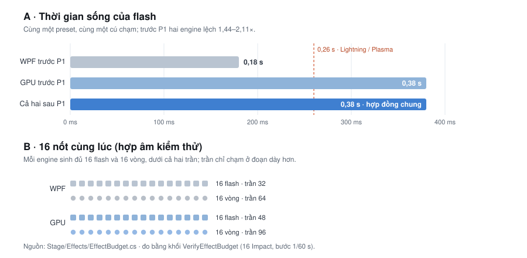

# Vẽ nốt và hiệu ứng — kiểm tra toàn bộ và danh sách việc cần làm

> **Ngày:** 2026-10-19 · **Nhánh:** `arena/efa69378-pianopath` · **Loại:** audit + kế hoạch, **không sửa mã sản phẩm**
> **Số đo tái tạo được:** `python3 tools/note_effects_report.py` (thêm `--check` để báo khi một hằng số đã đổi).
> **Liên quan:** [EFFECT-COVERAGE-AUDIT.md](EFFECT-COVERAGE-AUDIT.md) (87 mục, trạng thái từng family) ·
> [VISUAL-EFFECTS-MASTER-ROADMAP.md](VISUAL-EFFECTS-MASTER-ROADMAP.md) (phase và cổng phần cứng) ·
> [DAMPER-BAR-LIGHT-ANALYSIS.md](DAMPER-BAR-LIGHT-ANALYSIS.md) (D0–D3) ·
> [PARTICLE-MOTION-REVIEW.md](PARTICLE-MOTION-REVIEW.md) (W0–W3).
> **Prototype:** [note-view-lab](prototypes/note-view-lab/index.html) — ba panel WPF/GPU, AR phẳng, AR 3D,
> cùng một đồng hồ; 53 kiểm tra headless trong `tools/check_note_view_lab.cjs`.

## 0. Tóm tắt

1. **Hình học nốt của WPF và GPU giống hệt nhau**, nhưng **AR dùng quy ước khác**: một nốt trên phím trắng rộng
   **31,75 px (86% phím)** trong AR so với **17,45 px (47,3% phím)** trên stage ở 1920×1080 — **1,82×**.
   Trên phím đen thì ngược lại: stage 90,9%, AR 86%. **N1 đã chốt:** giữ lane cho stage và kẹp ở 98% phím đen;
   ở 100% nốt còn **18,82 px**, không còn tràn 13,6%.
2. **Thanh nốt dài đã được sửa (N2):** bỏ clamp `0,9·hitY`; nốt 4 s là thanh **4,00 s ở cả 900p, 1080p và
   1440p**, chỉ phần viewport nhìn thấy khác nhau; trần an toàn **20 s**. Trước sửa, cùng nốt đó chỉ còn
   2,50/3,00/4,00 s tùy khung. AR vẫn cắt ở **3,0 s** vì đó là *vùng nhìn* (reach), không phải giới hạn duration.
3. **AR mặc định là đường phẳng** (`ArNotesInPerspective = false`): trail, ghost, landing glow, nhãn nốt và
   min-aspect **không chạy** dù setting đang bật; chỉ pulse, shimmer và vật liệu nốt hoạt động. **Đã chốt (b):**
   giữ phẳng làm mặc định vì không cần calibration, và tooltip giờ nói rõ lớp phẳng bỏ qua những gì; 3D là đường
   khuyến nghị khi đã calibration.
4. **Ngân sách hiệu ứng: một hợp đồng, hai trần (N5 đã xong)**: hạt tối đa vẫn **2.600 (WPF) vs 24.000 (GPU)** —
   9,23× vì mỗi hạt WPF là một `Drawing`; vòng sóng **64 vs 96** và flash **32 vs 48** cũng giữ nguyên vì đó là
   ngân sách khung hình. Nhưng **thời gian sống đã thống nhất**: flare **0,38 s**, Lightning/Plasma **0,26 s** ở
   cả hai engine (trước đây WPF 0,18/0,30). Khi chạm trần, cả hai cùng **bỏ cái cũ nhất**.
5. **Độ phủ hiệu ứng đã rộng nhưng bằng chứng còn mỏng**: 87 mục, 86 `Available`, 1 `Planned`; AR có 24 family
   (6 `Native`, 14 `Unverified`, 4 `Unsupported`); kiểm thử theo family, chưa theo từng option; cổng phần cứng
   vẫn chưa đạt.
6. **Những thứ đang tốt, không nên phá**: bảng màu nốt dùng chung (`GpuLook.NoteColor` lấy từ stage), vật liệu
   nốt dùng chung `ShadeNoteMaterial` cho stage và AR, công thức hình học WPF/GPU trùng nhau, brush/pen đã được
   cache, seed tất định. Vấn đề nằm ở **hợp đồng giữa các đường vẽ**, không phải ở chất lượng một đường.

**Trạng thái P0:** N1 và N2 **đã sửa** trong mã sản phẩm (helper `Stage/NoteGeometry.cs`, test
`tests/PianoPath.Tests/NoteGeometryTests.cs`). N3 **đã chốt (b)** và sửa ở mức cảnh báo. N4 **đã chốt là khác
biệt có chủ ý** (0,35 s cho thanh phẳng nằm trên phím, 3,0 s cho thanh 3D bay vào chiều sâu). D0 bước 1–3 **đã
vào mã**: CC64 liên tục tới hình, đường cong cơ học 0–25% chết / đầy ở 50%, Pedal Glow sáng theo mức pedal và
một bộ làm mượt 55/75 ms dùng chung. D1 **đã vào mã**: lõi dải AR chạy theo lift, vạch WPF và halo GPU nhích
lên cùng quy ước. D2 **đã vào mã**: mỗi phím có một ô LED và một pin trong dải AR (kind 12), tối đa 265 quad,
tắt cùng dải ở Lite. D3 **đã vào mã**: lõi chỉ vượt ngưỡng bloom 1,8 từ lift 0,74 (CC64 ≈ 53, ~42% hành trình),
và dải/ô/pin thở ±2% ở 0,7 Hz khi pedal giữ (tắt theo Reduced Motion).

## 1. Đã kiểm tra gì

Đã đọc và đối chiếu:

- **WPF:** `Stage/PianoStage.cs` — `DrawNotes` (:1227), `DrawConfiguredNote` (:1265), `DrawFallingTrail` (:2162),
  `DrawNoteGhosts` (:2281), `DrawHoldBar` (:2303), `DrawElectricArcs` (:2313), `DrawLiveTrails` (:1771),
  `SpawnImpactMorph` (:388), `DrawRings`/`DrawFlashes`/`DrawSparks`; cache brush/pen (:3451, :3459).
- **GPU:** `Gpu/GpuStageSimulation.cs` — `GpuSceneLayout` (:32), `BuildNotes` (:623), `AddNoteWithFx` (:720),
  `AddNote` (:734), `BuildKeys` (:757), `Impact` (:530), `BuildSprites` (:814); `Gpu/GpuStageRenderer.cs`
  (uniform note: :734–749); `Gpu/StageShaders.hlsl` — `PsNote`/`ShadeNoteMaterial` (:1040–1230), `PsArQuad`
  (:681–760); `Gpu/GpuLook.cs` (giá trị chuẩn hoá :379–386).
- **AR:** `Camera/ArProjection.cs` — `ArNoteStyle` (:105), `ArNotes.Build` (:169), `ArNotes.BuildLive` (:210);
  `Camera/Ar3DNoteProjection.cs` — `Build` (:66), `BuildLive` (:119), `BuildRisingMidiNotes` (:170);
  `Camera/ArNoteMinimum.cs`; `Camera/ArOptions.cs` (:54–120); `Gpu/GpuArLayer.cs` (:146–240).
- **Hợp đồng/hiệu ứng:** `Stage/Effects/EffectCatalog.cs` (87 mục), `EffectContracts.cs` (24 family, chi phí,
  binding), `docs/EFFECT-COVERAGE-AUDIT.md`, `docs/NOTE-MATERIAL-GPU-BENCHMARK.md`,
  `docs/VISUAL-EFFECTS-MASTER-ROADMAP.md`.
- **Đo:** `tools/note_effects_report.py` đọc hằng số trực tiếp từ các tệp trên, in bảng và `--check` 23 giá trị
  ghim. Không có `dotnet` trong môi trường này nên **không build, không chạy app, không chụp màn hình**.

Giới hạn: số px tính với layout 88 phím, `KeyboardScale = 100`, 1 DIP = 1 px; cửa sổ 16:9. Các kết luận về
"nhìn thấy gì" là suy ra từ công thức, không phải ảnh chụp. Trạng thái AR/CI lấy từ tài liệu audit, không chạy lại.

## 2. Ba đường vẽ nốt, trong một bảng

| | WPF | GPU | AR phẳng (mặc định) | AR 3D (bật "Notes in perspective") |
|---|---|---|---|---|
| Hàm dựng | `DrawNotes` :1227 | `BuildNotes` :623 | `ArNotes.Build` :169 | `Ar3DNoteProjection.Build` :66 |
| Bề rộng | `min(lane · pct, 0,98·phím đen)` :1234 | như WPF :633 | `span(phím) · 0,86` | `span(phím) · 0,86` |
| Chiều cao | `max(min(dur, 20)·speed − gap, 16)` :1242 | như WPF :650 | `dur·1,5 − 0,015`, min 0,06 key-depth | tự nhiên + min-aspect, cắt tại reach |
| Tốc độ | `258 · NoteFallSpeed/550` | như WPF | 1,5 key-depth/s | 1,5 key-depth/s |
| Lookahead | `hitY / speed` = **2,77–4,70 s** | như WPF | `ArLookahead` = **3,0 s** | 3,0 s |
| Fade vào | **6% đầu của roll** (N7) | **6% đầu của roll** (N7) | 25% cuối của reach | 25% cuối của reach |
| Vật liệu | 6 style + satin | `ShadeNoteMaterial` | `ShadeNoteMaterial` | `ShadeNoteMaterial` |
| Trail/ghost/landing | có | có | **không** | có |
| Shimmer | **không** | có | có | có |
| Nhãn nốt | có | có | **không** | có |
| Min-aspect | không áp dụng | chỉ khi AR 3D | **không** | có |
| Live bar sau khi buông | trôi tới mép | trôi tới mép | **0,35 s rồi mất** | **3,0 s** |

Hai điểm quan trọng rút ra từ bảng: (a) WPF và GPU là **cùng một mô hình**, chỉ khác ngân sách hiệu ứng;
(b) AR có **hai mô hình** (phẳng và 3D) khác nhau cả về hình học lẫn hiệu ứng, và mô hình mặc định là mô hình
nghèo hơn.

## 3. Số đo

### 3.1 Kích thước và thời gian theo cửa sổ

`keyTop = H − clamp(max(110, min(228, 0,205·H))·KeyboardScale/100, 80, 300)`;
`lane = W / 88`; `speed = 258·NoteFallSpeed/550`.

| Khung | keyTop | lane | nốt stage (80%) | % phím trắng | % phím đen | nốt AR (phím trắng) | lookahead | trần thanh (sau N2) |
|---|---|---|---|---|---|---|---|---|
| 900p (1600×900) | 715,5 | 18,18 | 14,55 | 47,3% | 90,9% | 26,46 | 2,77 s | **20,00 s** |
| 1080p (1920×1080) | 858,6 | 21,82 | 17,45 | 47,3% | 90,9% | 31,75 | 3,33 s | **20,00 s** |
| 1440p (2560×1440) | 1212,0 | 29,09 | 23,27 | 47,3% | 90,9% | 42,34 | 4,70 s | **20,00 s** |

Đơn vị px (DIP). Phím trắng rộng `W/52`, phím đen `0,52·W/52`. Trước N2, trần thanh phụ thuộc khung:
2,50 / 3,00 / 4,23 s (xem §3.3).

### 3.2 Cùng một phím, hai bề rộng

Ở 1920×1080, `NoteWidth = 80`:

| | Phím trắng | Phím đen |
|---|---|---|
| WPF/GPU (80% lane) | **17,45 px (47,3%)** | 17,45 px (90,9%) |
| AR (86% span) | **31,75 px (86,0%)** | 16,51 px (86,0%) |
| Chênh | AR **1,82×** rộng hơn | stage 1,06× rộng hơn |

Trước N1, kéo `NoteWidth` lên 100 cho nốt stage trên phím trắng 59,1%, trên phím đen **113,6%** (tràn sang hai
bên phím đen); AR vẫn 86% vì `WidthShare` bị chặn ở 0,86. Đây là **hai quy ước**: stage giữ bề rộng đều cho mọi
pitch, AR phủ theo phím thật. Tỉ lệ 1,82× là hệ quả của hai quy ước, không phải lỗi pixel. Sau N1, stage kẹp ở
98% phím đen nên 100% chỉ còn 18,82 px (59,1% phím trắng, 98% phím đen).

### 3.3 Nốt dài: thanh từng bị cắt ngắn (đã sửa)

Nốt **xuất hiện** ở đúng lookahead cho mọi độ dài (`bottom = 0` khi `start − position = hitY/speed`). Trước N2,
**chiều dài thanh** bị kẹp ở `0,9·hitY`. Nghĩa là phần đuôi của nốt dài không bao giờ được vẽ; thanh trông như
một nốt ngắn hơn. AR cắt đuôi tại `Reach = Lookahead·FallSpeed`, tức **3,0 s cố định**, và neo đuôi ở reach nên
thanh trượt vào từ xa thay vì mọc lên từ mép trên.

| Độ dài nốt | 900p: thanh dài | 1080p | 1440p | AR | Ghi chú |
|---|---|---|---|---|---|
| 0,5 s | 0,50 | 0,50 | 0,50 | 0,50 | đủ |
| 2 s | 2,00 | 2,00 | 2,00 | 2,00 | đủ |
| 3 s | 2,50 (**hụt 0,50**) | 3,00 | 3,00 | 3,00 | 900p cắt sớm |
| 4 s | 2,50 (**hụt 1,50**) | 3,00 (**hụt 1,00**) | 4,00 | 3,00 (**hụt 1,00**) | 3/4 khung hụt |
| 6 s | 2,50 (**hụt 3,50**) | 3,00 (**hụt 3,00**) | 4,23 (**hụt 1,77**) | 3,00 (**hụt 3,00**) | chỉ 1440p gần đủ |

Hệ quả phụ: thanh dài tối đa chạm `0,1·hitY` phía dưới mép trên tại lúc chạm phím, nên **10% trên cùng của
stage không bao giờ có đuôi nốt**; nốt ngắn hơn thì đuôi nằm thấp hơn nữa. Đây là lý do nên bỏ hẳn clamp theo
`hitY` thay vì chỉnh nó.

**Sau khi sửa (N2):** chiều cao không còn phụ thuộc `hitY`; bảng dưới là cùng các nốt đó, và 10% trống biến mất.
AR vẫn 3,0 s vì reach là giới hạn *nhìn*, nhưng được ghi rõ trong tooltip/tài liệu thay vì ngầm hiểu.

| Độ dài nốt | 900p | 1080p | 1440p | AR (reach 3,0 s) |
|---|---|---|---|---|
| 4 s | **4,00** | **4,00** | **4,00** | 3,00 (cắt 1,00) |
| 6 s | **6,00** | **6,00** | **6,00** | 3,00 (cắt 3,00) |
| 30 s | **20,00** (trần) | **20,00** | **20,00** | 3,00 (cắt 27,00) |

### 3.4 Ngân sách hiệu ứng

Từ P1, **thời gian sống là hợp đồng chung** (`Stage/Effects/EffectBudget.cs`), còn **trần số lượng là ngân sách
khung hình của từng renderer**. Một hạt WPF là một `Drawing`, một hạt GPU là một điểm trong một lệnh instanced
duy nhất: cùng một trần sẽ hoặc làm chậm máy yếu, hoặc bỏ phí GPU.

| | WPF | GPU | Ghi chú |
|---|---|---|---|
| Hạt tối đa | **2.600** (`WpfParticleCap`) | **24.000** (`GpuParticleCap`) | 9,23×, giữ nguyên |
| Vòng sóng tối đa | 64 (`WpfRingCap`) | 96 (`GpuRingCap`) | ngân sách khung hình |
| Flash tối đa | 32 (`WpfFlashCap`) | 48 (`GpuFlashCap`) | ngân sách khung hình |
| Flash sống | **0,38 s** flare / **0,26 s** Lightning, Plasma | như WPF | **đã thống nhất** (trước: 0,18 / 0,30) |
| Khi chạm trần | bỏ cái **cũ nhất** | bỏ cái **cũ nhất** | nốt mới nhất luôn có hiệu ứng |

Ở kịch bản 16 nốt cùng lúc, cả hai engine đều ở **16 flash và 16 vòng** — dưới cả hai trần — nên phần flash và
vòng giống nhau; khác biệt chỉ còn ở đoạn dày hơn (glissando), nơi WPF cần trần thấp hơn để giữ 60 fps. Hạt vẫn
có trần riêng theo ngân sách khung hình, và đó là lý do bảng này tồn tại.

### 3.5 AR: phẳng vs 3D

| | AR phẳng | AR 3D |
|---|---|---|
| Release live bar | 0,35 s (`ArProjection.cs:159`) | 3,0 s (`ArOptions.cs:54`) — **8,6×** |
| Min-aspect | không | có |
| Nhãn nốt | không | có |
| Ghost/trail/landing | không | có |
| Cắt nốt trùng pitch | không | có |
| Vật liệu 6 style | có | có |

## 4. Phát hiện và việc cần làm

### P0 — hợp đồng và lỗi nhìn thấy được

#### N1. Cùng một chữ "Note width", hai quy ước khác nhau

- **Hiện tượng:** stage dùng `lane = width/88` nên ở 80% nốt rộng **47,3% phím trắng** nhưng **90,9% phím đen**;
  AR dùng span thật của từng phím nên cả hai đều **86%**. Ở `NoteWidth = 100`, nốt stage trên phím đen tràn
  **13,6%** ra ngoài; AR vẫn 86% (bị chặn bởi `WidthShare`). Không có gì "sai" về mặt toán, nhưng cùng một nhãn
  setting lại có hai nghĩa, và giới hạn trên của slider không an toàn.
- **Nguồn:** `lane = width / KeyCount` (`PianoStage.cs:710`, `GpuStageSimulation.cs:40`) rồi nhân `NoteWidth/100`
  (`PianoStage.cs:1234`, `GpuStageSimulation.cs:633`); AR dùng `layout.Span(pitch) · WidthShare` (`ArProjection.cs:191`).
- **Đã chốt và đã sửa:** stage giữ bề rộng đều theo lane, kẹp `min(lane·pct, 0,98·phím đen)` trong helper
  `Stage/NoteGeometry.cs`; WPF và GPU cùng gọi helper. Ở 100% nốt còn **18,82 px = 98% phím đen** (trước sửa
  21,82 px, tràn 13,6%). AR giữ nguyên `0,86·span`; "Fit keys" không làm cho stage.
- **Đã làm:** tooltip mới ở cả hai bảng Strings: "% của lane trung bình, tối đa 98% phím đen; 80% ≈ 47% phím
  trắng và 91% phím đen; AR phủ 86% mỗi phím". Unit test `NoteGeometryTests` ghim 80/100% ở cả 900/1080/1440p
  và mốc kẹp 86/87% ở 1080p.
- **Nghiệm thu:** `NoteWidth = 100` không tràn phím trên stage; nhãn UI khớp công thức; lab mặc định chế độ
  "đã sửa" và vẫn cho chọn "trước sửa" để so sánh.
- **Xem trước:** [note-view-lab](prototypes/note-view-lab/index.html) — đổi "Quy ước bề rộng" giữa Lane, Lane + kẹp,
  Theo phím.
- **Cỡ:** S (kẹp + nhãn) / M (Fit keys) · **Phụ thuộc:** không.

#### N2. Thanh nốt dài bị cắt ngắn, độ cắt đổi theo cửa sổ

- **Hiện tượng (trước sửa):** bảng §3.3. Nốt 4 s chỉ vẽ dài 2,5 s ở 900p, 3,0 s ở 1080p, 4,0 s ở 1440p; AR cắt ở 3,0 s.
  Nốt vẫn vào đúng lookahead, nhưng phần đuôi (thời gian còn lại) không bao giờ hiện, và 10% trên cùng của
  stage trống ở thời điểm chạm phím.
- **Nguồn:** `Math.Clamp(..., hitY * .9)` (`PianoStage.cs:1242`, `GpuStageSimulation.cs:650`); AR cắt tại
  `Reach` (`ArNotes.Build` :201–203, `Ar3DNoteProjection.Build` :98–105) và neo đuôi khác.
- **Đã sửa:** bỏ clamp theo `hitY` ở cả WPF/GPU; chiều cao là
  `max(min(duration, MaxNoteSeconds)·speed − gap, NoteMinLength)` trong `NoteGeometry.Height`. Trần
  **`MaxNoteSeconds = 20 s`** (người dùng đã duyệt), không chia sẻ với AR: AR giữ `Reach = 3,0 s` vì đó là
  **vùng nhìn** chứ không phải giới hạn duration — khác biệt có chủ ý, đã ghi trong tooltip/tài liệu.
- **Nghiệm thu:** nốt 4 s và 6 s ở 900p/1080p/1440p cho thanh 4,00/6,00 s giống nhau; nốt 30 s dừng ở 20,00 s;
  đầu nốt vẫn vào đúng lookahead; không còn 10% trống; unit test `NoteGeometryTests` ghim các mốc này.
- **Xem trước:** [note-view-lab](prototypes/note-view-lab/index.html) — đổi 900p/1080p/1440p và nhìn dòng
  "thanh 4 s →" của panel stage.
- **Cỡ:** M · **Phụ thuộc:** N1 (cùng đụng `DrawNotes`/`BuildNotes`).

#### N3. AR mặc định (phẳng) làm rơi hiệu ứng nốt mà không báo

- **Hiện tượng:** `ArNotesInPerspective = false` mặc định (`PianoVisualSettings.cs:463`). Đường phẳng chỉ gọi
  `AddSongNote` (`GpuArLayer.cs:170–178`), không gọi `BuildProjectedSongNoteEffects` (:159) nên **trail, ghost,
  landing glow, nhãn nốt, min-aspect, cắt nốt trùng pitch** đều không có. `ShowNoteLabels` bật cũng không hiện.
  (Shimmer thì vẫn có: `AddSongNote` tự gọi `AddNoteShimmer` — xem bảng §2.)
- **Nguồn:** nhánh projected `:149–168` (gọi `BuildProjectedSongNoteEffects` :159) vs nhánh phẳng `:170–178`
  (chỉ `AddSongNote`); `ArNotesProjected => ArNotesInPerspective` (`PianoVisualSettings.cs:596`).
- **Đã chốt (b) và đã sửa:** các control chỉ có ở 3D (tilt, azimuth, minimum length) đã bị ẩn khi
  `ArNotesProjected` tắt; tooltip "Notes in perspective" ở cả hai bảng Strings giờ nói rõ lớp phẳng **bỏ qua
  trail, ghost, landing glow và tên nốt**. Không đổi mặc định, không đổi hình ảnh của ai.
- **Còn lại (cần quyết định sản phẩm):** (a) bật 3D mặc định khi đã calibration — đổi hình ảnh của mọi người
  dùng AR; (c) cài hiệu ứng tương đương cho đường phẳng — nhiều việc nhất. Để sau, ghi ở N3.
- **Nghiệm thu:** mọi control bật mà không có tác dụng đều có ghi chú hoặc bị ẩn; tooltip khớp hành vi.
- **Xem trước:** [note-view-lab](prototypes/note-view-lab/index.html) — bật/tắt "Hiệu ứng AR 3D" để so panel phẳng.
- **Cỡ:** S cho (a)/(b), M cho (c) · **Phụ thuộc:** không.

#### N4. Release của live bar AR: 0,35 s hay 3,0 s?

- **Hiện tượng:** buông phím, AR phẳng giữ thanh thêm 0,35 s rồi bỏ; AR 3D cho thanh trôi hết reach = 3,0 s,
  cùng một setting. Chênh **8,6×**.
- **Đã chốt: giữ khác biệt có chủ ý.** Thanh phẳng nằm trên mặt phím; kéo dài 3 s sẽ giống phím bị kẹt. Thanh 3D
  rời khỏi phím và bay vào chiều sâu; 3,0 s là quãng đường của nó, không phải thời gian sống tuỳ ý. Hai đường
  không cần bằng nhau; tooltip/tài liệu ghi rõ để không ai đọc 8,6× như lỗi.
- **Nguồn:** `ArProjection.cs:159`, `ArNotes.BuildLive` :229–232 vs `Ar3DNoteProjection.BuildLive` :141–147;
  `LivePressReachSeconds = 3` (`ArOptions.cs:54`).
- **Đã ghi:** không thêm test parity cho hai con số này; test hiện có của mỗi đường giữ hành vi riêng. Nếu sau
  này muốn đổi, chỉ cần sửa `ArNotes.ReleaseLife` hoặc `ArOptions.LivePressReachSeconds`, không đụng hình học.
- **Cỡ:** S · **Phụ thuộc:** không.

### P1 — parity và chất lượng

#### N5. Ngân sách hiệu ứng khác nhau giữa WPF và GPU

- **Hiện tượng/số đo:** §3.4. Trước P1, preset dày (Concert Gold, Prism Flow) cho cảm giác khác khi tắt GPU;
  flash trên GPU sống lâu hơn **1,44–2,11×**.
- **Nguồn:** `Stage/Effects/EffectBudget.cs`; `PianoStage.cs:13`; `GpuStageSimulation.cs:60`.
- **Đã chốt (P1) — một hợp đồng, hai trần:** thời gian sống gom về `EffectBudget.FlareLifeSeconds = 0,38` và
  `StyledFlashLifeSeconds = 0,26`, dùng chung cho WPF và GPU; trần giữ nguyên theo từng backend (bảng §3.4) vì
  đó là ngân sách khung hình. Luật khi chạm trần thống nhất: **bỏ cái cũ nhất rồi thêm cái mới**, nên trần là số
  tối đa thật (WPF trước đây giữ được 33 flash / 65 vòng do so sánh lệch).
- **Không nâng trần WPF:** ở 16 nốt cùng lúc hai engine đã giống nhau; nâng 32→48 chỉ đổi hành vi ở glissando —
  nơi WPF chậm nhất — mà không thêm gì nhìn thấy. Muốn nâng phải có N9 đo trước.
- **Nghiệm thu:** `python3 tools/note_effects_report.py --check` ghim bảng §3.4 vào mã; `--verify` có khối
  `VerifyEffectBudget` (16 nốt ⇒ 16 vòng + 16 flash, flash tắt trước 0,40 s, vòng 0,55 s còn sống). Ảnh A/B
  dưới đây chú thích ngay trong hình: ba đường thời gian sống và số hiệu ứng của hợp âm 16 nốt so với hai trần.

- **Cỡ:** S (bảng) / M (đồng bộ) · **Phụ thuộc:** N9 chỉ còn cần nếu muốn nâng trần WPF.

#### N6. Hiệu ứng chỉ có trên GPU bị mất im lặng khi ghi/ở chế độ WPF

- **Hiện tượng:** `NoteShimmer`, `NoteLandingGlow`, `ShootingStars` không có đường WPF (`PianoStage.cs` không
  tham chiếu ba setting này). UI có ghi "(GPU stage)" nhưng preset vẫn bật chúng (`VisualPresets.cs:122`), và
  bản ghi/export dùng WPF fallback sẽ mất các hiệu ứng này mà không cảnh báo.
- **Nguồn:** `PianoVisualSettings.cs:153,207`; `GpuStageSimulation.cs:684,1146`; `Ui/MainWindow.Settings.cs:350,370,533`;
  `EffectContracts.cs` (hai family WPF `Unsupported`).
- **Đã chốt (b) và đã làm (P1):** `GpuOnlyEffects.Omitted` liệt kê ba hiệu ứng đang bật; dòng "Next recording"
  thêm câu **"Software frames leave out …"** khi take sẽ do software vẽ, và lúc bắt đầu ghi ghi đúng câu đó vào
  `Trace`. Không khoá toggle: cùng preset vẫn có thể chiếu bằng GPU, chỉ bản ghi software/alpha mất ba hiệu ứng.
- **Test:** `GpuOnlyEffectsTests` (3 Fact) ghim danh sách và thứ tự trên nửa thuần của helper; việc Landing glow
  mặc định phải được báo nằm trong `--verify` (`VerifyVisualSettings`) vì nó cần kiểu settings WPF;
  chuỗi UI có trong cả hai bảng Strings.
- **Còn lại (thủ công):** quay 5 s từ WPF fallback với ba toggle bật, xác nhận dòng recording + log. Không chạy
  được trong CI headless vì cần WPF và một bộ ghi thật.
- **Cỡ:** M · **Phụ thuộc:** không.

#### N7. Nốt vào màn hình bằng một lát cắt cứng, không fade

- **Hiện tượng:** nốt xuất hiện dưới dạng một lát mỏng bị clip ở `y = 0`, không có alpha ramp; ở 60 fps,
  `258 px/s` = 4,3 px/frame nhưng `NoteFallSpeed = 1000` = 7,8 px/frame; ở 30 fps là 15,6 px/frame. AR có fade
  25% reach (~0,75 s) nên mềm hơn nhiều. Đây là **đánh bóng**, không phải lỗi hợp đồng: nốt vẫn vào đúng
  lookahead (xem N2) và không có chuyện "pop" toàn thanh.
- **Nguồn:** `DrawNotes` :1248–1260 (không alpha theo mép), AR `fade` :111.
- **Đã làm (P1):** `NoteGeometry.EnterFadeShare = 0,06` và `EnterFadePixels(hitY)`; WPF đẩy một
  `PushOpacityMask` tuyến tính **chỉ cho nốt chạm dải trên** (16 DIP dư để bloom cùng mờ), GPU nhân alpha trong
  `PsNote` theo `ScreenTime.w`; cả hai dùng đúng 6% nên hình khớp. Thời điểm/chiều cao/tốc độ không đổi.
  Ở 1080p dải mờ là **51,5 px** (900p 42,9; 1440p 72,7); nốt 258 px/s đi qua trong ~0,2 s, nốt 1000 px/s trong
  ~0,05 s. Nốt đi lên (Direction = Up) cũng mờ dần khi rời mép trên.
- **Kiểm:** `NoteGeometryTests` ghim dải mờ ở 900/1080/1440p và sàn 1 px; `note_effects_report.py --check` đọc cả
  `EnterFadeShare` lẫn hằng 0,06 trong shader, nên hai bên không lệch được.
- **Còn lại (thủ công):** quay 1000% ở 30/60 fps, so sánh trước/sau ở 3 tốc độ (cần máy build được WPF + GPU).
  Motion blur theo `fall speed` vẫn để sau, không thuộc N7.
- **Cỡ:** S · **Phụ thuộc:** N2 (cùng sửa đường vẽ nốt).

#### N8. Refraction và texture chưa tương đương giữa WPF và GPU

- **Hiện tượng:** WPF vẽ viền khúc xạ màu cho Crystal/Glass (`PianoStage.cs:1416`); shader GPU **không** dùng
  `NoteRefraction` cho viền này — hợp đồng ghi rõ "WPF paints the crystal's refraction fringe; the GPU branch does
  not consume it" (`EffectContracts.cs:345`). Texture lửa/satin cũng là hai cách dựng khác nhau.
- **Việc cần làm:** hoặc thêm fringe vào shader (một nhánh nhỏ trong `ShadeNoteMaterial`), hoặc đổi nhãn control
  thành "WPF" và bỏ khỏi preset GPU; ghi bảng khác biệt có chủ đích.
- **Nghiệm thu:** ảnh 6 style × 3 mức `NoteRefraction`, có bảng "giống/khác có chủ ý".
- **Cỡ:** M · **Phụ thuộc:** N9.

#### N9. Chưa có benchmark khung hình cho nốt/hiệu ứng

- **Hiện tượng:** chỉ có benchmark GPU cho **một nốt tĩnh** (p95 0,02356 / 0,02688 / 0,0268 ms cho Solid/Gem/
  Crystal); WPF, AR, recording và nhiều nốt đồng thời đều `Unmeasured`.
- **Nguồn:** `docs/NOTE-MATERIAL-GPU-BENCHMARK.md`; `EffectContracts.cs` (`GpuStage = Measured`, còn lại `Unmeasured`).
- **Việc cần làm:** thêm probe khung hình: 3 độ phân giải × 1/20/60 nốt × (trail/ghost/landing bật/tắt), đo p95
  CPU+GPU; ghi vào contract. Đặc biệt kiểm tra 4 lớp bloom của WPF (mỗi nốt 4 hình bo tròn, :1290–1295).
- **Nghiệm thu:** bảng p95 cho 12 tổ hợp; xác định ngưỡng số nốt mà WPF tụt dưới 60 fps.
- **Cỡ:** M · **Phụ thuộc:** không.

#### N10. AR vẽ hiệu ứng lên tay người chơi

- **Hiện tượng:** không có mask tay; hạt/beam/flash nằm trên ảnh camera và có thể vẽ xuyên qua bàn tay. Roadmap
  AR đã ghi yêu cầu occlusion.
- **Nguồn:** `docs/AR-OVERLAY-ROADMAP.md`; `GpuArLayer` không có depth/mask pass.
- **Việc cần làm:** dùng mask tay/độ tin cậy; nếu chưa có, hạ hiệu ứng xuống sau vùng phím thay vì vẽ xuyên.
- **Nghiệm thu:** video 10 s có tay che phím; không có hạt nào nằm trên da.
- **Cỡ:** L · **Phụ thuộc:** camera/ML mask.

#### N11. Accessibility: chưa có "giảm chuyển động/giảm flash" toàn cục

- **Hiện tượng (theo audit gốc):** từng effect có thể tắt riêng, nhưng không có một công tắc chung; flash dày,
  24.000 hạt, pulse và shimmer có thể gây mỏi mắt/nhạy cảm.
- **Nguồn:** `docs/VISUAL-EFFECTS-MASTER-ROADMAP.md` §5.12; `Stage/Effects/AccessibilityContracts.cs`.
- **Thực tế khi làm P1:** phần runtime **đã có trong mã** — ba toggle (Reduced motion, Reduce flashes, High
  contrast) ở `MainWindow.Settings.cs:965–967`, resolver theo family trong `Stage/Effects/AccessibilityContracts.cs`,
  và `WithAccessibilityTogglesApplied` (PianoStage áp một lần nên GPU/AR thừa hưởng). Audit gốc coi là chưa có; việc
  còn thiếu thật sự là **bằng chứng ở mức preset** và chốt tần số.
- **Đã làm:** `MotionBudget` gom nhịp pulse của nốt (`1,5 + 9·rate` rad/s) cho WPF/GPU/AR — nhanh nhất **1,67 Hz**,
  dưới mốc 3 Hz (`MotionBudgetTests`, 2 Fact); `VerifyAccessibilityTogglePolicy` quét **cả 14 preset built-in**:
  Reduced motion tắt pulse, vibration, colour cycle, breath, shimmer, sao băng, halo, sao/mote/beam và bốn lớp
  ambient, background về `None`; Reduce flashes tắt hẳn impact flash; hai toggle **idempotent**, và nốt vẫn rơi
  đúng `NoteFallSpeed`/`NoteDirection`/`ShowNotes`.
- **Ghi chú:**`CopyFrom` vẫn mang ba toggle khi áp preset (vì cùng hàm đó khôi phục undo); muốn tách chúng thành
  thuộc tính của máy thì phải thêm tham số riêng cho đường preset và kiểm lại undo — để đợt sau, không gộp vào N11.
- **Nghiệm thu:** mọi preset sau khi bật toggle không còn kênh nhấp nháy >3 Hz; 2 Fact cho nhịp pulse + vòng quét
  14 preset trong `--verify`; round-trip settings do cùng vòng quét giữ.
- **Cỡ:** S (kiểm chứng) · **Phụ thuộc:** không.

#### N12. Bằng chứng hiệu ứng mới ở mức family, chưa mức option

- **Hiện tượng:** 87 mục, 86 `Available`, 1 `Planned`; AR 24 family (6 `Native`, 14 `Unverified`, 4
  `Unsupported`: `falling.trail`, `falling.pulse`, `falling.shimmer`, `atmosphere.stars`). Audit ghi nhiều assertion
  mới **chưa chạy trên Windows CI**; kiểm thử chỉ theo family/giá trị đại diện.
- **Nguồn:** `docs/EFFECT-COVERAGE-AUDIT.md` §2, §6; `EffectContracts.cs`.
- **Việc cần làm:** (a) chạy lại CI Windows cho các assertion đang chờ; (b) sinh ma trận capture cho từng option
  (ít nhất default + một cực trị) và lưu ảnh/checksum; (c) đưa trạng thái AR 4 family `Unsupported` lên UI hoặc
  implement.
- **Nghiệm thu:** mỗi ID có ảnh/kiểm tra; CI xanh; không còn dòng "chờ chạy".
- **Cỡ:** L · **Phụ thuộc:** N9.

### P2 — nhất quán và tài liệu

#### N13. Lookahead stage và AR lệch nhau

- **Hiện tượng:** stage nhìn trước 2,77–4,70 s tuỳ cửa sổ; AR cố định 3,0 s (`ArLookahead`). Ở 1440p nốt stage
  xuất hiện sớm hơn AR 1,7 s.
- **Việc cần làm:** nếu người dùng chuyển qua lại AR/stage, suy ra tốc độ stage từ lookahead (hoặc ngược lại);
  nếu không, ghi rõ "lookahead của AR là riêng".
- **Nghiệm thu:** cùng bài, cùng setting: thời điểm nốt xuất hiện ở hai chế độ lệch ≤0,1 s.
- **Cỡ:** S · **Phụ thuộc:** N2.

#### N14. Nhãn nốt ở AR phẳng và độ dễ đọc

- **Hiện tượng:** `ShowNoteLabels` chỉ có ở AR 3D; WPF/GPU có ngưỡng `w≥11, h≥15`, không có kiểm tra tương phản.
- **Việc cần làm:** hiện nhãn ở phẳng hoặc vô hiệu hoá; kiểm tra cỡ chữ/tương phản trên nền camera sáng.
- **Nghiệm thu:** ảnh 3 nền (tối/trung bình/sáng), đọc được tên nốt.
- **Cỡ:** S · **Phụ thuộc:** N3.

#### N15. Nợ tài liệu và trạng thái

- **Hiện tượng:** audit còn câu "chờ CI", một số bảng đếm theo ngày. (Link từ hai roadmap đã thêm trong lần này;
  phần còn lại vẫn mở.)
- **Việc cần làm:** cập nhật `EFFECT-COVERAGE-AUDIT.md` sau mỗi lần chạy CI; giữ
  `tools/note_effects_report.py --check` trong CI tĩnh cùng `tools/check_sources.py`.
- **Cỡ:** S.

## 5. Danh sách hợp nhất

Ngoài 15 việc trên, đây là các việc đã có kế hoạch ở tài liệu khác — gộp vào cùng một thứ tự để không làm chồng.

| ID | Việc | Kết quả cần đạt | Cỡ | Nguồn |
|---|---|---|---|---|
| N1 | Chốt quy ước bề rộng, kẹp tràn | **đã xong**: lane + kẹp 98% phím đen, tooltip mới, test | S/M | tài liệu này |
| N2 | Bỏ clamp `0,9·hitY`, chốt `MaxNoteSeconds` | **đã xong**: trần 20 s, thanh 4 s = 4,00 s ở mọi khung | M | tài liệu này |
| N3 | AR phẳng: bật 3D mặc định hoặc vô hiệu hoá control | **đã chốt (b)**: giữ phẳng mặc định, ẩn control 3D, tooltip nói rõ; (a)/(c) để sau | S/M | tài liệu này |
| N4 | Thống nhất release live bar AR | **đã chốt: khác có chủ ý** — 0,35 s phẳng, 3,0 s 3D | S | tài liệu này |
| N5 | Bảng ngân sách hiệu ứng WPF/GPU | **đã xong**: hợp đồng thời gian sống, bảng §3.4, tool + `--verify` ghim | S/M | tài liệu này |
| N6 | GPU-only effects khi ghi/ở WPF | **đã xong (b)**: cảnh báo ở dòng recording + log; 3 Fact + một assert `--verify` | M | tài liệu này |
| N7 | Fade mép trên/motion blur | **đã xong phần fade**: 6% roll, WPF mask + GPU shader, test + tool ghim; motion blur để sau | S | tài liệu này |
| N8 | Refraction/texture parity | bảng giống/khác có chủ ý | M | tài liệu này |
| N9 | Benchmark khung hình nốt/hiệu ứng | p95 12 tổ hợp, ngưỡng 60 fps | M | tài liệu này |
| N10 | Occlusion bàn tay AR | không vẽ xuyên tay | L | AR roadmap |
| N11 | Reduced Motion/giảm flash toàn cục | **đã xong**: hệ thống có sẵn từ Phase 2; P1 chốt tần số pulse 1,67 Hz + test toàn bộ preset | S | master roadmap |
| N12 | Ma trận capture từng option | 87 ID có ảnh; CI xanh | L | audit |
| N13 | Lookahead stage ↔ AR | lệch ≤0,1 s khi chuyển chế độ | S | tài liệu này |
| N14 | Nhãn nốt AR phẳng | đọc được trên 3 nền | S | tài liệu này |
| N15 | Nợ tài liệu/trạng thái | audit/roadmap khớp; tool trong CI | S | tài liệu này |
| D0 | CC64 liên tục vào hình | **đã xong**: 34 mức từ 128 giá trị CC64 (51 mẫu trên thang 0..1), dead zone 25%, đầy ở 50%, mượt 55/75 ms | S | DAMPER §7 |
| D1 | Lõi sáng chạy theo lift | **đã xong**: 8,2 px @45°, 6,6 px @90°; vạch WPF 6 px, halo GPU 5 px | S | DAMPER §7 |
| D2 | 88 ô LED + tick theo phím | **đã xong**: ô `0,70/0,46` phím, thân `0,05+0,42v`, mép `0,16+0,54v`; pin co theo phép chiếu (`≤15 px`, `≤2,4 px` ở 1080p) + crossbar, τ 30/40 ms; tối đa 265 quad, tắt ở Lite | M | DAMPER §7 |
| D3 | Bloom threshold, thở, màu | **đã xong**: `ignite` 1 → 2,4 (lõi 0,48 → 2,57; cắt ngưỡng 1,8 tại lift 0,74 ≈ CC64 53); breath ±2% @ 0,7 Hz, đúng 1 khi pedal lên, tắt theo `ReducedMotion`; pin giữ màu dải | S | DAMPER §7 |
| W0–W3 | Bốn lát cắt chuyển động hạt | theo bốn cổng trong PARTICLE-MOTION-REVIEW | M–L | PARTICLE §7 |
| H1 | Cổng phần cứng + Adaptive Quality | đạt 8 ms p95 trên iGPU/dGPU thật | L | MASTER §11 |
| H2 | Audio-reactive thật (FFT) | band/envelope có nguồn PCM, latency đo được | L | MASTER §5.12 |
| H3 | Dọn tài liệu/CI | hết "chờ chạy"; số đếm có ngày | S | audit |

## 6. Thứ tự đề xuất

**Đợt 1 — hợp đồng (khoảng 5–7 ngày):** N1 (chốt + preview), N2 (hàm thuần + test), N3, N4, D0, N15 (một phần).
Lý do: đây là những thứ người dùng nhìn thấy ngay, sửa nhỏ, và chặn các quyết định sau (bề rộng/độ dài là đầu vào
của benchmark và parity).

**Đợt 2 — parity và đo (khoảng 2 tuần):** N5, N6, N7, N8, N9, bắt đầu N12. Ở đợt này **không** thêm effect mới;
mục tiêu là làm cho ba đường vẽ kể cùng một câu chuyện và có số đo.

**Đợt 3 — trải nghiệm và phần còn lại (3–4 tuần):** N10, N11, N13, N14, D1–D3, W0–W3, H1–H2.

**Không nên làm bây giờ:** thêm ID hiệu ứng mới; đổi preset hàng loạt trước khi chốt N1/N2; ép parity pixel
WPF↔GPU (hai rasterizer khác nhau — chỉ nên ép timing, hình học, ngân sách); tối ưu AR trước khi có benchmark
khung hình.

## 7. Cách nghiệm thu

- **Unit test thuần:** tách `NoteGeometry` (bề rộng theo span, chiều cao theo chính sách N2) khỏi `DrawingContext`
  để test 88/76/61 phím × 900p/1080p/1440p × `NoteWidth` 30–100; AR flat/projected dùng cùng hàm.
- **Golden frames:** 6 style × 3 mức `NoteRefraction`; 4 đoạn MIDI (2/3/4/6 s) ở 3 khung; AR phẳng vs 3D.
- **Ngân sách:** **đã làm** — `tools/note_effects_report.py --check` đọc `EffectBudget.cs`; khối `VerifyEffectBudget` đo 16 nốt cùng lúc trên simulation thật.
- **Hiệu năng:** p95 khung hình 12 tổ hợp; ghi rõ CPU/GPU, WARP hay hardware.
- **AR/recording:** ảnh capture từng option; video 10 s có tay; bản ghi WPF fallback với 3 toggle GPU-only.
- **Tài liệu:** `python3 tools/note_effects_report.py --check` trong CI tĩnh cùng `tools/check_sources.py`.

## 8. Nguồn và độ tin cậy

| Điều | Nguồn | Tin được |
|---|---|---|
| Bề rộng/chiều cao/tốc độ/caps/flash life | mã nguồn, đọc trực tiếp | **cao** (số nguyên văn) |
| Số px và bảng nốt dài | công thức + layout 88 phím, 1 DIP = 1 px | **trung bình** (tính toán, chưa chụp) |
| AR phẳng thiếu hiệu ứng, release 0,35 vs 3,0 s | nhánh code + hằng số | **cao** |
| 87 mục/24 family/6-14-4/Unsupported | `EFFECT-COVERAGE-AUDIT.md` + `EffectContracts.cs` | **trung bình–cao** (tài liệu, chưa chạy lại CI) |
| Hiệu năng p95 | benchmark GPU một nốt tĩnh; WPF/AR chưa đo | **thấp cho khung hình** |
| "Nhìn thấy" khác nhau | suy ra từ hình học, không có ảnh chụp | **trung bình** |

Điểm phải nói rõ: mình **không chạy được app** trong môi trường này (không có `dotnet`), nên mọi kết luận về
trải nghiệm là từ mã + số đo, không phải từ video. Nếu cậu muốn, bước tiếp theo là dựng một trang so sánh
WPF/GPU/AR bằng chính các công thức này (giống lab hạt) để nhìn trước khi sửa mã sản phẩm.
