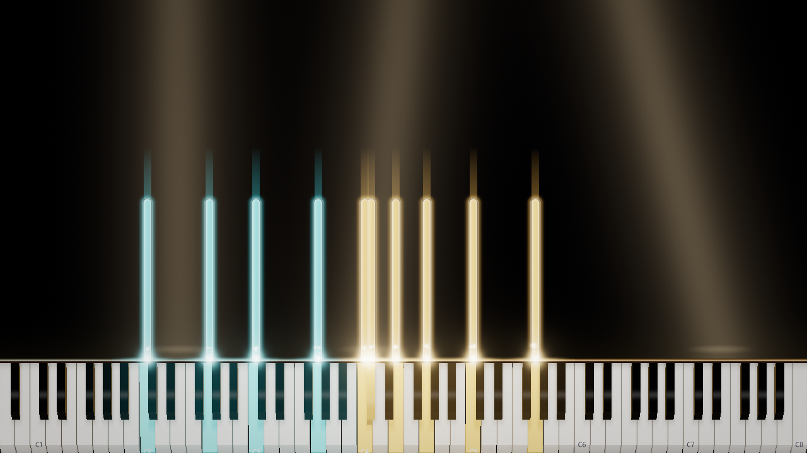
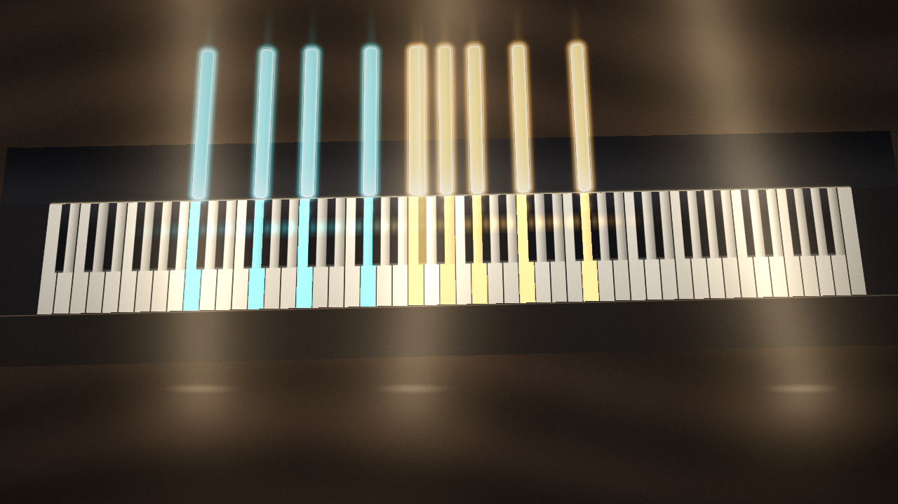
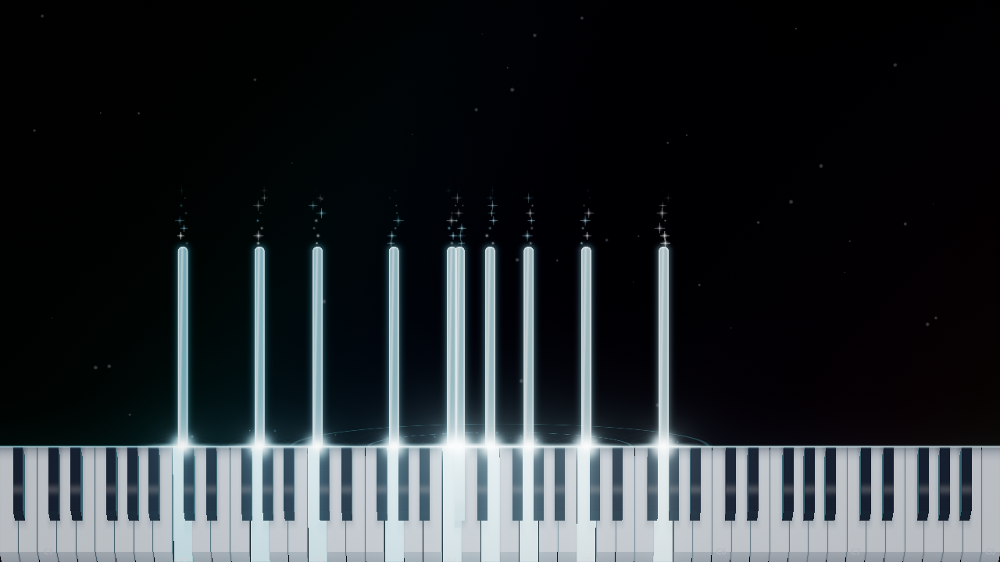
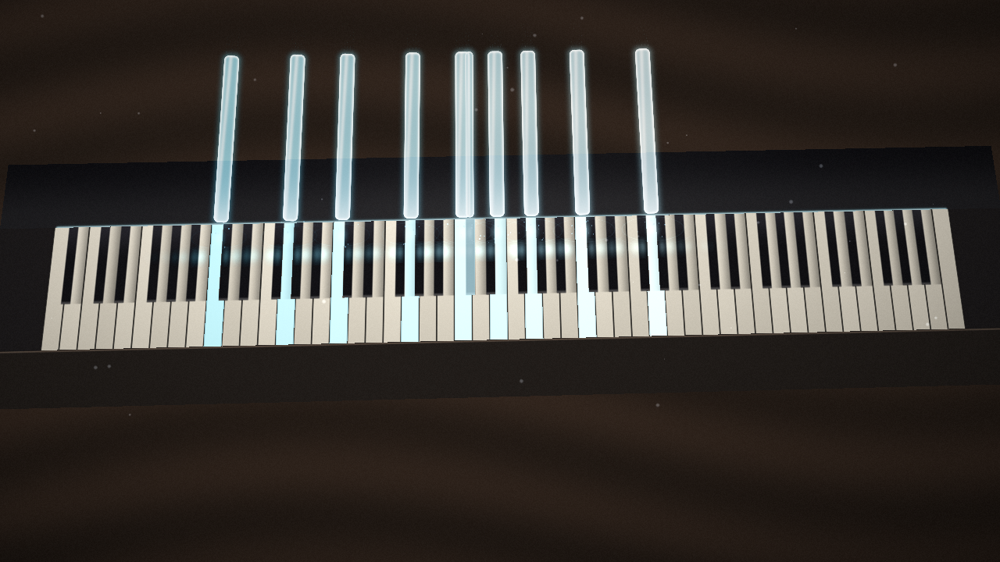
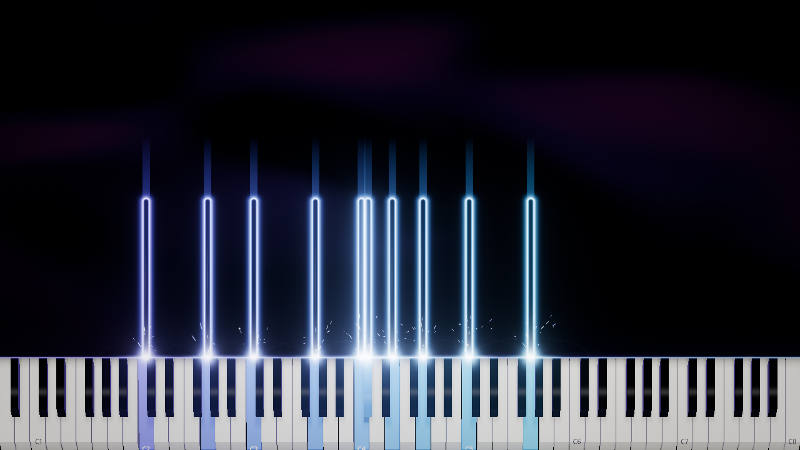
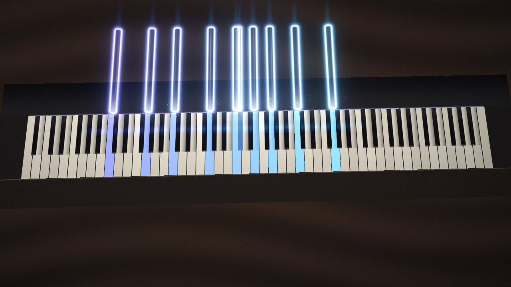

# P0 — Ảnh baseline thật của Live Stage và AR

> **Đây là diện mạo hiện tại, chưa phải Prism Flow mới.** Ảnh do ứng dụng render trên Windows/D3D11 WARP, không phải ảnh AI hoặc mockup.
> Nguồn: [CI run 38595904297](https://github.com/lxmtuu/PianoPath/actions/runs/38595904297), source commit `4478f93`; sáu ảnh đại diện được CI lưu ở preview commit `6138271`.
> Checkpoint `dense-chord`, 9.5 giây, 1280×720; cùng MIDI/seed. AR Ultra, camera bàn phím synthetic, delay=0, không mirror. Không phải test webcam/đàn thật.

> **Lưu ý ảnh tự cập nhật (2026-10-15):** các đường dẫn preview bên dưới hiện được render lại ở P3a, source `08c83b5` / ảnh `78d2d24`; sáu ảnh có hạt đã thay đổi sau sửa lịch phát/tín dụng. Các kết quả của run P0 trong tài liệu này là lịch sử; ảnh gốc nằm ở commit `6138271`. Xem [review P3a](KEY-PARTICLES-P3A-REVIEW.md) cho bằng chứng mới, không dùng ảnh hiện tại để xác nhận pixel hash cũ.

## Kết quả kiểm chứng

- Static checks, portable xUnit và Windows Release build: **PASS**.
- P0: **78 ảnh PASS**, gồm 72 baseline + sáu phase-FX-off controls; PNG round-trip, guard hình học và effect-presence checks đạt.
- Full Windows verification suite chạy riêng: **PASS — 3753 assertions, 1 skipped check group** (không coi nhóm skip là đã kiểm xong).
- Toàn CI workflow: **success**. Perf step dùng software rasterizer, không áp dụng hardware FPS budget và không chứng minh 60 FPS.
- Đã mở/xem sáu ảnh bên dưới; decode BGRA32 và đối chiếu SHA256 pixel: **6/6 khớp annotation CI**.
- Bộ 78 ảnh, manifest và HTML ở artifact `phase1-visual-review` → `prism-flow-p0`. Repo chỉ giữ sáu ảnh đại diện bên dưới, không lưu toàn bộ gallery lớn.
- PASS ở đây là đúng đường render/input/kiểm tra đã nêu; không phải visual sign-off, full style coverage, motion parity hay hardware FPS.

## 1. Concert Gold — control thân nốt đầy / hai màu theo tay

### Live Stage

### AR

**Nhận xét thiết kế:** hai họ cyan–gold dễ phân biệt; body nốt có màu. Ánh sáng sân khấu rộng xuất hiện cả trên nền camera, có thể tranh tiêu điểm. Prism Flow nên giữ điểm mạnh của body nhưng dùng nền/ambient tiết chế hơn, không sao chép toàn recipe Concert sang AR.

## 2. Ice Crystal — control vật liệu Glass hiện có

### Live Stage

### AR

**Nhận xét thiết kế:** thân bán trong suốt và viền đọc được trên camera, nhưng palette sáng hẹp và highlight nhạt khiến nhiều nốt khá gần trắng. Texture mới cần giữ pigment trong thân, không chỉ tăng viền/glow. Hạt và trang trí hiện tại chưa tạo silhouette của một dòng xoáy như hướng Prism Flow.

## 3. Neon Violet — control viền neon và sparks

### Live Stage

### AR

**Nhận xét thiết kế:** viền phát sáng rõ và màu phím có liên kết; sparks hiện đọc như tia ngắn quanh điểm chạm. Hình thức khung rỗng là tính cách của Neon, không nên sửa toàn cục thành kính đầy. Prism Flow cần recipe/material riêng nếu thử Solid/Glass không đủ; chuyển động dòng hạt phải được review bằng clip, không kết luận từ ảnh tĩnh này.

## Quyết định cho bước tiếp theo

1. Giữ ba control này làm đối chứng, không đổi default/preset cũ.
2. Thử palette nhiều stop trên body đầy; giảm nền trang trí và tách sức sáng thân–rim–halo để giữ màu.
3. Thiết kế texture local theo nốt, bảo toàn độ rõ ở AR; không dùng texture để chữa lỗi màu/composite.
4. Chốt và test semantics physical-held/sounding, delay và reset trước khi nâng toàn bộ emitter. Baseline này chưa đóng các mục đó.
5. Khi có bản thử mới, capture lại cùng fixture/seed ở hai mode, thêm nốt ngắn/dài và clip motion. Chưa tái thiết kế menu trong bước baseline.

Chi tiết phạm vi và lịch sử lỗi: [P0 Audit](PRISM-FLOW-P0-AUDIT.md). Kế hoạch toàn chương trình: [Design Roadmap](PRISM-FLOW-DESIGN-ROADMAP.md).
