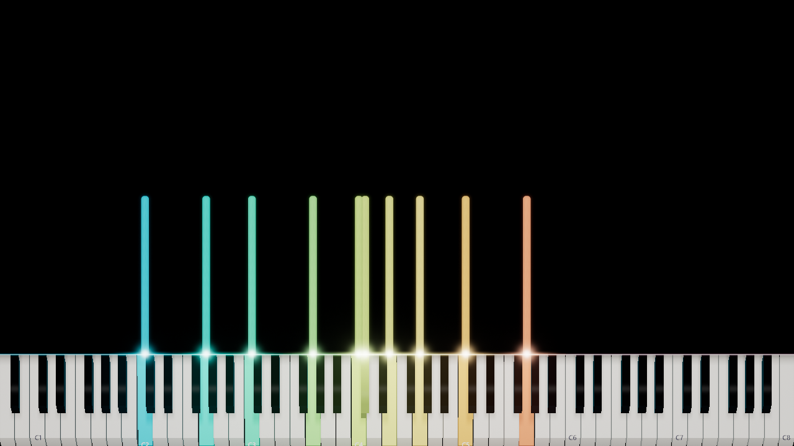
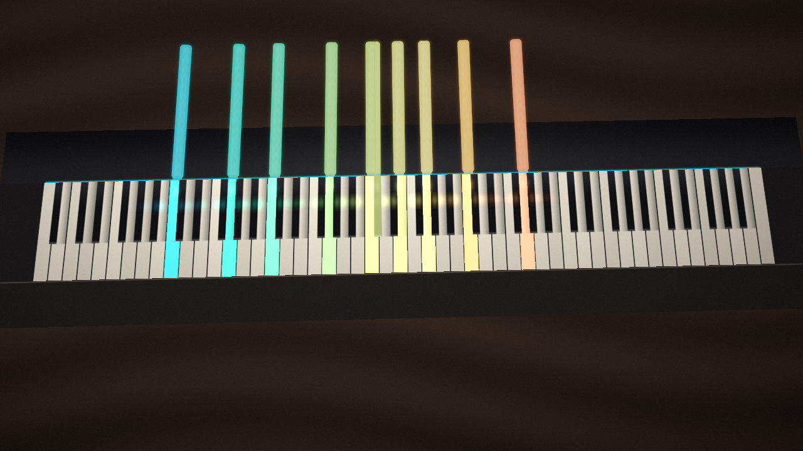

# Prism Flow Preview — ảnh thật sau bước palette / satin

> **Bản thử opt-in, chưa phải look hoàn thiện.** Ảnh render bằng ứng dụng trên Windows/D3D11 WARP, không phải mockup hoặc ảnh AI.
> [CI run 38601052995](https://github.com/lxmtuu/PianoPath/actions/runs/38601052995) — source `28bcab5`, preview commit `3b199cc`.

## Live Stage

## AR

Cùng fixture/seed với [P0](PRISM-FLOW-P0-REVIEW.md), checkpoint dense chord ở 9.5 giây, 1280×720. AR Ultra, camera synthetic, delay=0; không phải webcam/đàn thật.

## Nhìn thấy gì ở bản thử này?

- Dải cyan → mint → lime → champagne → peach/coral nằm trong **thân đầy** và nối với màu phím đang bấm. Không còn phụ thuộc vào một khung viền trắng sáng để đọc nốt.
- Nền Stage yên, tối; AR không còn stage spotlights/ambient trang trí của control Concert. Đây là recipe mới, không sửa các preset control.
- Tắt bloom vẫn đọc được thân và phân biệt màu. Vân ở mức này rất nhẹ; ảnh cuối cùng khi tắt texture chỉ lệch tối đa 2 mức kênh trên Stage, 6 mức trên AR. Không nên tăng texture chỉ để dễ nhìn thấy trong thumbnail.
- Vật liệu hiện đọc thiên **satin/matte**, chưa đạt toàn bộ cảm giác kính có chiều sâu ở art direction. Cần review nốt ngắn/dài, motion và camera sáng/da tay trước khi chốt sheen/bevel/alpha.
- Điểm chạm phím vẫn có vùng sáng gần trắng, hit line vẫn cyan chung. Cân lại contact light và gradient bám layout là việc P4, chưa hoàn tất trong bản này.
- Không có dòng hạt mới trong ảnh: recipe chủ động tắt particle để kiểm màu/vật liệu. P3 vẫn phải nâng toàn bộ family hạt nhấn/giữ, không chỉ thêm một hiệu ứng cho Prism Flow.

## Đối chứng có thể mở riêng

| Mode | Không texture | Không bloom/glow |
|---|---|---|
| Live Stage | [texture-off](previews/prism-flow-p1/live-stage-texture-off.png) | [bloom-off](previews/prism-flow-p1/live-stage-bloom-off.png) |
| AR | [texture-off](previews/prism-flow-p1/ar-texture-off.png) | [bloom-off](previews/prism-flow-p1/ar-bloom-off.png) |

Surface-off cũng đã capture và pass, nằm trong full artifact, không đưa thêm vào Git. Đây là kiểm tra từng điều khiển có tác dụng, không phải thước đo thẩm mỹ/parity:

| Control so với candidate | Live Stage — pixel thay đổi | AR — pixel thay đổi | Threshold |
|---|---|---|---|
| Surface off | 33,711 | 38,285 | >8 mức ở ít nhất một kênh RGB |
| Texture off | 3,368 | 13,735 | >1 mức ở ít nhất một kênh RGB |
| Bloom/glow off | 27,717 | 14,930 | >8 mức ở ít nhất một kênh RGB |

Texture được tạo trong SDF thân nốt; sau post-processing, bloom có thể lan chênh lệch nhỏ ra ngoài thân. Không coi toàn bộ pixel khác là pixel grain trực tiếp.

## Kết quả kiểm chứng

- **Toàn CI success:** static, portable xUnit, Windows Release build, capture, full suite và các bước preview/đóng gói hiện có.
- **78 ảnh P0 + 30 ảnh candidate/control PASS**; full suite riêng: **4,926 assertions, 1 skipped check group**. Không đổi nhóm skip thành đã kiểm xong.
- Đã mở/xem sáu ảnh P1 ở repo; decode BGRA32 và đối chiếu CI: **6/6 kích thước và SHA256 khớp**. Bốn pixel-diff counter texture/bloom được tính lại bằng Pillow và khớp annotation.
- Sáu ảnh control P0 đại diện giữ **nguyên pixel SHA256** so với run `38595904297`, trước khi thêm shader/recipe mới. Không suy ra mọi frame của toàn bộ preset đều đã được so pixel.
- Full gallery/manifest/recipe nằm trong artifact **phase1-visual-review → prism-flow-p1**. Manifest có seed, input checksum, timestamps, counters và settings.
- Perf report dùng **software rasterizer** và không áp dụng hardware FPS budget. P95 default/heavy/AR lần này lần lượt 2491.15 / 738.75 / 260.92 ms; dao động so với baseline được report, không phải bằng chứng đạt 60 FPS hoặc không có performance regression. Chưa có hardware benchmark cho look mới.
- Chưa review toàn bộ 30 frame bằng mắt, chưa motion clip, webcam/hand occlusion, nonzero delay, full quality/style coverage hoặc user sign-off.

**Cách thử:** trong bản build mới, mở Style/preset list → **Prism Flow Preview** → Apply. Preset nằm trong community shelf để tách khỏi 14 curated looks; default Concert Gold và preset người dùng không bị ghi đè. [Thông số và điều khiển](PRISM-FLOW-P1-PREVIEW.md).

**Tiếp theo:** kiểm lifecycle/clock/reset và delay trước khi nâng burst + held emitters theo inventory P3a; tiếp tục tinh chỉnh satin/glass bằng cùng fixture ở hai mode. Redesign menu gọn/thống nhất vẫn ở giai đoạn cuối P6.
